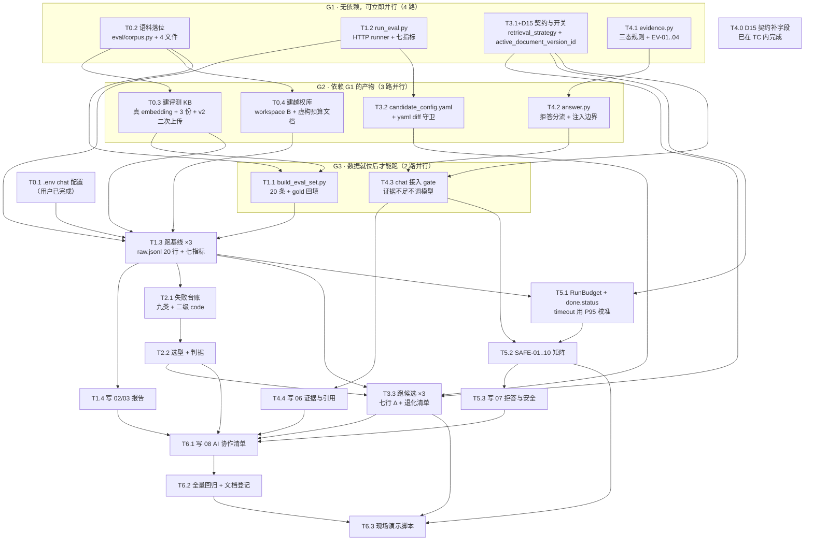

# Day03 可信 RAG 闭环 · DAG 执行路径

> **上游**：[PyKnora_Day03_可信RAG闭环实施计划.md](PyKnora_Day03_可信RAG闭环实施计划.md)（813 行，任务编号 T0.1–T6.3 全部出自其 §8）。
> **本文件只做一件事**：把那份计划里的 23 个任务排成**有向无环图**，标出哪些能并行、哪些必须等、共用文件谁先写，
> 以及派给子 agent 的**单写者边界**（同一时刻一个文件只有一个写者）。
>
> 生成时间：2026-10-31；基线 HEAD `4e16d65`；库 `pyknora-pg-p0`（宿主 5434）。
> 环境事实：`chat_base_url=https://opencode.ai/inference/go`、`chat_model=deeseek-v4.1-flash`、
> `chat_api_key` 已配置（T0.1 已由用户完成）、`embedding_backend=local`（`BAAI/bge-small-zh-v1.5`, dim 512）。
> 库内现状：`knowledge_bases=2`、`documents=0`、`chunks=0`（上一次全量测试 `TRUNCATE` 之后没有重建评测语料）。

---

## 1. DAG 图



**图上被合并的两个节点**：`T4.0`（D15 契约补字段）与 `T3.1`（`retrieval_strategy` 开关）**写同一批文件**
（`schemas/query.py`、`schemas/chat.py`、`services/retrieval/{search,rrf}.py`、`core/settings.py`、`api/v1/{query,chat}.py`），
所以合成一个节点 `TC` 由一个写者一次改完；拆开并行必然撞车。

---

## 2. 依赖矩阵（边表，可直接喂给编排脚本）

| 节点 | 前置（全部满足才能开工） | 阻塞谁 | 人日 |
| --- | --- | --- | --- |
| T0.1 `.env` | —（用户已做） | T1.3、T5.1 的任何答案侧指标 | 0 |
| T0.2 语料 | — | T0.3、T0.4、T1.1 | 0.2 |
| T0.3 评测 KB | T0.2 | T1.1、T1.3 | 0.3 |
| T0.4 越权库 | T0.2 | T1.3（deny 样本） | 0.2 |
| T1.1 评测集 | T0.2、T0.3 | T1.3 | 0.6 |
| T1.2 runner | — | T1.3、T3.2 | 0.7 |
| T1.3 基线 ×3 | T0.1、T0.3、T0.4、T1.1、T1.2 | T1.4、T2.1、T3.3、T5.1 | 0.2 |
| T1.4 报告 02/03 | T1.3 | T6.1 | 0.3 |
| T2.1 失败台账 | T1.3 | T2.2 | 0.3 |
| T2.2 选型 | T2.1 | T3.3、T6.1 | 0.2 |
| T3.1 + T4.0 契约/开关 | — | T3.3、T4.3、T5.1 | 0.7 |
| T3.2 候选配置 + 守卫 | T1.2 | T3.3 | 0.2 |
| T3.3 候选 ×3 + 对比 | T1.3、T2.2、T3.1、T3.2 | T6.1、T6.3 | 0.3 |
| T4.1 evidence.py | — | T4.2、T4.3 | 0.7 |
| T4.2 answer.py 分流 | T4.1 | T4.3 | 0.3 |
| T4.3 chat 接入 gate | T4.1、T4.2、T3.1/T4.0 | T4.4、T5.2 | 0.4 |
| T4.4 写 06 | T4.3 | T6.1 | 0.3 |
| T5.1 RunBudget + status | T1.3（P95）、T3.1/T4.0 | T5.2 | 0.6 |
| T5.2 SAFE 矩阵 | T4.3、T5.1 | T5.3、T6.3 | 0.4 |
| T5.3 写 07 | T5.2 | T6.1 | 0.2 |
| T6.1 写 08 | T1.4、T2.2、T3.3、T4.4、T5.3 | T6.2 | 0.2 |
| T6.2 回归 + 登记 | T6.1 + 全部代码节点 | T6.3 | 0.3 |
| T6.3 演示脚本 | T6.2、T33、T52 | — | 0.2 |

**关键路径**（最长链，决定总工期）：

```
T0.2 → T0.3 → T1.1 → T1.3 → T2.1 → T2.2 → T3.3 → T6.1 → T6.2 → T6.3   ≈ 2.5 人日
```

其余节点全部落在关键路径的等待窗口里，所以**并行度上限 = 4**（G1 的四路），再往上加人只会增加撞车。

---

## 3. 并行组与派单（本机实际执行方式）

| 组 | 并行数 | 派给谁 | 单写者边界（只有这个人能写） |
| --- | --- | --- | --- |
| G1-a 语料 | 1 子 agent | `eval/corpus.py`、`.tmp_ref/eval_corpus/*`（4 文件） | 同上 |
| G1-b runner | 1 子 agent | `eval/run_eval.py` | 同上 |
| G1-c 契约/开关 | 1 子 agent | `src/pyknora/{core/settings.py, schemas/query.py, schemas/chat.py, services/retrieval/search.py, services/retrieval/rrf.py, api/v1/query.py, api/v1/chat.py}` + 三个测试文件 | 同上 |
| G1-d 证据模块 | 1 子 agent | `src/pyknora/services/rag/evidence.py` + `tests/unit/test_evidence.py` | 同上 |
| G2 · T0.3/T0.4 | Lead 亲自做 | 只读代码 + 打 HTTP，**不写源码** | — |
| G2 · T3.2 | 1 子 agent | `eval/candidate_config.yaml` + runner 的 yaml 守卫（在 T1.2 之后追加） | 需等 T1.2 落地 |
| G2 · T4.2 | 1 子 agent | `src/pyknora/services/rag/answer.py` + 其单测 | 需等 T4.1 落地 |
| G3 · T1.1 | 1 子 agent | `eval/build_eval_set.py`、`eval/corpus_manifest.json`、`eval/eval_set_v0.1.jsonl` | 需等 T0.3 |
| G3 · T4.3 | 1 子 agent | `src/pyknora/api/v1/chat.py`（gate 部分）+ `tests/api/test_api_chat_safety.py` | 需等 T4.1/T4.2 |
| G4 文档 | 按需并行 | `docs/Day03/01..08` **一文件一写者** | 依赖数据节点 |

**两条硬编排规则**（不遵守会互相污染，比写得慢更糟）：

1. **同一时刻只有一个写者碰同一个文件**。上面表里没列到的文件，任何子 agent 都不许写。
2. **同一时刻只有一个进程连库做写操作/跑 `pytest`**。`tests/api` 与 `tests/integration` 会 `TRUNCATE ... CASCADE`
   并需要 `ACCESS EXCLUSIVE`；两个 agent 同时跑 = `deadlock detected`（本项目已知坑，见 AGENTS.md §6）。
   所以：**子 agent 只准跑 `uv run --frozen pytest -q tests/unit`，`tests/api`/`tests/integration` 一律由 Lead 串行跑。**

---

## 4. 每步的验证信号（与计划 §8 同源，此处只列命令）

| 节点 | 验证命令/动作 | 通过判据 |
| --- | --- | --- |
| T0.2 | `uv run python eval/corpus.py --verify-only` | 4 个 sha256 与 manifest 一致 |
| T1.1 | `uv run python eval/build_eval_set.py --check` | 20 条；`gold_chunks` 非空（`abstain` 类除外） |
| T1.2 | `uv run python eval/run_eval.py --dry-run` | 打印 1 条完整 raw 记录 |
| T1.3 | `uv run python eval/run_eval.py --config eval/baseline_config.yaml --repeats 3` | `raw.jsonl` 20 行、七个数齐 |
| T3.2 | 故意改 `candidate_config.yaml` 两个字段 → 重跑 | runner `exit 2` 并指出差异字段 |
| T3.3 | 同上换 candidate 配置 | 对比表七行 Δ 齐 |
| TC | `pytest -q tests/unit/test_retrieval_search.py tests/api/test_api_query.py tests/api/test_api_chat.py`（Lead 跑） | 全绿；`/openapi.json` 有 `retrieval_strategy` 与 `active_document_version_id` |
| T4.1 | `pytest -q tests/unit/test_evidence.py` | EV-01..04 + CIT/SAFE 单元部分全绿 |
| T4.3 | `pytest -q tests/api/test_api_chat_safety.py` | 证据不足不调模型（打桩断言未调用） |
| T5.1 | SAFE-09/10 | `done` 事件含 `status`/`run_id` |
| T6.2 | `uv run --frozen pytest -q` | ≥377 passed；`ruff check` 全绿 |

---

## 5. 阻塞与假设（写在最前面，免得到时候当成"做完了"）

| 项 | 现状 | 影响 |
| --- | --- | --- |
| T0.1 chat 三件套 | **已就绪**（`chat_model=deeseek-v4.1-flash`，注意这个名字里 `deeseek` 少一个 `p`，先按实际值跑通再决定要不要改） | 若模型名无效，答案侧指标（引用准确率/拒答率）全部作废，须先纠正 |
| 真实 embedding | 本机 `local` 后端 + 权重已缓存 | 首次建 KB 会加载模型（数十秒），不是卡死 |
| 库内语料 | 0 文档 | T0.3 必须重跑；`eval/results/` 里的历史结果若存在也已失效 |
| Docker | 本会话第 4 次自行停止过 | 每波开始前 `docker ps` 确认 `pyknora-pg-p0` 在跑 |
| `tests/api` 并发 | 不能并行 | 见 §3 规则 2 |

---

## 6. 与计划 §8 的偏差

- 计划 §8 把 `T4.0` 单列为 W4 的第一格；本 DAG 把它与 `T3.1` 合并为 `TC`（同文件冲突），
  人日不变（0.7 = 0.5 + 0.2），**唯一的语义变化是 D15 的契约字段随开关一次改完**。
- 计划 §8 的 W0–W6 是"波次"（时间顺序），本 DAG 是"依赖关系"（可并行性）。两者不冲突：
  按 DAG 拓扑序执行，落到日历上就是 W0→W6；但 DAG 允许 `T4.1`/`T1.2` 提前到 W0 当天做。
