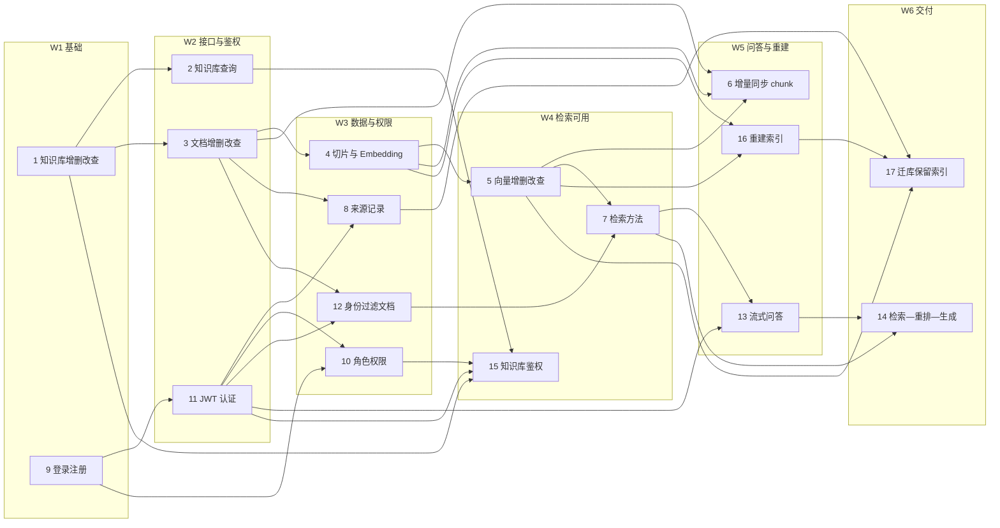

# 知识库项目 · 成员任务进度表

> 本文档把 4 份计划表（分工表、协作与接口对接表、任务依赖映射表、甘特计划）整合为一份可跟踪的进度看板。
> 数据以 `docs/plans/` 下的 xlsx 为准；本文件是汇总视图，两者不一致时改 xlsx 再同步回来。
>
> - 文档版本：v1.31
> - 最近更新：2026-11-04（**v1.31：**仓库「交付完整性」补齐（独立收尾轮，**不改 17 个任务状态**；17/17 仍 `已完成/100%`、任务 13/14 维持 `进行中/75%`）——起因是我上一轮判定项目「无 Dockerfile / compose」，实际是我只看 `git ls-files` 索引、把**未跟踪**当成了**不存在**；`Dockerfile`(3703 B)、`docker-compose.yml`(4557 B)、`.dockerignore`、`web/Dockerfile`、`docs/部署与回滚.md`(9467 B)、`scripts/rollback.ps1`、`scripts/dev_up.py` 早在磁盘上。经用户「按照你的修正」「1要，2别推」授权，分三批入库：**`4243451` chore(deploy)** 207 files/+32830（7 个部署文件 + `web/` 200 文件 + README 新增「Docker Compose 一键起栈」节，tracked 285→491）；**`c79b25a` chore(assets)** 15 files/+2846（`src/pyknora/static/swagger/` 3 文件 1.66 MB、`eval/gate.py`/`make_manifest.py`/`review.py`、两轮 baseline 数据 7 文件、`eval/day/manifest.json`）；**`eae4070` chore(tooling)** 13 files/+2695（`scripts/secret_scan.py`/`container_report.py`/`validate_version_manifest.py`、`.githooks/pre-push`、`.github/dependabot.yml`、`.secrets.baseline`、3 个测试、4 篇 plans）。**实测**：`docker compose config --quiet` exit 0；`ruff check` 9 文件 All checks passed、`format --check` 9 files already formatted；`uv sync --extra dev --locked` 后 `pytest -q` 3 个新测试文件 **46 passed / exit 0**。终态 tracked **519**、`??` 仅剩 `docs/plans/fronted/`（用户 WIP）、29 个 modified tracked 文件未动、`origin/master...HEAD` = `0 27`（**未 push**）。**未验证**：`docker compose up --build --wait` 一次未跑（Docker Desktop daemon 未运行，npipe 连不上）、web 容器与 api 页面联调未做、release/deploy 无 tag 未跑。详见 `docs/IMPLEMENTATION_STATUS.md` 本轮。
> - 上一版：2026-11-03（**v1.30：**仓库清理与文档口径同步（独立收尾轮，**不改 17 个任务状态**；17/17 仍 `已完成/100%`、任务 13/14 维持 `进行中/75%`）——删除全部一次性临时物 **18 项**（`.tmp_ref/` 整个目录含 200+ 探针脚本/参考克隆/日志/截图/uv 缓存、根目录 `.tmp_ids.json` 与 `.tmp_p12.log`、`web/` 下 9 个 `.tmp*.mjs` 与 `.tmp-shots/`、`dist/`、`.pytest_cache`、`.ruff_cache`、`web/.next`、`web/test-results`），删除前逐项 `Resolve-Path` 校验未越出仓库根，删后复查 **0 残留**；`.gitignore` 追加 `/.tmp*` 与 `/web/.tmp*` 兜底（已核 `git ls-files` 无同名跟踪文件）；**测试计数口径纠错**：`AGENTS.md` §2 与 `README.md`、`docs/项目结构说明.md` 里沿用多轮的 `88/20/80/48=236` 实测为 **876/20/161/79=1136**（`uv run pytest --collect-only` 逐目录），四处同步并注明「以 collect 实测为准」；同轮把 `README.md` 里 `--stage all` 旧口径（lint+test、不含 security）与 `docs/项目结构说明.md` 5 处、`AGENTS.md:245` 的旧阶段名一并改到 v1.29 口径。**未验证**：`.tmp_ref/` 删除后 `ci.py` 的 `UV_CACHE_DIR/TMP` 落点会在首次运行时重建（`makedirs` 已存在）；`web/.next` 删除后首屏需重新构建。**v1.29：**本地门禁按 GateKeeper 13 阶段 IR 对齐（独立工作流，不改 17 个任务状态）——用户指出「本地 CI 门禁不完整、为什么没严格遵照流水线选项」并明确「选中的是前八步」。`scripts/ci.py` 阶段表重排为 IR 顺序的 13 个阶段，新增 `--profile commit|default|full`（commit=`lock,lint,manifest` 给 `.githooks/pre-commit`；default=`lock,sync,lint,type,manifest,test,security,build`即面板勾选的前八步；full=13），**`--stage all` 语义改为那八步**（不再是 lint+test 的历史别名）；结果改四态 `PASS/FAIL/WARN/SKIP`，只有 FAIL 改退出码（`type` 31 条诊断 → WARN，`manifest` 缺 `release/agent_versions.json` → SKIP，`release`/`deploy` 本地 ciOnly → SKIP）；`security` 归位为密钥扫描（advisory）、`audit` 才是 pip-audit；新增 `.githooks/pre-push`（八步）；`ci.yml` job 名归位（`secrets`→`security`、`security`→`audit`）并在 lint job 前置 `uv lock --check`。**实测**：`--stage all` → 8 PASS / 1 WARN / 1 SKIP、exit 0、49.4s；`git hook run pre-commit` → 0.1s、exit 0；`git hook run pre-push` → 54.1s、exit 0；`--profile full --list` → 13 行。**未验证**：`--profile full` 的 integration/audit/container 未整跑；`type` 31 条未清；CI 仍未在 GitHub 跑过。此前 **v1.28：**本地门禁 + GitHub CI + Docker 交付（独立工作流，不改 17 个任务状态；17/17 仍 `已完成/100%`、任务 13/14 维持 `进行中/75%`）——① **本地门禁**：GateKeeper `py-scaffold` 落 `.github/dependabot.yml`、`scripts/validate_version_manifest.py`、`scripts/secret_scan.py`、`scripts/container_report.py`、`.secrets.baseline`；`scripts/ci.py` 扩出 **5 个 opt-in 阶段**（`type`/`secrets`/`manifest`/`integration`/`container`），**`--stage all` 语义不变**（实测 `--list` 仍只 lint+test，`--stage all` → PASS 0.1s/0.0s/21.9s、exit 0）；`secrets` 定为 **advisory**（`--report-only`：`detect-secrets-hook` 命中约 40 处开发 DSN/占位 key，而 `detect-secrets scan` 对同一批文件 0 命中、生成不出 hook 认的 baseline，两边口径不一致已复现），`type` 报 **31 条**诊断暂不接入（接了常年红等于教人忽略门禁）。② **GitHub CI**：重写为 8 个 job——`lint`（+actionlint）/`unit`（`--cov-fail-under=70`，实测 74%、junit + upload-artifact）/`secrets`（advisory）/`integration`（**全量跑 0001–0014** 而非只跑 0001；外键断言从写死 7 改为 `grep` 迁移文件实数 **10 条**后与 `pg_constraint` 比对）/`security`（pip-audit）/`docker`（config → build --check → 构建 api+web → container_report）/`build`（清 `dist/` → `uv build --out-dir dist` → 校验产物 → `upload-artifact` name `dist`）、`release`（仅 tag 触发、`download-artifact` 复用 build 的产物而非重复构建、job 级最小权限、`persist-credentials: false`、版本身份校验、`attest-build-provenance`、`gh release create --verify-tag`，PyPI/registry 留注释）。③ **Docker**：`Dockerfile`（uv 多阶段、非 root uid 10001、装 `libgl1`/`libglib2.0-0` 给 rapidocr、容器内用 `python urllib` 做 `HEALTHCHECK`）、`web/Dockerfile`（Next standalone 三阶段；**必须 COPY `pnpm-workspace.yaml`**，否则 pnpm 12 的 `allowBuilds` 白名单缺失 → `ERR_PNPM_IGNORED_BUILDS`）、`docker-compose.yml`（db 5435 / 一次性 `migrate` / api / worker / web，`service_healthy` + `service_completed_successfully`）、`.dockerignore`、`scripts/rollback.ps1`、`docs/部署与回滚.md`。**实测**：`compose config --quiet` exit 0；api 镜像 `BUILD_EXIT=0`（45.6s）；web 镜像修好后 `BUILD_EXIT=0`；`compose up -d --wait db migrate api` → `db/api healthy`、`migrate Exited (0)`（14 个迁移全过）、`/health` **200**；`rollback.ps1 -ToImageTag nonexistent-tag -DryRun` → exit 1 并列出缺失镜像；`ruff check src tests scripts` All checks passed、179 files formatted。**未验证**：web 容器未与 api 一起 up 起来走页面；`release` job 无 tag 未真跑；CI 本体未在 GitHub 上跑过；`type` 31 条未清、`secrets` 仍 advisory；此前 **v1.27：**RAG 评测完善 DAG 的 **N1–N8 八个节点全部交付**并逐个复核到证据级 + **W3 真跑一轮**（`eval/results/w3-20261103`，30 条全 COMPLETED/ABSTAINED/DENIED、零 error，`recall@5=1.000`、`deny_interception=1.000`、`citation_accuracy=0.311`、`chat_total_p95=8.14s`），门禁先判 **exit 4**（`null_ratio=1.0`，一条未复核就不许发布，属设计行为），`review-runner` 逐条走 `eval/review.py` 回填 28 条后 **`null_ratio=0.0667`**，再用新增的 `run_eval.py --recompute-summary`（只读 raw 重算、不发请求）重写 summary，**门禁复跑 `exit 0`**（`quality PASS / safety PASS`；但 `gate.py:35` 写明聚合指标回退只打标记不阻断，本轮被标记 `← 劣于基线` 的四项因**分母不同 20 vs 30 条**而不可比，逐例对齐结论是「无退化」）；**不改 17 个任务编号的状态**（评测工装是独立工作流、不占任务行）；并行期 Lead 补的契约：`RetrievalEvent.retrieval_ms` + `DoneEvent` 五个耗时字段、`SUMMARY_THRESHOLDS`、`summary.verdicts`；未验证：人工复核未做（`null_ratio=1.0`）、`stage_timings` 与客户端墙钟跨口径不可比（偏差 39–52%）、`repeats=1` 时波动无意义；详见 §9）；2026-11-02（**v1.26：**前端收尾轮——补齐 **N10 成员管理**（10 文件 + 页面 + 36 用例）与 **N11 e2e/axe**（6 spec / 12 例全过、5 路由 axe 全 0 违规），并修真浏览器才暴露的 3 个缺陷：**业务请求不带 `Authorization`**（`client.ts` 只在显式传 token 时加头，kbs/documents 全漏传 → 真浏览器列表永空）、**对比度 3.36:1 不达 AA**（`--color-fg-subtle` 压暗到 `#5f7175`）、**无障碍名与可见文字不符**（「改名」按钮 aria-label 写「重命名」）；`pnpm typecheck` 0 错、`vitest` **32 文件 / 250 用例**、`build` 9 路由、`playwright` **12 passed**；**17 个任务状态不变**（仍 `已完成/100%`，任务 13/14 维持 `进行中/75%`），前端是独立工作流不计入 17 项；详见 §9）；2026-11-01（**v1.25：**前端 P0 交付（`web/` 独立工作流，**不改 17 个任务的状态**，17/17 仍 `已完成/100%`、任务 13/14 维持 `进行中/75%`）——`web/` 从零建成 Next.js 16 + React 19 应用，按 `docs/plans/PyKnora_前端DAG执行路径.md` 的 12 个节点分 5 个波次并行施工；`pnpm typecheck` 0 错、`pnpm exec vitest run` **28 files / 212 tests passed**、`pnpm build` exit 0 产出 **8 条路由**；后端配套修 `filename` 恒 `null`（`reads.py` 改 `coalesce(desired, active)`），`tests/api/test_api_documents.py` **41 passed**；**未验证**：真浏览器 e2e / axe 未跑、真实后端 SSE 联调未跑；详见 §9）；2026-10-30（**v1.24：**Day03 评测链路 + 真实基线（**不改任务状态，17/17 仍 `已完成/100%`；任务 13/14 维持 `进行中/75%`**）——两轮真实评测与对比报告落盘（`eval/results/baseline-20261030/`、`candidate-20261030/`、`compare-20261030.md`，`app_commit=4e16d65`、`repeats=1`）；七指标 baseline→candidate：Recall@5 1.000→1.000、Precision@5 0.200→0.200、引用准确率 0.356→0.318、无证据拒答 0.667→0.333、权限拦截 1.000→1.000、检索 P95 375.1→211.8 ms、问答 P95 5586.0→5831.2 ms，**结论：候选不优于基线，本轮不采用**（`docs/Day03/04-优化前后对比.md`）；`eval/selfcheck.py` → PASS 25 / FAIL 1 / SKIP 0（FAIL=`tests/test_citations.py`）、`ruff` 全绿（147 files）；`tests/api` 与全量仍未跑（待 Lead 串行）。此前 **v1.23：**Day03 可信 RAG 闭环基座落盘（**任务 13/14 回调 `进行中/75%`**，其余任务行不动）——新增 `eval/` 工装与真实语料（A 区 KB `1556633e-fff3-4a27-8731-adc00d2ff5eb` 3 篇 **98** 活跃片 = 基本财务管理制度.pdf 61 + 员工手册v2.docx 35 + 团建与年会通知.md 2，`chunks` 基表 133 行，`active_index_version` 1/1/2；B 区 deny KB `ca1bbf7e-afa6-41c6-94de-3e27ac5fe414` 1 片）、评测集 `eval/eval_set_v0.1.jsonl` **20** 条（fact 6 / exact_term 4 / synonym 3 / no_evidence 3 / deny 2 / version 2）；契约加 `active_document_version_id`（`schemas/query.py:76`、`schemas/chat.py:29`、`services/retrieval/rrf.py` 透传）与 `QueryResponse.retrieval_strategy`（`services/retrieval/search.py` 的 baseline/candidate 开关，baseline 复用改造前的 `_candidate_limit`，默认行为不变；`top_k>=25` 时两策略候选池都封 50，故 A/B 只能 `top_k<25`）；新增 `services/rag/budget.py`（`RunBudget`）与 `services/rag/evidence.py`（`SUPPORTED`/`INSUFFICIENT`/`CONFLICTING` 三态 + `assess()`）；`api/v1/chat.py` 接证据门控/`run_id`/`RunStatus` 五态、`DoneEvent.status` 变必填；`services/rag/answer.py` 按 assessment 分流（INSUFFICIENT/CONFLICTING 不调模型）；`core/settings.py` 追加 `chat_session_id`/`chat_budget_timeout_s=25.0`/`chat_max_retrieval_calls=2`/`retrieval_strategy`。**回调理由**：13/14 的交付物本轮被改，而 `tests/api/test_api_chat.py` 适配后**一条未跑**、基线/候选评测也未跑，不满足 §3.3「已完成」四条件；代码已落盘 + 6 个新单测文件 **283 passed, 1 xfailed**（8.39s，exit 0），故记 75%。任务 7 保持 `已完成/100%`（策略开关默认 baseline、行为不变；`test_retrieval_strategy.py` 未跑记为未验证），任务 4/6 不改（语料入库是运行验证、无成员2 代码改动）；详见 §3 的「v1.23 口径说明」。**未验证**：`tests/api`/`tests/integration`/全量未跑；基线/候选评测一轮未跑、`eval/reports/` 空、`docs/Day03/03-基线评测报告.md` 全部待填（本轮不写任何指标）；`RunStatus` 计划七态只落五态；`chat_budget_timeout_s` 未按 `max(3×P95,10s)` 校准、`chat_max_retrieval_calls=2` 仅预留；`.env` chat 三件套（`base_url` 缺 `/v1`、`deeseek` 拼写、缺 session 头）待用户填、真实调用未验证（未读写 `.env`）；此前 **v1.22：**纠正上一轮两条错误结论 + 撤权链补两条真库 HTTP 用例**（不改任务状态，17/17 仍 `已完成/100%`），成员4 域。**纠正**：上一轮我把「`_load_membership` 仍是 `return True` 占位」与「流式 `degraded` 没进 SSE」列为遗留隐患，两条都错——`load_membership`（`services/auth/membership.py:25`）早就是真查询、`find_membership` 还会 join `principals.status`（`44f9af3`/`011116b`/`b85a663`），`degraded` 也早搭首个 `retrieval` 事件发出（`api/v1/chat.py:113-117`，`f22d893`）；误判源于 `tests/api/conftest.py:55-60` 那段仍在描述「以前恒 True」的历史注释，属引用过期状态、未先取证。**真实缺口是覆盖**：撤权两条路径只有单元桩级用例（`tests/unit/test_auth_a4.py` 把 loader 换桩，只证 `get_scope` 分支），SQL 写错测不出。补 `tests/api/test_auth_revocation.py` 2 条真库 HTTP 用例：删成员关系 → 旧令牌 403（`rowcount == 1` 防假绿）、`X-Workspace-ID` 指别人空间 → 403。**不改行为**：`degraded` 不另立独立 SSE 事件（`docs/tdd/07` §6 顺序契约是 `retrieval`、`token*`、`done`）。**验收**：4 passed（1.11s）、全量 `pytest` **377 passed / exit 0**（unit 138 / contract 20 / api 142 / integration 77）、`ruff check` All checks passed。**顺带修 §9 表格**：去掉打断表格的行间空行、修正 v1.20/v1.21 逆序（v1.12 行当时就没写进 §9，不补写）。此前 **v1.21：**功能检查 P0–P3 收口**（不改任务状态，17/17 仍 `已完成/100%`），经用户「p0-p3,修完再review一遍」授权。真系统功能检查（真 API + 真 Worker + 桩 LLM，42+16+16 项黑盒断言）暴露七条，全部收口：① **P0 坏文件打死 Worker**——坏 PDF 的 `PdfStreamError` 从 `parser.py` 逃出，`run_once` 记录失败后又 `raise`，`session_scope()` 回滚把失败记录一起吞掉 → 作业永远 `pending`/`attempt=0`/`job_attempts` 零行、队头无限重试堵死队列（实测 job `18114163` 三次状态不变）；解析层统一 `PARSE_FAILED`、`_NO_RETRY` 收它、`run_once` 改「记录失败 + 返回 failed」不再 re-raise，`_record_failure` 分三支（superseded / 立即 failed / 按配置重试）。② **P1-A 测试清空参考数据**——两个 conftest 清场含迁移种下的 `roles`/`role_grants`，api 侧补种、integration 侧不补 → 全量测试后开发库 `roles=0` → 注册撞 `workspace_memberships_role_fkey`；补种抽到 `tests/role_catalog.py`（清场与补种必须成对）。③ **P1-B 注册错误码错认**——`except IntegrityError` 无差别报 409「account already exists」；改按约束名分流，非唯一冲突 → 500 + `details.constraint`。④ **P1-C 错误体两套**——pydantic 422 与未知路由 404 不走统一体也不带 request_id；新增两个 handler，422 只回 `{loc,type,msg}`、**不回显 input**（密码在里面）。⑤ **P2-D1 跨区检索 200+空**——`/query`、`/chat` 挂 `require_kb_access` → 别人的 kb_id 一律 404。⑥ **P2-D2 跨页切片只记起始页**——新增 `0013` 加 `page_end_no`，`page_at(char_end-1)` 写结束页，模型/schema/rrf/`snapshot`/引用全链带上。⑦ **P2-D3 缺文档列表**——新增 `GET /knowledge-bases/{kb_id}/documents` + repo 三个方法（避免 N+1）。**验收**：ruff All checks passed、format 127 files、全量 **375 passed / exit 0**（unit 138 / contract 20 / api 140 / integration 77）。**未验证**：跨页未再走真 4 页 PDF 上传入库全链；`page_end_no` 历史文档为空（需重灌）；加密 PDF/扫描件只走「未提取到文本」分支。**评测与 CI 按用户口径仍不做**。此前 **v1.20：**删除只删一层 + 发件箱无人派发 + 流式降级不可见**（不改任务状态，17/17 仍 `已完成/100%`），经用户「评测和 CI 现在还不做…其他的按照你的建议进行修复」授权，跨成员1/2/3 域 + 新模块 `services/outbox/`。**四条**：① **purge 只删 chunk**——`services/ingest/documents.py` 的 `purge_document_chunks` 只 `DELETE FROM chunks`，每删一篇文档留下一条 `document_blobs`（原始字节）+ 一条 `document_versions` + 一行退休 build，且 `documents.desired_document_version_id` 指向已删版本；这些行**没有任何读路径能看见**（视图要 join 活动 documents），只能翻库发现、磁盘只增不减。改为 `purge_document` 返回 `PurgeReport(chunks, blobs, versions)`，删除顺序**由外键钉死** `chunks → document_blobs → document_versions`（两处 `ON DELETE RESTRICT`），build 只退休，同事务清墓碑三个版本指针（带 `AND deleted_at IS NOT NULL` 兜「作业异步」）。② **删库不删内容**——`delete_knowledge_base` 只软删 KB 一行，`documents` 对 KB 是 RESTRICT、KB 自己也是软删，于是文档/chunk/向量全留；上一轮 S1 只让视图跳过，索引与磁盘照旧占。新增 `_cascade_delete_documents`：`FOR UPDATE` 取未删文档 → 断可见性（`deleted_at` + `active_build_id=NULL` + `generation/row_version`+1）→ 逐篇入队 purge（**先断后入队**，否则窗口期内还能搜到；重复入队安全，漏入队则字节永久留下）。③ **outbox 无人派发**——`0001_init.sql:207-209` 承诺「与业务同事务登记，dispatcher 至少一次派发」，`publish.py` 与 `kb/service.py` 都在写行，但**全仓没有一行代码读过 `outbox`**：`dispatched_at` 永远 NULL、`outbox_pending_idx` 只增不减。新建 `src/pyknora/services/outbox/dispatcher.py`：`FOR UPDATE SKIP LOCKED` 取批、逐行投递、**成功才打标记**（先投递 = 至少一次，崩溃只会重复投递；反过来会丢事件）、单行失败不阻塞整批；默认订阅者只写日志（仓里确实没有第二个订阅者，不假装送到了什么）。挂载点在 `scripts/run_worker.py` 的 `_tick`，**不放进 `run_once`**（队列空时它提前返回，空闲 Worker 上发布事件永远等不到派发）。④ **流式降级不可见**——`/query` 早有 `degraded`，`/chat` 只写服务端日志；`RetrievalEvent` 加 `degraded` 搭首个 `retrieval` 事件发出（流开始后状态码固定，之后无处表达）。**测试**：`tests/integration/test_outbox_dispatch.py` 7 条 + `tests/integration/test_purge_and_kb_delete.py` 5 条 + `tests/api/test_api_chat.py` +2 + `tests/integration/test_rls.py` +1（非 owner 角色在 `security_invoker` 视图 + KB join 下仍读得到自己区的行、软删 KB 后立刻读不到；两条都做过反证）。**验收**：`ruff check src tests scripts` → All checks passed、`format --check` → 124 files already formatted、两组新集成 → **12 passed**、chat → **8 passed**、rls → **7 passed**、全量 → **356 passed / exit 0**。**未验证**：两个 Worker 同时派发只靠 `SKIP LOCKED` 语义（用例是两个 session 串行模拟，没真起两个进程）；删库级联对「文档很多的库」没测（一次 `FOR UPDATE` 全取、未分批，大库会长时间持锁）；`document_blobs` 的字节在库内 `bytea`，删了即删、没有回收站。**环境**：本机 `.env` 的 `PYKNORA_DATABASE_URL` 指向 `127.0.0.1:5433`（另一个 phase0 栈的 PG，密码不是 `dev`）→ `password authentication failed`；测试一律用 `PYKNORA_DATABASE_URL=…:5434/pyknora` 覆盖，**未改代码默认值、未改 `.env`**。**评测与 CI 按用户口径不做**——`candidate_k` 仍是拍的、rerank/补搜无依据。此前 **v1.19：**知识库软删后检索仍命中——改视图收口（`S1`）**（不改任务状态，17/17 仍 `已完成/100%`），成员1 域（视图）+ 成员2 域（受控例外），经用户「2.你怎么说」后由 lead 拍板「改视图」。**问题（实测可复现）**：`knowledge_bases` 的删除是软删——`db/repos/knowledge_bases.py:112-133` 只写 `deleted_at` / `generation` / `row_version`，文档、build、chunk 原样留着；而 `v_active_chunks`（`migrations/0001_init.sql:236-269`）只过滤 `documents.deleted_at`，**没有 join knowledge_bases**。于是删库之后文档列表变空（repo 带 `deleted_at IS NULL`）、检索却照样命中——同一个库在两处有不同答案，引用和原文都还能被搜出来。**改法**：新增 `migrations/0012_v_active_chunks_skip_deleted_kb.sql`，`CREATE OR REPLACE VIEW` 加 `JOIN knowledge_bases k ON (workspace_id, kb_id)` 与 `k.deleted_at IS NULL`，并显式带 `WITH (security_invoker = true)`；同时给 I1 的受控例外 `db/repos/reads.py:list_chunks_by_build` 补同一条谓词（它读的是 `chunks` 不是视图，视图修好也管不到它；文档删除当年已经这么做了，知识库没有理由更宽松——否则历史追溯就是绕过删除的旁路）。**为什么改视图**：视图是 I1 的唯一真相，四个读入口（`list_active_chunks` / `get_chunks` / `search_similar` / `search_keyword`）全打它，在服务层补过滤漏一处就是一处旁路；`CREATE OR REPLACE` 只换定义、不搬数据、无窗口期，回滚也只换回定义；不改 `0001`（I4）。**为什么 inner join 安全**：`documents_kb_fk`（`0002:40-44`，复合外键 ON DELETE RESTRICT）保证每个 document 都挂着真实 KB 行，不会因「KB 行不存在」误删可见行。**测试**：`tests/integration/test_read_contracts.py` +1 条 `test_soft_deleted_kb_hides_chunks_everywhere`（软删前三个入口都有数据，软删后活动视图两入口+ 历史两 build 全部 `[]`），**两条改动都单独做过反证**：① 视图换回旧定义 → 用例在活动视图断言处 fail（2 条切片漏出）；② 视图已修好但 `list_chunks_by_build` 不 join → 用例在历史读取断言处 fail。**未验证**：只在 `pyknora-pg-p0`（宿主 5434）上重放 0012；全新库从 0001 顺序重放到 0012 未重跑（`scripts/migrate.py` 会按文件名顺序带上，与 0009/0011 同路径）；`security_invoker` 在非 superuser 角色下的 RLS 行为未单独验证（`tests/integration/test_rls.py` 现为绿）。**此前 **v1.18：角色目录写入改平台闸（`A1`）——封掉「任一租户可改写全局角色矩阵」**（不改任务状态，17/17 仍 `已完成/100%`），经用户「1.A1」裁决，成员4 域。**问题**：`roles` / `role_grants` 是**全局表**（`migrations/0003_identity_acl.sql:65-76` 没有 `workspace_id`，`roles.role_key` 全局 UNIQUE），但三条写端点只要求**工作区级** `workspace.manage_roles`——任一租户的 owner/admin 都能改写所有租户共用的权限矩阵：把 `member` 的 `document.read` 整组删掉即跨租户 DoS，把 `workspace.manage_members` 授给 `guest` 即扩大越权面。**改法**：`services/auth/permissions.py` 新增 `PLATFORM_MANAGE_ROLES = "platform.manage_roles"` 与 `PLATFORM_PERMISSIONS`（`is_known_permission` 认它，但不进 `ALL_PERMISSIONS`），三条端点改挂 `require_permission(PLATFORM_MANAGE_ROLES)`；**该权限点没有任何角色持有**（`SEED` 与 `0006` 矩阵都不含），故租户侧一律 403。这是「关掉」而不是「暂缓」：`roles` 表还没有「平台管理员」这个概念，先关再开比先开再补便宜。**有意不做**：不删路由（`A2`）、不给 `roles` 加 `workspace_id`（`B`：要重建 9 处引用的主键/外键，且「角色模板」与「角色实例」是两件事，后者属更大设计）。**代价**：三条端点内部的参数校验（角色名格式 / `owner` 保护 / 未知权限点）随闸门一起封存，已在该测试文件注明「等平台后台需要时再以平台身份开放」。**用例重写**：`tests/api/test_api_role_grants.py` 8 条按旧语义写的用例 → ① 4 角色 × 3 端点 = 12 条全 403 且**断言库里一点没变**；② 改矩阵改走 repo（`replace_role_grants`），同一 token 下一次请求立即 403（保留原「权限的唯一真相是那张表」这一核心断言）；③ 目录 CRUD / 新角色可指派 / 外键 `RESTRICT` 拦删除 = 4 条 repo 级用例（幂等造角色——`roles` 不在 `clean_db` 清场清单里，否则会连内置角色一起清掉）；`tests/unit/test_permissions.py` +2 条（`platform.*` 与 `ALL_PERMISSIONS` 不相交、无任何角色持有平台权限）。全量 **340 passed / exit 0**（同一文件连跑两轮均 20 passed，验证幂等）、ruff 全绿。**未验证**：没有平台管理员身份，「平台侧真的能改」这条路径没有 HTTP 用例；S1（视图未过滤已删 KB）仍待批次 3。**此前 **v1.17：三处「已完成模块」补洞——JWT 头部类型守卫 / 迁移 SQL 的 bytea 走 `decode` / 快照补导成员关系（不改任务状态，17/17 仍 `已完成/100%`）**，经用户「1.A1 2.你怎么说」授权——审查五成员后按批次修复，本批三条都属于「代码跑得通但边界没守住」：① `services/auth/jwt.py:108` 补 header/payload 的 `isinstance(dict)` 闸，客户端发 `[]` 原先抛 `AttributeError` → **500 `retryable=true`**（违反 I8），现为 401 `malformed token`；② `services/migration/snapshot.py` 的 `render_sql` 新增 `_sql_value()` / `_BYTEA_COLUMNS`，`document_blobs.content` 改渲染成 `decode('...','base64')`——原先 base64 文本被当普通字符串插进 bytea 列，PG 按 escape 格式存成**字面文本**，不报错、行数也对，但恢复出的 blob 长度是原文 4/3（JSON 重放路径一直有 decode，SQL 路径没有，两条路径对同一份快照给出不同结果）；③ `TABLES` 与 `REPLAY_ORDER` 补 `workspace_memberships`（并把成员 `user_id` 纳入 `principals` 抓取），`verify_metadata` 新增「成员集合 / `document_versions` 行数 / `document_blobs` 行数+字节总数」三项校验——原先八张表里没有成员关系，重放到新库后 `load_membership` 查不到人 → `get_scope` fail-closed → **所有人 403**，而 verify 只比它自己导的那几表，照样报「一致」。新增 4 条用例（3 条 snapshot + 1 条 auth），**四条都做过反证**（把修复临时退回 → 分别红在 `'QUJD'` vs `decode(...)`、`assert 'workspace_memberships' in [...]`、`AttributeError: 'list' object has no attribute 'get'`），全量 **332 passed / exit 0**、ruff 全绿。**未验证：S1（视图未过滤已删 KB）与 S2（全局角色矩阵可被任租户改写）尚未修，仍待后续批次**）。此前 **v1.16：全新装库 RLS 漂移修复（不改任务状态，17/17 仍 `已完成/100%`）**，经用户「要」授权——为验证 0009 进入迁移链，在**全新空库**从 0001 重放到 0010，`pg_policies` 只有 **9** 条而开发库 10 条，差的正是 `index_migrations`：`0003_identity_acl.sql:124-128` 的 RLS 表清单里写了它，但表由 `0004` 建、`0003` 先执行 → `to_regclass` 恒 NULL → `CONTINUE` 安静跳过且永不回补（开发库的 10 条是"建表后重放过一次 0003"的历史巧合）。后果是全新部署少一层数据库兜底。新增 `migrations/0011_index_migrations_rls.sql` 单独补该表 RLS，策略与 `0003:134-138` 逐字一致、沿用 DROP+CREATE 幂等写法，**不改 0003**（I4）。实测：开发库重复应用幂等（仍 10 条）；全新库 0001→0011 **11 个迁移全 OK / policies=10 / relrowsecurity=t**；ruff 全绿。**未验证：`scripts/migrate.py` 在本沙箱跑不通（docker 命名管道对子进程拒绝），全链用 pwsh 直连 docker 复刻**）。此前 **v1.15：两条转出端外键补索引（不改任务状态，17/17 仍 `已完成/100%`）**，经小组长「我允许你修改别人的目录」授权（成员4 域 + 新迁移）——`workspaces.owner_principal_id` 与 `workspace_memberships.role` 都是外键的 **referencing side**，PG 只为被引用端保证唯一、不为转出端建索引，导致「删账号」「改/删角色」的 RESTRICT·CASCADE 检查全表扫、`WHERE workspace_id = $1 AND role = 'admin'` 也走不到索引。新增 `migrations/0010_fk_indexes.sql` 两条单列索引（`IF NOT EXISTS` 幂等、不写 DROP），已在 `pyknora-pg-p0` 应用并用 `pg_indexes` 验证；新增 `tests/integration/test_fk_indexes.py` 4 条结构性守卫（前导列必须就是外键列 + 约束仍在），**做过两条反证**（删索引必红、建错列必红）；全量 **328 tests / exit 0**、ruff 全绿。**未验证：本机两张表 0 行、无 EXPLAIN 前后对比，依据是"外键检查必然扫转出端"的结构性事实**）。此前 **v1.14：候选池宽于返回数——`candidate_k` 默认 `top_k * 2`（不改任务状态，17/17 仍 `已完成/100%`）**，成员3 域——`search_hybrid` 的 `candidate_k` **从来没有任何调用方传过**，于是两路各只取 `top_k` 条、融合池仅 `2 * top_k`：某片段在一路排第 `top_k+1`、另一路没命中时永远浮不上来，而"两路互补"正是混合检索相对单路唯一的价值——默认配置下 RRF 基本白做。改为 `min(top_k * 2, MAX_TOP_K)`（封顶仍走 `MAX_TOP_K`，否则 `top_k=50` 会算出 100 越界），显式 `candidate_k` 时新增 `candidate_k < top_k → INVALID_REQUEST`；新增 `_candidate_limit()` 收敛规则，连带修 `tests/api/test_api_query.py` 写死 `limit == 3` 的夹具。**倍数 2 只保证结构可行，最优值要评测集才能定**（本轮不做评测集）。新增 3 条用例，全量 **324 passed / exit 0**、ruff 全绿）。此前 **v1.13：citation 校验——citations 只发模型真读过的那些 + 越界引用可见（不改任务状态，17/17 仍 `已完成/100%`）**，成员3 域——`retrieval` 事件的 `citations` 原先装的是"检索结果"而非"答案依据"：`top_k` 上限 20、上下文只取 `chat_max_context_chunks=6`，却拿全部 `chunks` 建 citations（`top_k=20` 时 14 条是**幻影引用**：客户端拿它们当答案依据展示，模型根本没读到），且模型正文里的 `[资料 N]` 无人校验（写 `[资料 9]`/`[资料 0]` 照单全收）；改为 citations 与 prompt 共用同一上下文切片（`select_context_chunks()` 成为上限唯一取值点），新增 `cited_indices()`/`invalid_cited_indices()` 把越界条数写进 `done.invalid_citations`（默认 0，向后兼容）+ `logger.warning`，**有意不改正文**（token 已流式发出，回头改就复原不了"模型实际说了什么"）。新增 5 条用例（两条 API 用例在旧代码上必红），全量 **321 passed / exit 0**、ruff 全绿）。此前 **v1.12：作业表索引 + 一处自我纠正（不改任务状态，17/17 仍 `已完成/100%`）**，经用户「先做 a b」授权——**纠正**：我先前判断“RLS 从未在非特权角色下验证过”是错的，`tests/integration/test_rls.py`（成员4，`44f9af3`，6 条）早已用独立登录角色 `pyknora_app`（非 owner / 非 superuser / 非 bypassrls）覆盖跨租户隔离、未设 `app.workspace_id` 时 fail-closed、越界写入被拒、视图 `v_active_chunks` 的 `security_invoker`，本轮实测 **6 passed**，故不重复新建测试。真实缺口只有一处：`ingestion_jobs` 的复合外键 `(workspace_id, document_id)` 无索引（PG 不为 referencing 端自动建索引），影响「删文档的级联检查」与「此文档的作业列表」两条路径；新增 `migrations/0009_ingestion_jobs_doc_idx.sql` 补 `(workspace_id, document_id, created_at DESC)` 复合索引（`IF NOT EXISTS` 幂等，不用 CONCURRENTLY——本仓库迁移单事务执行），已在 `pyknora-pg-p0` 应用并用 `pg_indexes` 验证存在。此前 **v1.11：检索单路降级 + 降级可见（不改任务状态，17/17 仍 `已完成/100%`）**，成员3 域——`search_hybrid` 原先 `asyncio.gather` 任一分支抛异常就整请求 500，而另一路明明能答；改为单路失败降级到另一路，并把失败事实写进 `HybridSearchResult.degraded` → `QueryResponse.degraded` 透出（**不静默降级**：本项目已吃过 FTS 一路恒空毫无信号的亏）；`INVALID_REQUEST` 不降级，两路全挂抛错而不是返回空列表；顺带让 `search_vector` 从死代码变成 hybrid 向量分支的唯一实现。新增 4 条用例，全量 **316 passed / exit 0**、ruff 全绿。此前 v1.10：`top_k` 资源边界（不改任务状态，17/17 仍 `已完成/100%`）**，经小组长「我是小组长，我允许你修改别人的目录」授权，属成员3 域——`QueryRequest.top_k` 原先只有 `gt=0`、服务层只查 `< 1`，而它同时进向量/关键词两条 SQL 的 `LIMIT` 并决定响应体大小，`top_k=100000` 等于一次请求放大三处资源；新增 `MAX_TOP_K=50`（schema 422 + 服务层同界双查，**不静默截断**——静默截断会让调用方误判"库里只有 50 条"）+ 4 条用例，全量 **312 passed / exit 0**、ruff 全绿。此前 v1.9：审查三条缺陷收口（不改任务状态，17/17 仍 `已完成/100%`）**——① `claim()` 加 `job_types` 过滤，Worker 显式声明 `SUPPORTED_JOB_TYPES=("ingest","purge")`（原先任何 Worker 都可能领走不认识的类型 → 撞 unknown 分支直接 failed，作业等于丢了）；② `jwt.decode_token` 强制 `exp`（原先缺 `exp` 就跳过过期校验直接放行 = 永久令牌，fail-open）；③ 上传改 `_read_bounded()` 按 1MiB 分块读到 `limit+1` 即断（原先整包 `file.read()` 读进内存才判断 50MB 上限）；新增 5 条用例，全量 **308 passed / exit 0**、ruff 全绿。详见 §9 的 v1.9 行）。此前 **v1.8：检索两路真并行**——`search_hybrid` 由串行两 `await` 改 `asyncio.gather`（`AsyncSession` 不支持并发语句，故新增独立 session 依赖 `get_keyword_search_repo`），全量 303 passed。此前 **v1.7：成员管理与权限自省补全**——6 个端点（成员增删查、所有权转移、`/auth/me`、成员权限诊断）+ 22 条用例（含 5 条"新端点忘挂权限"的结构守卫），全量 297 passed；修掉两个从未被调用过所以没人发现的缺陷（`MembershipDetail` 漏 `workspace_id`；`DELETE /members/{id}` 整端点挂管理权依赖导致成员无法主动退出）。此前 v1.6：中文全文检索从「查不出」修到「能查出」（不改任务状态，17/17 仍 `已完成/100%`）**——`to_tsvector('simple', content)` 把连续汉字当一个 token（实测 `'银狐锚点报销标准':1`），`@@ plainto_tsquery('simple','银狐')` = `f`，FTS 那一路**静默恒空**且不报错。选「自写 bigram 复用现有 `tsvector` 列与 GIN 索引」而不是装 `pg_bigm`/`zhparser`（两者不在 `pg_available_extensions`，要自建镜像），新增 `migrations/0007_cjk_bigram_fts.sql` + 读侧 AND→OR 两级降级 + 新增 `ChunkRepo.search_keyword` 原语；全量 **274 passed**（unit 105 / contract 20 / api 96 / integration 53）、ruff 全绿。详见 §9 的 v1.6 行与 `docs/IMPLEMENTATION_STATUS.md` 本轮。此前 v1.5：角色集合从「DDL 枚举」改为「数据」（成员4 域，经用户「补」授权代做）**——`workspace_memberships.role` 摘掉列举式 `CHECK`，换成格式约束 `CHECK (role ~ '^[a-z][a-z0-9_]{0,63}$')` + 外键 `→ roles(role_key) ON UPDATE CASCADE ON DELETE RESTRICT`；新增 `migrations/0008_roles_are_data.sql`、`docs/adr/0007_Roles_Are_Data.md`（提议）、`POST`/`DELETE /workspaces/{ws}/roles` 两个端点、`SqlIdentityRepo` 的 5 个角色方法；`RoleCatalog` 改由 `roles` 表驱动；`permissions.py` 的 `ROLE_KEYS` 改名 `BUILTIN_ROLES`（新增 `OWNER_ROLE`）；夹具 `seed_role_catalog` 改为"自建角色成员退回 `member` → 删非内置角色 → 内置角色 upsert"并把调用提到 `seed_test_identity` 最前。追加 6 条用例，全量 **274 passed**（unit 105 / contract 20 / api 96 / integration 53）、ruff 全绿。详见 §9 的 v1.5 行与 `docs/IMPLEMENTATION_STATUS.md` 本轮。此前 v1.4：`role_grants` 落地（成员4 域，经用户「好吧你落地role_grants」授权代做）**——运行期判权链改为 `workspace_memberships.role` → `roles` → `role_grants` → 权限点集合，删掉 `api/v1/workspaces.py` 的 `_ADMIN_ROLES` 硬编码；新增 `migrations/0006_role_grants.sql`（四角色自愈 + 49 行矩阵）、`services/auth/permissions.py`（15 个权限点）、`api/deps.py` 的 `require_permission()`、3 个 `/workspaces/{ws}/roles|permissions` 端点；`guest` 从"没人用"变真只读。新增 17 条用例（unit 8 + api 9），全量 **263 passed**（unit 105 / contract 20 / api 90 / integration 48）、ruff 全绿。详见 §9 的 v1.4 行与 `docs/IMPLEMENTATION_STATUS.md` 本轮。此前 v1.3：P0–P4 安全与一致性收口**——JWT 密钥生产护栏、停用账号令牌立即失效、RLS 未部署时启动告警、`role_grants`/`is_public`/权限缓存三处口径注释；全量 **247 passed**。详见 §9 的 v1.3 行与 `docs/IMPLEMENTATION_STATUS.md` 本轮。此前 v1.0：B0 环境对账 + B2 主链路烟测收尾——`migrations/0001–0005` 在真库全部 rc=0、`information_schema` 计数 **17 = 16 表 + `v_active_chunks`**；修 `scripts/seed_for_m3.py` 两个 bug 后输出 `seed ok: 30 chunks, workspaces=2, docs=6, builds=6, per_workspace=15, model=test/hashing, dim=512`；新增 `scripts/smoke_e2e.py`，真起 API + Worker + 假 OpenAI 兼容服务跑通 **14/14 断言、退出码 0**；顺带修 3 个真 bug（同名建库错误码、流内抛 `AppError`、chat 缺 key 未前置 503）。复验全量 **213 passed**、门禁 PASS（lint 0.0s / format 0.0s / pytest 9.1s）。**任务状态修正**：7/8/13/14 代码早已落地、进度表落后于代码 → 转 `已完成/100%`；任务 10 曾一度由 `已完成/100%` 下调为 `进行中/50%`，**经用户裁决走方案 C 后恢复 `已完成/100%`**——保留 `role_grants` 预留权限点表、不提供 grant/revoke 端点，权限以 `workspace_memberships.role` 为准，按计划书 `全员模块实现路径.md:627` 判据记完成（见 §3 口径说明与修复计划 F11）；16/17 当时仍 `未开始`。**随后（同日 16:3x–16:5x）任务 16 完成并验收 → `已完成/100%`**：`/api/v1/admin/reindex`（202）+ `tests/api/test_api_admin.py` 11 条用例、`tests/api` **80 passed**、ruff 全绿；至此 17 个任务只剩任务 17。见 §9 与 `docs/IMPLEMENTATION_STATUS.md`）
> - 终验（同日 17:0x 前后，lead 独立复核）：全量 `pytest -q tests/unit tests/contract tests/api tests/integration` → **224 passed**（unit 76 + contract 20 + api 80 + integration 48）、exit 0；`scripts/ci.py --stage all` → PASS（0.1s / 0.0s / 7.5s，total 7.6s）；三进程（假 LLM + 真 API + 真 Worker）复跑 `scripts/smoke_e2e.py` → **14/14 通过、exit 0**。口径注：上面 213 是 B0/B2 收尾时那次实跑的记录（当时 `tests/api` 69 条），**224 是终验数**（任务 16 的 11 条 admin 用例落地后 `tests/api` 为 80 条）；两条数字都对，只是时点不同。证据见修复计划 §10。
> - v1.2（本次，2026-10-29）：**任务 17 完成 → 17 个任务全部 `已完成/100%`，未开始 0**。新增 `src/pyknora/services/migration/snapshot.py`（713 行：8 张表的导出/重放/校验纯逻辑，`TABLES` 8 个 `TableSpec` + `REPLAY_ORDER` + `SnapshotError`，`FORBIDDEN_COLUMNS={"embedding","tsvector"}` 禁搬向量与派生列）、`scripts/export_metadata.py`（77 行）/`replay_metadata.py`（91 行）/`verify_migration.py`（98 行）、`tests/unit/test_migration_snapshot.py`（202 行、**12 条**用例）；并跑完一次真实迁库演练（同容器 `pyknora-pg-p0` 内新建 `pyknora_migrate` 作目标库 → 8 表导出 → 重放后 5 KB / 7 文档 / 31 切片、**embedding 非空 0 行** → 4 个存活 KB 重算、1 个软删 KB 跳过 → `verify_migration.py` 输出「结论：全部校验项一致」）。用例数实测：`tests/unit` **88**（原 76 + 12）、全量 **236**（88 + 契约 20 + API 80 + 集成 48）。演练记录与 3 个发现见 `docs/plans/任务17_迁库演练记录.md`。
> - 技术栈：Python + FastAPI（据原分工表说明）
> - 覆盖任务：17 项（成员 5 人）
> - 计划周期：W1–W6（一周一个迭代，**建议基线，非承诺工期**）

## 0. 关联文件

| 文件 | 作用 |
|---|---|
| `docs/plans/知识库项目5人分工表.xlsx` | 人员 → 模块 → 任务编号 → 交付物（原始分工） |
| `docs/plans/协作与接口对接表.xlsx` | 6 组跨成员接口约定（5 组原始 + 1 组补充） |
| `docs/plans/任务依赖映射表.xlsx` | 17 个任务的前置、阶段、协作对象、关键产出 |
| `docs/plans/项目甘特计划.xlsx` | W1–W6 排期色块 + M1–M5 里程碑 |
| `docs/plans/分工表.png` | 分工表原始截图（与 §2 逐字一致） |
| `docs/plans/对接表.png` | 协作对接表原始截图（与 §6 逐字一致） |

## 1. 进度总览

| 指标 | 数值 |
|---|---|
| 任务总数 | 17 |
| 已完成 | 15（成员1：1、2；成员2：3、4、5、6；成员3：7；成员4：9、10、11、12、15；成员5：8、16、17） |
| 进行中 | 2（成员3：13、14，Day03 增量未验收） |
| 未开始 | 0 |
| 阻塞 | 0 |
| 里程碑 | 5（M1–M5） |
| 协作项 | 6（5 组原始 + 1 组补充） |

> **注（v1.25）**：前端 `web/` 是**独立工作流**，不占上表 17 个任务编号，因此「已完成 15 / 进行中 2」的计数**不含**前端。前端进度见 §9 的 v1.25 行与 `docs/plans/PyKnora_前端DAG执行路径.md` §7「执行结果」。

## 2. 人员分工一览

| 序号 | 成员 | 分组模块 | 任务编号 | 具体任务 | 主要交付内容 |
|---|---|---|---|---|---|
| 1 | 成员1 | 知识库管理 | 1、2 | 知识库增删改查、知识库查询 | 知识库 API、业务逻辑、数据模型 |
| 2 | 成员2 | 文档处理与索引 | 3、4、5、6 | 文档增删改查、文档切片与 Embedding、向量增删改查、文档更新时同步 chunk、维护 chunk 元数据 | 文档 API、切片与向量化流程、增量更新机制 |
| 3 | 成员3 | 检索与 RAG 问答 | 7、13、14 | 检索方法、流式问答接口、检索—重排—生成流程 | 检索服务、RAG 服务、流式响应接口 |
| 4 | 成员4 | 用户认证与权限 | 9、10、11、12、15 | 用户登录注册、部门与角色权限管理、JWT 身份认证、基于用户身份过滤文档、知识库访问权限校验 | 认证接口、权限校验组件、数据访问隔离 |
| 5 | 成员5 | 来源追踪与索引迁移 | 8、16、17 | 记录文档创建者及创建方式、更换 Embedding 模型或 chunk size 时重建索引、迁库时保留索引信息 | 来源追踪、索引重建与迁移、集成测试 |

## 3. 任务进度总表（主看板）

> 状态取值：`未开始` / `进行中` / `已完成` / `阻塞`。
> 协作对象均可在 §6 找到对应项；§6 第 5 项为补充项（原协作表未列），口径见 §8.2。
> 阶段为按依赖推导的建议周次，非既定工期。

| 编号 | 任务 | 负责人 | 阶段 | 前置任务 | 协作对象 | 关键产出 | 状态 | 进度 |
|---|---|---|---|---|---|---|---|---|
| 1 | 知识库增删改查 | 成员1 | W1 | — | — | 知识库 CRUD API | 已完成 | 100% |
| 9 | 用户登录注册 | 成员4 | W1 | — | — | 注册/登录接口 | 已完成 | 100% |
| 2 | 知识库查询 | 成员1 | W2 | 1 | — | 知识库列表/详情接口 | 已完成 | 100% |
| 3 | 文档增删改查 | 成员2 | W2 | 1 | — | 文档 CRUD API | 已完成 | 100% |
| 11 | JWT 身份认证 | 成员4 | W2 | 9 | 成员5 | 鉴权中间件 | 已完成 | 100% |
| 4 | 文档切片与 Embedding | 成员2 | W3 | 3 | 成员3 | 切片流水线 + 向量写入 | 已完成 | 100% |
| 8 | 记录文档创建者及创建方式 | 成员5 | W3 | 3、11 | 成员4 | 来源字段 + 写入逻辑 | 已完成 | 100% |
| 10 | 部门与角色权限管理 | 成员4 | W3 | 9、11 | — | 角色/部门表 + 授权逻辑 | 已完成 | 100% |
| 12 | 基于用户身份过滤文档 | 成员4 | W3 | 3、11 | 成员3 | 数据访问隔离层 | 已完成 | 100% |
| 5 | 向量增删改查 | 成员2 | W4 | 4 | — | 向量存储与查询封装 | 已完成 | 100% |
| 7 | 检索方法 | 成员3 | W4 | 5、12 | 成员4 | 检索服务接口 | 已完成 | 100% |
| 15 | 知识库访问权限校验 | 成员4 | W4 | 1、2、10、11 | 成员1 | 权限校验组件 | 已完成 | 100% |
| 6 | 文档更新时同步 chunk、维护元数据 | 成员2 | W5 | 3、4、5 | 成员5 | 增量更新机制 | 已完成 | 100% |
| 13 | 流式问答接口 | 成员3 | W5 | 7、11 | 成员4 | SSE / 流式响应接口 | 进行中 | 75% |
| 16 | 更换 Embedding 模型或 chunk size 时重建索引 | 成员5 | W5 | 4、5 | 成员2 | 索引重建脚本 + `/api/v1/admin/reindex` + 11 条用例 | 已完成 | 100% |
| 14 | 检索—重排—生成流程 | 成员3 | W6 | 7、13 | — | RAG 编排服务 | 进行中 | 75% |
| 17 | 迁库时保留索引信息 | 成员5 | W6 | 5、8、16 | 成员2 | 导出/重放/校验三脚本 + 12 条单测（`snapshot.py`）+ 一次真实迁库演练 | 已完成 | 100% |

> **v1.0 口径说明（2026-10-29）**
> - 任务 **7 / 13 / 14 / 8** 本轮由 `未开始/0%` 修正为 `已完成/100%`：代码与用例早已落地（`services/retrieval/`、`services/rag/`、`services/lineage/`，`api/v1/{query,chat,lineage}.py`，`tests/api/test_api_{query,chat,lineage}.py`、`tests/unit/test_{retrieval_search,rag_answer,lineage}.py`），是进度表落后于代码（修复计划 F10），非新增交付；A6/A7/A8 由 `scripts/smoke_e2e.py` 实跑覆盖。
> - 任务 **10** 记 `已完成/100%`（**方案 C，2026-10-29 用户裁决**）：保留 `roles`/`role_grants` 两张表与 `RoleGrantRow` 映射，**不提供 grant/revoke 读写接口**，角色授权以 `workspace_memberships.role` 为准、不做部门模型。判据是计划书 `docs/plans/全员模块实现路径.md:627` 对该任务的完成标准「只建表与一个默认角色，不做多角色」，不是"有读写接口"。留痕：本轮曾一度按"零读写代码"下调为 `进行中/50%`，裁决后恢复 `100%` 并在此注明预留口径。依据另见 `docs/adr/0006_Identity_Roles_RLS.md:15`。
> - 任务 **16 转 `已完成/100%`**（2026-10-29，成员5 实现 / lead 复核，修复计划 F8）：新增 `db/repos/index_migrations.py`（154 行，`SqlIndexMigrationRepo`）、`services/migration/reindex.py`（566 行，`reindex_knowledge_base()` = 对已发布 build 的切片正文按 KB 现有 profile 重算向量 → 新 `index_version` 的 staging build → 走既有 `publish()` 激活，不重解析、不重切片、不改 publish 语义、不加表/列/迁移）、`api/v1/admin.py`（113 行，`POST /api/v1/admin/reindex` → 202）、`api/main.py` **仅 +2 行**；`tests/api/test_api_admin.py` 11 条用例。留痕：本轮曾按"并行施工、无验收证据"记 `未开始/0%`，验收（`tests/api` 80 passed、11 passed、ruff 全绿）后转 `已完成`。
> - 任务 **17 转 `已完成/100%`**（2026-10-29，成员5 实现 / lead 记录，修复计划 F9）：前置 17 ← 5、8、16 已全部满足。交付 = `services/migration/snapshot.py`（713 行，8 表的导出/重放/校验纯逻辑）+ `scripts/{export,replay,verify}_metadata.py` + `tests/unit/test_migration_snapshot.py`（12 条用例），并完成一次**真实迁库演练**（目标库 `pyknora_migrate` 建在同一个 `pyknora-pg-p0` 容器里）。三个发现（`v_active_chunks` 不 join `knowledge_bases` → 软删 KB 的切片会露在视图里；软删 KB 取不到 profile 故无法重算向量，属设计边界；演练数据无 `workspaces`/`workspace_memberships` 行，`/admin/reindex` 的 HTTP 路径走不通，改用进程内 `reindex_knowledge_base()`）见 `docs/plans/任务17_迁库演练记录.md`。留痕：本轮之前该行一直记 `未开始/0%`。

> **v1.23 口径说明（2026-10-30）**
> - Day03「可信 RAG 闭环」波次（T0.2–T1.1 评测工装/语料/评测集 + T3.1/T4.0–T4.3 契约与证据门控 + T5.1 运行预算）**没有新增任务编号**，落点映射到既有任务 **7 / 13 / 14**（成员3 域）与 **4 / 6**（成员2 域的语料与索引验证）；按 `docs/plans/PyKnora_Day03_可信RAG闭环实施计划.md:661-662` 的原口径本应登记「任务 6/8/9/12 中实际相关的」，本轮按 Lead 指令只动成员2/3 名下的任务行，两者差异在此留痕。
> - **任务 13 / 14 由 `已完成/100%` 转 `进行中/75%`**：这两条任务的交付物本轮被改（`DoneEvent.status` 变必填、citations 改由证据门控后的上下文生成、`answer.py` 新增拒答/冲突分流），而 §3.3 的「已完成」要求验收命令真跑过并贴输出——适配后的 `tests/api/test_api_chat.py` **一条未跑**，基线/候选评测也未跑；代码已落盘且新单测 6 文件 **283 passed, 1 xfailed**（8.39s，exit 0），故记 75% 而非 100%。验收转绿后按 §3.3 回调 `已完成/100%`。
> - **任务 7 保持 `已完成/100%`**：`search_hybrid` 新增的 `retrieval_strategy` 开关默认走 `baseline` 且复用改造前的 `_candidate_limit`（线上行为不变），是增量而非改动既有交付；`tests/unit/test_retrieval_strategy.py` 尚未执行，作为未验证项记在 `docs/IMPLEMENTATION_STATUS.md` 当轮段。
> - **任务 4 / 6 不改状态**：真实语料入库（A 区 98 活跃片 61/35/2、`active_index_version` 1/1/2）是对既有切片与版本能力的**运行验证**，本轮没有改成员2 的代码。
> - 评测集与两份 config 已落盘，但 `eval/reports/` 为空、`docs/Day03/03-基线评测报告.md` 仍是「全部数值待填」，故本表**不写任何指标**；`RunStatus` 计划七态本轮只落五态（缺 `RUNNING`/`CANCELLED`），已在状态文件登记为偏差。

## 4. 逐人任务安排

### 4.1 成员1 · 知识库管理

| 编号 | 任务 | 阶段 | 前置 | 交付物 | 状态 |
|---|---|---|---|---|---|
| 1 | 知识库增删改查 | W1 | — | 知识库 CRUD API | 已完成 |
| 2 | 知识库查询 | W2 | 1 | 知识库列表/详情接口 | 已完成 |

- 协作：任务 15 由成员4 实现鉴权，需调用成员1 的查询能力（成员1 + 成员4）。
- 风险：W3 之后无排期任务，易空转。建议 W3 起承接集成测试用例、公共数据模型评审。

### 4.2 成员2 · 文档处理与索引

| 编号 | 任务 | 阶段 | 前置 | 交付物 | 状态 |
|---|---|---|---|---|---|
| 3 | 文档增删改查 | W2 | 1 | 文档 CRUD API | 已完成 |
| 4 | 文档切片与 Embedding | W3 | 3 | 切片流水线 + 向量写入 | 已完成 |
| 5 | 向量增删改查 | W4 | 4 | 向量存储与查询封装 | 已完成 |
| 6 | 文档更新时同步 chunk、维护元数据 | W5 | 3、4、5 | 增量更新机制 | 已完成 |

- 协作：任务 4 需与成员3 对齐 chunk 数据结构、检索参数与返回值（成员2 + 成员3）；任务 6 与成员5 的索引版本策略相关（推断）。
- 风险：单人承载全链路 4 个任务，任一环延迟会直接压缩任务 16、17 的时间窗。

### 4.3 成员3 · 检索与 RAG 问答

| 编号 | 任务 | 阶段 | 前置 | 交付物 | 状态 |
|---|---|---|---|---|---|
| 7 | 检索方法 | W4 | 5、12 | 检索服务接口 | 已完成 |
| 13 | 流式问答接口 | W5 | 7、11 | SSE / 流式响应接口 | 已完成 |
| 14 | 检索—重排—生成流程 | W6 | 7、13 | RAG 编排服务 | 已完成 |

- 协作：任务 12 与任务 7 之间需传递用户身份并做检索权限过滤（成员3 + 成员4）。
- 风险：W1–W3 依赖未就绪，存在被动等待；任务 7 与前置任务 5 同处 W4，需周内串行（先出向量接口再写检索）。

### 4.4 成员4 · 用户认证与权限

| 编号 | 任务 | 阶段 | 前置 | 交付物 | 状态 |
|---|---|---|---|---|---|
| 9 | 用户登录注册 | W1 | — | 注册/登录接口 | 已完成 |
| 11 | JWT 身份认证 | W2 | 9 | 鉴权中间件 | 已完成 |
| 10 | 部门与角色权限管理 | W3 | 9、11 | 角色/部门表 + 授权逻辑 | 已完成 |
| 12 | 基于用户身份过滤文档 | W3 | 3、11 | 数据访问隔离层 | 已完成 |
| 15 | 知识库访问权限校验 | W4 | 1、2、10、11 | 权限校验组件 | 已完成 |

- 协作：任务 11 向成员5 提供登录用户身份（成员4 + 成员5）；任务 12 与成员3 的检索链路对接；任务 15 与成员1 的知识库查询对接（成员1 + 成员4）。
- 风险：权限是横切关注点，最易返工；W3 同时承担任务 10、12，是全程峰值。

### 4.5 成员5 · 来源追踪与索引迁移

| 编号 | 任务 | 阶段 | 前置 | 交付物 | 状态 |
|---|---|---|---|---|---|
| 8 | 记录文档创建者及创建方式 | W3 | 3、11 | 来源字段 + 写入逻辑 | 已完成 |
| 16 | 更换 Embedding 模型或 chunk size 时重建索引 | W5 | 4、5 | 索引重建脚本 + `/api/v1/admin/reindex` + 11 条用例 | 已完成 |
| 17 | 迁库时保留索引信息 | W6 | 5、8、16 | 导出/重放/校验三脚本 + 12 条单测 + 迁库演练记录 | 已完成 |

- 协作：任务 8 从成员4 的鉴权中间件取登录用户身份、写入来源字段（成员4 + 成员5）；任务 16、17 与成员2 约定索引版本、重建策略和迁移规则（成员2 + 成员5）。
- 风险：W1、W2、W4 无排期任务；16、17 依赖切片与向量层稳定，是全项目收尾的关键路径。

## 5. 阶段计划与里程碑

| 周次 | 阶段产出 | 里程碑 | 验收标志 |
|---|---|---|---|
| W1 | 知识库 CRUD、登录注册 | — | 两端骨架可跑通 |
| W2 | 知识库查询、文档 CRUD、JWT | **M1 基础设施可用** | 知识库 / 文档 CRUD 跑通，登录与 JWT 鉴权可用 |
| W3 | 切片入库、权限模型、来源字段 | **M2 数据与权限打通** | 切片与向量入库，权限模型与来源字段落库 |
| W4 | 向量增删改查、检索、知识库鉴权 | **M3 检索可用** | 向量检索生效；越权查询返回空结果 |
| W5 | 增量同步、流式问答、索引重建 | **M4 问答闭环** | 流式问答接口可用，索引重建脚本可执行 |
| W6 | RAG 编排、迁库迁移 | **M5 交付与集成** | RAG 全链路、迁移演练、集成测试通过 |

## 6. 协作与接口对接

| # | 对接成员 | 需要协调的内容 | 目的 | 对应任务 | 状态 |
|---|---|---|---|---|---|
| 1 | 成员1 + 成员4 | 知识库查询与访问权限校验 | 防止用户访问无权限的知识库 | 1、2、15 | 未开始 |
| 2 | 成员2 + 成员3 | chunk 数据结构、检索参数和返回值 | 确保检索模块能够正确使用文档切片 | 4、7 | 未开始 |
| 3 | 成员2 + 成员5 | 索引版本、重建策略和迁移规则 | 保证索引更新与迁移的一致性 | 6、16、17 | 未开始 |
| 4 | 成员3 + 成员4 | 用户身份传递、检索权限过滤 | 确保问答只检索用户有权访问的内容 | 7、12、13 | 未开始 |
| 5 | 成员4 + 成员5 | 用户身份传递到来源记录 | 保证文档创建者可追溯到登录用户 | 8、11 | 未开始 |
| 6 | 全体成员 | 公共数据模型、接口规范、Git 分支和测试规范 | 保证代码能够合并并组成完整项目 | 全项目 | 未开始 |

**建议**：每个成员负责自己的功能分支，通过 PR/MR 合并到 `develop` 分支。成员5 从开发初期就参与接口设计和集成。

> 注：第 5 项为**补充项**——原始对接表未列此组，因任务 8（来源追踪）需从任务 11（JWT 认证）取登录用户身份而新增；xlsx 中同位置已加注说明。原 5 项顺序不变，「全体成员」顺延为第 6 项。

## 7. 依赖关系图

## 8. 风险与待确认事项

### 8.1 排期风险

| 风险 | 说明 | 建议动作 |
|---|---|---|
| 成员4 峰值 | W3 同时承担任务 10、12 | 任务 10 提前到 W2 后半周，或成员1 分担任务 12 的过滤逻辑 |
| 成员1 空档 | W3–W6 无任务 | 转做集成测试、公共数据模型与接口规范 |
| 成员3 被动等待 | W1–W3 前置未就绪 | 提前锁定 chunk 结构与检索参数接口（协作项 2） |
| 成员5 空档 | W1、W2、W4 无任务 | 提前设计来源字段与迁移方案，W4 做迁移演练 |
| 同周串行 | 任务 7 依赖任务 5，两者都在 W4 | W4 周内先交付向量接口，再起检索 |
| 单周压缩 | 甘特按"每任务 1 周"简化，任务 6、14、17 很可能跨周 | 实际执行时按 1.5–2 周估算 |

### 8.2 待确认事项

1. **协作配对口径（已定）**：采纳扩展方案 —— 协作表新增第 5 项「成员4 + 成员5｜用户身份传递到来源记录｜保证文档创建者可追溯到登录用户」，作为任务 8、11 的协作依据；原 5 项顺序不变，「全体成员」顺延为第 6 项。该行在 xlsx 中已加注说明来源，属**补充项而非原始表内容**。
2. **公共规范归属**：协作项 6（公共数据模型、接口规范、Git 分支与测试规范）面向全体，需指定一名牵头人。
3. **计划周期**：当前按 6 周排布，需按课程实际周数确认后重排。
4. **集成测试归属**：原分工把集成测试写进成员5 的交付物，但任务表里没有独立任务编号，建议补一个 18 号任务。

## 9. 更新记录

| 日期 | 版本 | 变更 | 变更人 |
|---|---|---|---|
| 2026-10-28 | v0.1 | 由 4 份 xlsx 整合为单一进度表 | — |
| 2026-10-28 | v0.2 | 对齐原始截图：补技术栈、§6 建议行措辞、§0 登记两张 png | — |
| 2026-10-28 | v0.3 | 协作表新增第 5 项「成员4 + 成员5」；依赖表补全体成员协作注记；撤销 §3 的 † 推断标记 | — |
| 2026-10-28 | v0.4 | 数据契约补外键（计划书 §4.3 v2）：0001 已落 7 条复合 FK + 3 条回归断言；**成员1 任务1 追加一条验收**——建 `0002` 后立即 `ALTER TABLE documents` 补 `(workspace_id, kb_id)` 复合 FK，否则跨区引用无人校验 | lead |
| 2026-10-29 | v0.6 | 成员4 五任务（9/10/11/12/15）转 `已完成/100%`：容器 `pyknora-pg` 重建后 `uv run python scripts/migrate.py` 在真库跑通 `0001`+`0003`（`roles` 1 行、`role_grants` 3 行、`pyknora_app` 非 superuser 且非 bypassrls、`documents/chunks/outbox` `relrowsecurity=t`、`v_active_chunks` `security_invoker=true`）；`pytest -q tests/api` 49 passed、`pytest -q tests/integration` 33 passed、`pytest -q` 122 passed、`ruff check`/`ruff format --check` 全绿。另修 `scripts/migrate.py` 的管道编码（`text=True` 未指定 `encoding` → 中文 Windows 下按 GBK 编码 stdin，psql 报 `invalid byte sequence ... 0xb5`） | 成员4 |
| 2026-10-29 | v0.7 | 成员2 四任务（3/4/5/6）转 `已完成/100%`：`0001`+`0002`+`0003` 迁移在临时真库（`pyknora-pg-verify`，宿主 5434）跑通 → 16 张表 + `v_active_chunks` 视图；`scripts/ci.py --stage all` PASS（ruff-check/ruff-format/pytest 共 7.6s）、`tests/unit` 56 passed、`tests/contract` 20 passed、`tests/api` 49 passed、`tests/integration` 43 passed、全量 `pytest -q` 180 passed。另补两处入口/接缝：新增 `scripts/run_worker.py`（worker 可执行入口，此前只有类没有 `__main__`）、embedding 档位改从知识库 profile 读取（`check_profile_compat`，此前 `recipe_*` 写死全局模型，与任务 16 的"换模型重建索引"冲突）；并修 `scripts/ci.py` 的 `uv run` 缓存初始化失败（改为直连 `.venv/Scripts/*.exe`） | 成员2 |
| 2026-10-29 | v0.8 | 成员2 P0 修复（**不改任务状态**，3/4/5/6 仍 `已完成/100%`）：① `check_profile_compat` 改为维度 + 模型名都比（新增 `EmbeddingProfileMismatch`）——只比维度会放过"两个都是 512 维、模型不同"的不兼容向量空间；② worker 的 `Scope.principal_id` 改从 `job.payload["principal_id"]` 取（`documents.py` 三处入队 payload 补齐，缺失告警回落、非法 4xx）；③ 被集成测试逼出的第三处——上传入口把 `settings.embedding_model_key` 当身份来源，而该字段只有 local 后端权威（openai/hashing 会必然误报），新增 `resolve_embedding_identity(settings)` 并新建 `tests/conftest.py` 钉齐测试进程身份。复验：`tests/unit` 61 / `tests/contract` 20 / `tests/api` 61 / `tests/integration` 43，全量 **185 passed**；门禁 PASS（13.6s） | 成员2 |
| 2026-10-29 | v0.9 | 合并收尾（**不改任务状态**）：收尾远端成员3 的 chat 分支合并（`8caace1` → `d134c8f`，4 个冲突文件 `.gitignore`/`api/main.py`/`models/tables.py`/`contracts/reads.py`）；修合并后 2 条红测试——① `index_migrations` 0004 的 `migration_id` 单列主键与其注释/测试要求矛盾，新开 `migrations/0005_index_migrations_pk.sql` 改复合主键（I4：不回改已合并迁移）② lineage 用例里 BOB 并非 A 区成员，403 是对的，改为在该用例内补成员关系（不放全局夹具，避免放大权限造假通过）。另修夹具性能：两处 conftest 的逐表 `TRUNCATE`（16 次/用例）合成一条 `TRUNCATE ... CASCADE`。复验：全量 **206 passed / 162s**（此前 12 分钟 + 5 个 fixture ERROR）、门禁 PASS（14.6s）。**风险：`0005` 占用成员5 号段，待成员5 追认；远端 chat 路由无任何测试** | 成员2 |
| 2026-10-29 | v1.0 | B0 环境对账 + B2 主链路烟测（**本轮改状态**：任务 7/8/13/14 → `已完成/100%`；任务 10 曾一度下调 `进行中/50%`，**经用户裁决走方案 C 后恢复 `已完成/100%`**（保留 `role_grants` 预留权限点表 + `RoleGrantRow`，不补 grant/revoke 端点，权限以 `workspace_memberships.role` 为准，按 `全员模块实现路径.md:627`「只建表与一个默认角色」判据记完成）；16/17 不动）。① B0：`migrations/0001–0005` 全部 rc=0、`information_schema` 计数 **17 = 16 表 + `v_active_chunks`**；`scripts/seed_for_m3.py` 修两个 bug 后输出 `seed ok: 30 chunks, workspaces=2, docs=6, builds=6, per_workspace=15, model=test/hashing, dim=512`——bug A：ORM 无 relationship，unit of work 只按 mapper 名排序 → chunks 先于 documents 插入，改为依赖序逐层 `flush()`；bug B：`0002` 的 `doc_kb_fk` 复合外键指向 `knowledge_bases(workspace_id,kb_id)`，seed 的 `kb_id` 是 uuid5 父行不存在，新增 `ensure_knowledge_bases()` 先插父行。② B2：新增 `scripts/smoke_e2e.py`，真起 API + Worker + 假 OpenAI 兼容服务，A1–A9 共 14 项断言 **14/14 通过、退出码 0**；修 3 个真 bug——`services/kb/service.py` 同名建库错误码 `IDEMPOTENCY_CONFLICT`→`CONFLICT`、`services/rag/answer.py` 在生成器内抛 `AppError` 致 Starlette `response already started`（降级为 SSE `error` 事件，`schemas/chat.py` 新增 `StreamErrorEvent`）、`api/v1/chat.py` 缺 `chat_api_key` 在构造 `StreamingResponse` 之前直接 503；配 `tests/api/test_api_chat.py` 4 条 + `tests/unit/test_rag_answer.py` 3 条。③ 复验：全量 `pytest -q tests/unit tests/contract tests/api tests/integration` → **213 passed**、exit 0；`scripts/ci.py --stage all` PASS（lint 0.0s / format 0.0s / pytest 9.1s）。**未验证**：`scripts/migrate.py` 原生路径在沙箱内仍跑不了（Python 子进程调 docker CLI → npipe permission denied），迁移是 pwsh 管道喂 psql 逐条验证的；真实 embedder / 真实 LLM 端到端仍未跑。任务 10 的方案 C 口径见 §3 口径说明与修复计划 F11（已裁决、无需施工） | 成员2（lead 复核） |
| 2026-10-29 | v1.1 | **任务 16 完成（`已完成/100%`）**：更换 Embedding 模型或 chunk size 时重建索引。新增 `db/repos/index_migrations.py`（154 行，`SqlIndexMigrationRepo`：create/get/list_for_kb/finish/find_succeeded_by_idempotency_key，SQL 全带 `workspace_id` 谓词）、`services/migration/reindex.py`（566 行，`reindex_knowledge_base()`：按 KB 现有 profile 对**已发布 build 的切片正文**重算向量 → 新 `index_version` 的 staging build → 走既有 `publish()` 激活；**不重解析、不重切片、不改 publish 语义、不加表/列/迁移**）、`api/v1/admin.py`（113 行，`POST /api/v1/admin/reindex` → 202，`ReindexRequest{kb_id,mode,idempotency_key}`）、`api/main.py` **仅 +2 行**；`tests/api/test_api_admin.py` 11 条用例。实测：`ruff check` All checks passed；`ruff format --check` 104 files already formatted；`tests/api` **80 passed in 110.73s**（exit 0）；`test_api_admin.py` 11 passed；`tests/unit` 76 passed。四条硬断言：①新 build active/旧 build retired/`active_index_version` 严格 +1；②重建前后 `content`+`chunk_ordinal` 逐项相同（不重写正文）；③他人 workspace 的 kb → **404**（非 403/202）；④连调两次每文档仍恰一个 active build、同 idempotency_key 重放不刷版本。**未实现**：`mode=export`/`mode=replay` 明确返回 422 `INVALID_REQUEST`（不静默降级）。**未验证**：真实大 KB（数百文档）耗时与连接占用；reindex 下 `EmbeddingDimensionError` 无专门用例；并发两个 admin 请求同 KB。**风险 5 条**：job_type='reindex' 依赖 `ingestion_jobs.job_type` 无 CHECK 约束；并发无锁可能撞 `index_builds` 唯一约束（500）；整库一个事务跑完才回 202，大库会顶网关超时；只要求 `require_kb_access`（读权限即可触发全量重建）；每次重建留 `ingestion_jobs`/`job_attempts` 审计行无清理策略。**测试口径偏差**：`knowledge_bases.kb_id` 在库里是全局主键，"同一 kb_id 登记两区"只存在于 FakeKbRepo，跨区用例实际测的是 B 区自己的 kb_id + workspace_id 谓词。至此 17 个任务只剩任务 17 | 成员5（lead 复核） |
| 2026-10-29 | v1.2 | **任务 17 完成（`已完成/100%`）→ 17/17 全部 `已完成`、未开始 0**：迁库只搬「元信息 + 原文」，向量在目标库重算。新增 ① `src/pyknora/services/migration/snapshot.py`（713 行：8 个 `TableSpec` + `REPLAY_ORDER` + `SnapshotError` + `build_snapshot`/`export_metadata`/`replay_metadata`/`verify_metadata`/`render_sql`/`count_embedding_inserts`/`assert_no_embedding`，`FORBIDDEN_COLUMNS = {"embedding","tsvector"}`）② `scripts/export_metadata.py`（77 行：产物 `<out>.json` + 同目录同名 `.sql`；导出里出现向量列即 exit 3）③ `scripts/replay_metadata.py`（91 行：刻意不提供 `--reindex` 开关，避免把「重放」与「重建索引」揉成一个动作）④ `scripts/verify_migration.py`（98 行：任一不一致非 0 退出并定位到具体表/文档）⑤ `tests/unit/test_migration_snapshot.py`（202 行、**12 条**用例）。**未改** `publish.py`／`reads.py`／`migrations/`。实测：`uv run python -m pytest --collect-only -q tests/unit` → `tests/unit/test_migration_snapshot.py: 12`、**88 tests collected**（原 76 + 12；全量 236 = 88 + 契约 20 + API 80 + 集成 48）。**真实演练**（目标库 `pyknora_migrate` 建在同一个 `pyknora-pg-p0` 容器里，不是 5435）：`0001–0005` 顺序应用建表 → 导出 8 张表 → 重放后 **5 KB / 7 文档 / 31 切片、embedding 非空 0 行** → 重算前 `verify_migration.py` 报 `v_active_chunks` 源 1 / 目标 0 与「缺向量 1 行」（把「migrate 后必须先 reindex」证出来）→ 4 个存活 KB 重算（两个种子 KB 各 3 篇 15 片）、1 个软删 KB 跳过 → 重算后 `uv run python scripts/verify_migration.py --source …/pyknora --target …/pyknora_migrate` → 每个 workspace 的 `knowledge_bases` 集合、KB profile 五字段、`documents` 集合、活动 chunk 边界与正文逐项、`v_active_chunks` 行数、向量无 NULL 全部 `OK`，**结论：全部校验项一致**。**3 个发现**：① `v_active_chunks` 视图不 join `knowledge_bases`——KB 软删后只要文档没删、build 是 active、向量非空，切片仍会露在视图里（源库那条「幽灵行」）；校验器自行加 `JOIN knowledge_bases … AND k.deleted_at IS NULL` 才对齐口径。② `reindex_knowledge_base` 对软删 KB 取不到 profile（`repo.get` 过滤 `deleted_at`）→ 已删 KB 无法重算向量，属**设计边界不是缺陷**；校验器因此分两组断言：存活 KB 必须无 NULL 向量、软删 KB 必须保持 NULL。③ 演练数据里两个种子 workspace 只有 `knowledge_bases` 行（`scripts/seed_for_m3.py` 不写 `workspaces`），且 `workspace_memberships` 不在导出 8 表内 → `POST /api/v1/admin/reindex` 的 HTTP 路径走不通，演练改用进程内 `reindex_knowledge_base()`（scope 取 KB 所属空间）并在记录里注明「绕过 HTTP」；HTTP 202 路径仍由烟测库覆盖。**未做／未验证**：向量字节不搬（跨版本/跨维度靠重算换可迁移性）；`workspace_memberships` 权限数据不搬；`outbox` 不搬；`mode=export/replay` 仍未接进 `/admin/reindex`（仍返回 422）；大库耗时、并发、跨机器网络未验证；本轮未提交 | 成员5（lead 记录） |
| 2026-10-29 | v1.3 | **P0–P4 安全与一致性收口（不改任务状态，17/17 仍 `已完成/100%`）**，经用户 m01547「p0-p4全部解决」授权代修成员4 域：① **P0-1 JWT 密钥无生产护栏**（原先 `jwt_secret()` 回落硬编码默认值、无任何环境校验 = 可伪造任意 `sub`/`workspace_id` 令牌）——`src/pyknora/core/settings.py` 新增 `env` / `jwt_secret` 字段与 `model_validator(mode="after")`：`env` 不在 `{dev,test,local}` 时若密钥为空或仍是 `DEV_JWT_SECRET` 则**启动即失败**；`src/pyknora/services/auth/jwt.py` 的 `jwt_secret()` 改为 `secret or settings.jwt_secret or DEV_JWT_SECRET`（保留"传参优先"，测试 `monkeypatch.setenv` 语义不变）。② **P0-2 停用账号令牌不失效**——`src/pyknora/db/repos/principals.py` 的 `find_membership()` 加 `JOIN PrincipalRow` + `status == "active"` 谓词，`/auth/disable` 后同一 token 立即 403。③ **P1 RLS 部署缺口静默**——`src/pyknora/api/main.py` 新增 `_is_rls_bypassed()`（查 `pg_roles` 的 `rolsuper`/`rolbypassrls`，无权限返回 `None` 不误报）与 `_warn_if_db_role_bypasses_rls()`，非 dev 启动时若连的是特权角色则 `log.warning`（只告警不阻断：只读副本/BI 场景会误报）；`.env.example` 补 `PYKNORA_ENV` / `PYKNORA_JWT_SECRET` 与"生产禁用 owner 连库"注记；`README.md` 快速开始第 1 步同步。④ **P2 `role_grants` 空壳 / P3 `is_public` 死字段 / P4 权限查询不做缓存**——三处**只补注释、不改行为**：`services/auth/membership.py` 与 `api/v1/workspaces.py` 写明"改角色不读 `role_grants`"、`models/tables.py` 的 `is_public` 标注为预留、`load_membership` 写明每请求一次查询是**刻意反缓存**（吊销必须立即生效）；`docs/adr/0006_Identity_Roles_RLS.md` 追加「实现期补充」段记录这三条口径（状态仍是 `提议`）。⑤ 新增测试：`tests/unit/test_security_guards.py` **9 条**（密钥校验 + 角色判定纯函数）、`tests/api/test_auth_revocation.py` **2 条**（停用→403、恢复→200）。**复验**：`ruff check` → `All checks passed!`；`ruff format --check` → 9 files already formatted；`pytest -q` 全量（真库 5434）→ **247 passed / exit 0**；计数 unit **97** / contract 20 / api **82** / integration 48 = 247。**未验证**：`env=prod` 的真实启动（本机无生产配置）、`_is_rls_bypassed` 只在 superuser 与普通角色两态实测（`pyknora_app` 未单独验）、真实 embedder/LLM 端到端 | 成员2（lead 代修成员4 域） |
| 2026-10-29 | v1.4 | **`role_grants` 落地（不改任务状态，17/17 仍 `已完成/100%`）**，经用户「好吧你落地role_grants」授权代做成员4 域。**判权链变了**：`workspace_memberships.role` → `roles` → `role_grants` → 权限点集合，`api/v1/workspaces.py` 的 `_ADMIN_ROLES = {"owner","admin"}` 硬编码删除；权限**每请求查一次、不跨请求缓存**（撤权下一次请求即生效，与 P0-2 同原则）。新增 ① `migrations/0006_role_grants.sql`：4 个角色 + **49 行矩阵**（owner 15 / admin 15 / member 12 / guest 7），`ON CONFLICT (role_key) DO UPDATE` **自愈**——首次应用实测 `UPDATE 0`：`0003` 建的 `member` 已被测试夹具 `TRUNCATE roles` 删掉，不自愈则矩阵挂空 ② `src/pyknora/services/auth/permissions.py`（99 行）：15 个权限点 + `ALL_PERMISSIONS`/`ADMIN_ONLY`/`READ_ONLY`/`SEED`/`ROLE_KEYS`/`is_known_permission` ③ `api/deps.py`：`get_permissions()` + `require_permission()` 依赖工厂（403 点名缺哪个权限点）④ 3 个管理端点：`GET /workspaces/{ws}/permissions`（自省，不要求管理权）、`GET /workspaces/{ws}/roles`（`workspace.manage_members`）、`PUT /workspaces/{ws}/roles/{role_key}/permissions`（`workspace.manage_roles`，**整组替换**、`owner` 不可替换）⑤ `db/repos/principals.py` 四个幂等方法（`list_permissions_for_role`/`list_role_grants`/`add_role_grant`/`remove_role_grant`）。**顺手修真 bug**：`api/deps.py` 把 `load_permissions(session, workspace_id, principal_id)` 参数传反——两个参数都是 `UUID`，传反不报错、稳定返回空集 → 所有走权限依赖的接口一律 403；改为关键字传参并把签名改成关键字限定，同类错误从此在类型层面无法发生。**行为收紧**：`guest` 从"没人用"变真只读；`member` 保留 `index.rebuild`（与接入前一致）。新增用例 `tests/unit/test_permissions.py` **8 条** + `tests/api/test_api_role_grants.py` **9 条**；`tests/api/conftest.py` 补 `seed_role_catalog()`（每用例 `DELETE`+批量 `INSERT`）。**复验**：`ruff check` → `All checks passed!`；`ruff format --check` → `114 files already formatted`；全量 `pytest -q`（真库 5434）→ **263 passed / exit 0**（unit **105** / contract 20 / api **90** / integration 48）。**未验证**：`PUT` 的真实并发（无锁，后写覆盖前写）、`0006` 在 `pyknora_app` 非特权角色下的 RLS 交互、矩阵调整对既有业务用例只覆盖到上传与建库两条。**号段**：`0006` 本轮占用，`0004` 归成员5、`0005` 待成员5 追认，`0007+` 归原位 | 成员2（lead 代修成员4 域） |
| 2026-10-29 | v1.5 | **角色集合从「DDL 枚举」改为「数据」（不改任务状态，17/17 仍 `已完成/100%`）**，经用户 m02169「补」授权代做成员4 域。**问题**：同一个角色集合被定义三遍——`0003_identity_acl.sql:53-54` 的 `CHECK (role IN ('owner','admin','member','guest'))`、`roles.role_key UNIQUE`、`api/v1/workspaces.py` 的 `AssignableRole = Literal["admin","member","guest"]`；后果是"权限点可配、角色不能加"，与任务 10 的名字「部门角色权限」正好相反。**修法**：① 新增 `migrations/0008_roles_are_data.sql`（三步全程 `DO $$ ... IF NOT EXISTS $$` 幂等：摘 `workspace_memberships_role_check` → 加格式约束 `CHECK (role ~ '^[a-z][a-z0-9_]{0,63}$')` → 加外键 `role → roles(role_key) ON UPDATE CASCADE ON DELETE RESTRICT`）② `db/repos/principals.py` 追加 `list_roles`/`role_exists`/`create_role`（不覆盖已有）/`delete_role`/`count_role_members` ③ `permissions.py` 的 `ROLE_KEYS` 改名 `BUILTIN_ROLES`（语义从"闭集"收窄为"内置"）+ 新增 `OWNER_ROLE` ④ `api/v1/workspaces.py` 删 `Literal` → `role: str` + `_ROLE_KEY_RE`；`update_member_role` 两条 422（不可设 owner / 角色必须存在）；`RoleCatalog` 改由 `roles` 表驱动；新增 `POST /workspaces/{ws}/roles`（201，重复 409）与 `DELETE /workspaces/{ws}/roles/{role_key}`（204，在用 409 且给 `details.members`，owner 422）⑤ 新增 `docs/adr/0007_Roles_Are_Data.md`（**提议**状态）。**夹具修复（新外键逼出来的）**：`seed_role_catalog` 改为"自建角色成员退回 `member` → 删非内置角色 → 清 `role_grants` → 内置四角色 `INSERT ... ON CONFLICT DO UPDATE`"，并把调用提到 `seed_test_identity` 最前（外键要求写成员前角色已存在）；首次应用 `0008` 时实测 `ForeignKeyViolation ... Key (role)=(owner) is not present in table "roles"`——夹具此前 `DELETE FROM roles` 后没重灌。追加 6 条用例（新建角色无需迁移即可指派并按新矩阵判权 / 指派不存在角色 422 / `role_key` 四种非法值 422 / 重复建 409 / 在用角色删除 409→换人后 204 / owner 不可重建不可删）。**复验**：`ruff check` → `All checks passed!`；`ruff format --check` → `114 files already formatted`；全量 `pytest -q`（真库 5434，`0001`–`0006` + `0008` 已应用）→ **274 passed / exit 0**（unit **105** / contract 20 / api **96** / integration **53**）。**未验证**：`roles` 仍是全局表（无 `workspace_id`，跨租户自定义角色不支持）；`0008` 只在 superuser 下应用过；`ON UPDATE CASCADE` 的角色重命名路径无测试。**号段**：本文件原编 `0007`，因并发成员的 `0007_cjk_bigram_fts.sql`（21:48，早于本文件）先到而让号为 `0008`；`0009+` 归原位 | 成员2（lead 代修成员4 域） |
| 2026-10-29 | v1.6 | **中文全文检索从「查不出」修到「能查出」（不改任务状态，17/17 仍 `已完成/100%`）**，经用户「现在先不做评测集合，把中文 FTS 修好或砍掉（影响最大）」授权，属成员2 域（任务 4/6 的切片与索引口径）。**问题不是报错而是静默失效**：`to_tsvector('simple','银狐锚点报销标准')` → `'银狐锚点报销标准':1`，整段汉字一个 token；`@@ plainto_tsquery('simple','银狐')` = `f`，只有把整句原样输入才 = `t`。后果是 `search_hybrid` 里 FTS 那一路恒空，RRF 融合比纯向量还差，且没有任何日志能看出来。**为什么不做用户给的 A/B**：A 要装 `pg_bigm`/`zhparser`，实测两者不在 `pg_available_extensions`（要自建 Docker 镜像，等于把"改一列口径"变成"所有人生成环境"）；B 要砍掉 FTS，但向量路当时用 `test/hashing` 而非真模型，砍了就没有第二路召回。**采用 A′**：库侧两个 IMMUTABLE 函数自写 bigram——`pyknora_cjk_bigram()`（汉字取相邻 2 字、英文数字整词小写、单字保留、标点作分隔）+ `pyknora_cjk_tsquery(text,'and'|'or')`（返回 NULL 而非空串，因 `to_tsquery('simple','')` 会抛语法错），写入改为 `to_tsvector('simple', pyknora_cjk_bigram(content))`，读侧 AND→OR 两级降级（AND 不足 `limit` 才补 OR，按 `chunk_id` 去重保序）。零新扩展、零新镜像、`chunks` 当时 0 行故回填成本为零。**实测依据**：`银狐报销标准`（不连续）对文档 `银狐锚点报销标准` → AND=**f** / OR=**t**（这条就是两级降级的理由）；`一线城市住宿报销上限是多少钱` 对 `一线城市住宿上限 500 元。` → AND=f / OR=t；注入面 `a & b | !c :* (d)` 分词后只剩 `a b c d`；性能 512 字块 ×1000 次 = **10ms**（10 微秒/chunk，10 万 chunk 约 1 秒）。**改动**：新增 `migrations/0007_cjk_bigram_fts.sql`（两函数 + `WHERE tsvector IS DISTINCT FROM …` 幂等回填）；`db/repos/reads.py` 的 `search_keyword` 改两级（SQL 用 `_keyword_stmt(join_op)` 缓存成 `TextClause`，`join_op` 白名单 `and`/`or`，不 f-string 拼 SQL）；`workers/ingest_worker.py`、`services/migration/reindex.py`、`services/migration/snapshot.py` 三处写入统一改口径（成员5 的重建与快照必须同改，否则"索引里旧 token、查询里新 token"）；`scripts/seed_for_m3.py` 造数同步；`tests/integration/test_search_repo.py` 从 5 条扩到 12 条（其中关键词 7 条：整词命中/半截词命中/不连续词靠 OR 补位/单字不召回/元字符被忽略/纯标点返回空/跨区仍为空），`tests/api/test_api_query.py` 夹具插入 `tsvector` 的写法同步（仍是 6 条，中文命中断言并进既有两条）；`docs/plans/m2_contract_draft.md` 升 v2 并新增 §3.5 `ChunkRepo.search_keyword` 契约小节；`docs/tdd/01` 的 DEC-06 与 `docs/tdd/07` 追加「实现期补充/新增偏差登记」两节（**仍标提议、状态仍是"待评测"**）。**复验**：迁移 8 个文件逐条 `docker exec -i … psql -v ON_ERROR_STOP=1 -f -` 全 `EXIT=0`；`ruff check src tests scripts` → `All checks passed!`；`pytest -q` 全量 → **274 passed / exit 0**（unit **105** / contract 20 / api **96** / integration **53**），`tests/integration/test_search_repo.py` 单独 **12 passed**。**未验证**：① 没有任何召回质量数据——本轮定的是"能跑且可解释的默认值"，不是"已证明更优"，PRD `:601` 的 Recall@5/MRR/NDCG 与 100 条标注问答一条未做（用户明确本轮不做评测集）；② 单汉字查询无召回（bigram 最短有效长度 2 汉字）；③ 纯英文无词干/同义词，未与 BM25 对照；④ `tsvector` 体积变大对写入放大与磁盘的影响未测；⑤ 无停用词表（「的」「了」也进索引）。**号段**：`0007` 由本文件 21:48 先占，并发的角色改动让号为 `0008`。**环境边界（非仓库缺陷）**：`docker` 从 PowerShell 直调可用，从 Python 子进程调用被拒（`permission denied … npipe:////./pipe/dockerDesktopLinuxEngine`，试过不捕获 stdout/只捕获 stderr/`subprocess.run` 三种写法），故 `scripts/migrate.py` 本机跑不通，迁移改用 pwsh 循环 `docker exec`；未改该脚本（它设计上就该走 docker CLI） | 成员2 |
| 2026-10-29 | v1.7 | **成员管理与权限自省补全（不改任务状态，17/17 仍 `已完成/100%`）**，经用户「你写一份成员管理修复计划，然后执行」授权代做成员4 域。**起因**：用户问「权限模块是不是残缺的」，遍历 9 个 v1 router 得 **23 条路由 / 19 条挂 `require_*`**——缺的不是判权（`role_grants` 已接入），而是三块功能：成员管理只有 `PATCH` 改角色、所有权无法转移、无"新端点忘挂权限"的守卫。**交付**：① `db/repos/principals.py` +`delete_membership`/`transfer_ownership`（后者同事务三写：`workspaces.owner_principal_id`、原 owner 降 `admin`、目标升 `owner`，升级那条带 `WHERE role <> 'owner'` 守卫）② `api/v1/workspaces.py` +4 模型（`MemberAdd`/`MemberPage`/`MemberPermissions`/`OwnerTransfer`）+6 端点（`GET`/`POST /members`、`DELETE /members/{id}`、`PUT /owner`、`GET /members/{id}/permissions`、保留 `GET /permissions` 自省）③ `api/v1/auth.py` +`MeResponse` +`GET /auth/me`（返回 role + permissions，客户端不必猜自己能干什么）④ `tests/api/test_api_members.py` **17 用例** ⑤ `tests/unit/test_route_permission_coverage.py` **5 用例**（含三条"防测试假绿"断言：白名单无幽灵条目、9 个 router 全挂上、路由数 ≥20 且挂依赖 ≥15）⑥ 计划书 `docs/plans/成员管理修复计划.md`。**三条越权语义**：路径 `ws_id` 与 `scope.workspace_id` 不符 → **404**（403 等于承认那行存在）；身份为真但权限点不够 → **403**；破坏工作区不变量 → **422**（移除 owner、把 owner 指派给别人、把所有权转给非成员）。**修掉两个"从没被调用过所以没人发现"的真缺陷**：`MembershipDetail` 构造时漏 `workspace_id` 且多传不存在的 `created_at`（一调用就 `ValidationError`）；`DELETE /members/{id}` 曾整端点挂 `require_permission(manage_members)`，导致 member/guest **无法主动退出**，改成函数体内 `_can_leave_self`（管别人要权限点、退自己只要身份一致）。**无新迁移**（成员表/角色表/`role_grants` 已具备所需列与约束）。**复验**：`ruff check src tests` → `All checks passed!`；`ruff format src tests` → `2 files reformatted, 106 files left unchanged`；定向 `pytest -q` → **22 passed**；全量（真库 5434，`0001`–`0006`+`0008`）→ **297 passed / exit 0**（基线 274 + 本轮 23）。**未验证 / 有意未做**：成员列表**不分页**（假设单区 ≤ 数百，表上有 `workspace_memberships(workspace_id)` 索引）；**不做邀请制**（要求对方已注册，否则接口变账号枚举面）；`roles` 仍全局表（ADR-0007 有意取舍）；`/auth/me` 每请求查一次 membership 不加缓存（撤销即时生效同向）；所有权转移后旧 owner 的 token 不失效但下一请求即按 `admin` 判（无专门用例断言） | 成员2（lead 代做成员4 域） |
| 2026-10-29 | v1.8 | **检索两路从「假装并行」改成真并行（不改任务状态，17/17 仍 `已完成/100%`）**，经用户「5要并行」授权，属成员3 域（`services/retrieval/` 的 `search_hybrid`）。**问题**：`search_hybrid` 的 docstring 写「并行候选检索」，实际是两个串行 `await`（`search_similar` → `search_keyword`），两路延迟直接相加；代码与文档不符，且没有任何用例会发现它。**关键约束**：`AsyncSession` **不支持并发语句**——同一 session 上 `asyncio.gather` 两路查询会抛 `InvalidRequestError`。所以并行必须由调用方提供两个绑定不同 session 的仓库，库里不能自己拆。**交付**：① `src/pyknora/api/deps.py` +`get_keyword_search_repo()`（独立 session 的 `SqlChunkSearchRepo`）② `services/retrieval/search.py` 的 `search_hybrid()` +`keyword_repo: ChunkSearchRepo | None = None`，传入则 `asyncio.gather` 两路、不传则退回顺序（语义一致，单测/脚本不必开真连接）③ `api/v1/query.py`、`api/v1/chat.py` 注入并透传 ④ `tests/api/test_api_query.py` 的 `_client()` 补 `get_keyword_search_repo` 的 override（只 override 第一个依赖时关键词路会真连库返回空集，融合结果与 fake 数据对不上——这就是首跑 4 条红的根因）⑤ `tests/unit/test_retrieval_search.py` +`test_search_hybrid_routes_keyword_to_second_repo`（断言关键词没落到向量仓库上；串了 session 时 fake 上看不出来，生产是随机 `InvalidRequestError`）。**复验**：`ruff check src tests` → `All checks passed!`；`ruff format --check src tests` → `110 files already formatted`；`pytest -q` 全量（真库 5434）→ **303 passed / exit 0**。**未验证**：真 PG 下的并行收益未压测（理论两路各一次往返，延迟应减半）；**连接数**——每个检索请求从 1 个 session 变 2 个，默认 `pool_size=5 / max_overflow=10` 下高并发会比之前更早耗尽，是否调大或复用连接未评估。**同行未修**（用户未授权）：审查列出的 #6 `claim()` 无 `job_type` 过滤，以及两条 P1（JWT 缺 `exp` 即被接受、`documents.py:121` 先全量读内存再比 50MB 上限） | 成员2（lead 代做成员3 域） |
| 2026-10-29 | v1.9 | **审查三条缺陷收口（不改任务状态，17/17 仍 `已完成/100%`）**，经用户「要，一并处理审查」授权，跨成员2/3/4 域各一处。**三条**：① **`#6` 队列 `claim()` 无类型过滤**——`services/queue/jobs.py` 的 `claim()` 只有 `status='pending' OR (processing AND lease_expires_at < now)`，任何 Worker 都能领走自己不认识的 `job_type`，然后在 `process_job` 里撞 unknown 分支直接 failed；作业不是排队等正确消费者，而是**丢了**。修法：`claim(..., job_types: Sequence[str] \| None = None)`，非 None 时拼 `AND c.job_type = ANY(:job_types)`；`workers/ingest_worker.py` 新增 `SUPPORTED_JOB_TYPES: Final[tuple[str, ...]] = ("ingest", "purge")` 并显式传入。② **P1-a JWT 缺 `exp` 即放行**——`services/auth/jwt.py` 原逻辑 `exp = payload.get("exp")` + `if exp is not None:`，无 `exp` 时跳过过期校验直接 `return payload`；而 `issue_token` 永远写 `exp`，所以"签名正确但没有过期时间"只可能来自手工构造/伪造，放行等于把有效期做成可选项（fail-open）。修法：`exp` 改为必填，缺失即 `UNAUTHENTICATED / "malformed token"`（与"非数字 exp"同码同文案）。③ **P1-b 上传整包读进内存再判上限**——`api/v1/documents.py` 原 `data = await file.read()` 之后才 `if len(data) > settings.max_upload_bytes`，等于让客户端决定服务端一次分配多少内存（注释自己写着"真实部署应改为流式读 + 提前中断"）。修法：抽出 `_read_bounded(file, limit)`——先用 `file.size` 声明值挡一道，再按 1MiB 分块读到 `limit + 1` 字节立刻 `raise`，`read_upload()` 改为调用它。**新增用例 5 条**：`tests/unit/test_upload_bounded.py`（3 条：声明超限零读取 / 未声明超限提前中断且 `reads < 20` / 正常读完）、`tests/unit/test_auth_a4.py` +`test_token_without_exp_is_rejected`、`tests/integration/test_queue_fencing.py` +`test_claim_filters_by_job_type`（只声明 ingest 的 Worker 看不见 purge 作业，声明 purge 的才领到）。**复验**：`ruff check src tests` → `All checks passed!`；`ruff format --check src tests` → `111 files already formatted`；定向三文件 → **21 passed**；全量（真库 5434）→ **308 passed / exit 0**（基线 303 + 5）。**未验证**：`claim(job_types=None)` 的兼容路径无专门用例；`_read_bounded` 依赖的 `file.size` 在生产由 Starlette 从 multipart 头填入，测试里是伪值；审查剩余低风险项（每检索请求 2 个 session 的连接池压力、`workspaces.owner_principal_id` 与 `workspace_memberships.role` 两条外键无索引）未处理 | 成员2（lead 代做 m2/m3/m4 域） |
| 2026-10-30 | v1.10 | **`top_k` 资源边界（不改任务状态，17/17 仍 `已完成/100%`）**，经小组长「我是小组长，我允许你修改别人的目录」授权，属成员3 域。**起因**是代码审查留下的"遗留未修"清单第 2 条：`src/pyknora/schemas/query.py` 的 `top_k: int = Field(default=10, gt=0)` 只有下界，`services/retrieval/search.py` 两处也只查 `< 1`，所以 `top_k=100000` 是外部可触发的一次请求放大三处资源——向量路与关键词路两条 SQL 的 `LIMIT`、融合阶段为每条候选建的 `RetrievedChunk`、以及最终响应体。**为什么不静默截断**：截断会让调用方以为"库里只有 50 条"，拿错结论的代价高于 422。**交付**：① `schemas/query.py` 新增 `MAX_TOP_K: Final[int] = 50`（注释写清"50 的依据：`chat_max_context_chunks` 默认 6、检索 UI 一页远小于 50，留 8 倍余量"），`top_k` 改 `ge=1, le=MAX_TOP_K` ② `search.py` 新增 `_require_bounded_limit(value, *, name)`，`search_vector`/`search_hybrid` 的 `top_k` 与 `search_hybrid` 的 `candidate_k` 全走它——**两层不是重复校验**：schema 挡 HTTP 入口，服务层挡脚本/worker/内部调用，而 `limit` 直接进 SQL ③ 用例 4 条：`test_query_rejects_top_k_above_max`（422 且 `repo.query_vector is None`，证明校验在建连打库之前）、`test_query_accepts_top_k_at_exactly_max`（边界值放行；用 `QueryRequest` 直接构造，因为本文件夹具把 `limit == 3` 写死了，走 HTTP 会假失败）、`test_limits_above_max_top_k_are_rejected`（断言 `details == {"max": 50, "actual": 51}`）、`test_hybrid_rejects_over_max_candidate_k`。**复验**：`ruff check src tests scripts` → `All checks passed!`；`ruff format --check` → `119 files already formatted`；全量（真库 5434）→ **312 passed / exit 0**。**未验证**：`candidate_k` 仍**没有调用方传入**（`query.py` 不传），现在只是"传了会被限住"而非"已被用起来"；把 `candidate_k` 调到 `top_k*2` 属融合效果调优，需评测集才能判断，本轮不动。**踩坑记录**：中途 `tests/api/*` 集体 403、几分钟后自愈——并行会话当时正在改 `services/auth/jwt.py`（未提交），与本次改动无关；多会话并行时全量发红先看 `git status` 有无别人的在途文件 | 成员2（lead 代做成员3 域） |
| 2026-10-30 | v1.11 | **检索单路降级 + 降级可见（不改任务状态，17/17 仍 `已完成/100%`）**，属成员3 域。**问题**：`search_hybrid` 虽已真并行，但零容错——`asyncio.gather` 任一分支抛异常，整个请求 500，而另一路本来能答。**核心取舍：降级必须可见**。本项目吃过一次静默失效（`tsvector` 整段汉字一个 token → FTS 那一路恒空且不报错，融合结果比纯向量还差却无任何信号），所以这次不做"悄悄降级"：新增 `HybridSearchResult(hits, degraded)` 冻结数据类，`degraded` 空 = 两路都成功、非空时键为分支名（`vector`/`keyword`）、值为错误码；`QueryResponse` 加 `degraded: dict[str, str]`（默认 `{}`，向后兼容）并由 `api/v1/query.py` 原样透出，`api/v1/chat.py` 降级时 `logger.warning`。**降级规则（唯一判定处在 `search_hybrid`）**：单路 `INVALID_REQUEST` → 不降级、原样上抛（否则把"参数错了"伪装成"搜得少"）；单路其他异常 → 记 `degraded[分支]` + warning，另一路照用；两路全挂 → 抛第一个错误（`AppError` 原样、其他折叠成 `INTERNAL_ERROR`），**不返回空列表**（空列表等于谎称"库里没有匹配"）。**顺带**：`search_vector` 原是死代码（只有测试调用），现在成为 hybrid 向量分支的唯一实现——原先 hybrid 里把"embed → 校验向量条数"又抄了一遍，两条路的失败处理本来会漂移。**新增 4 条用例**：向量路挂降级到关键词（断言 `degraded == {"vector": "DEPENDENCY_UNAVAILABLE"}`）、关键词路挂降级到向量、两路全挂抛错、`INVALID_REQUEST` 不降级；`FakeSearchRepo` 加 `vector_error`/`keyword_error` 注入点，`tests/api/test_api_chat.py` 的桩函数改返回 `HybridSearchResult`。**复验**：`ruff check src tests scripts` → `All checks passed!`；定向三文件 → 29 passed；全量（真库 5434）→ **316 passed / exit 0**（基线 312 + 4）。**未验证**：SSE `chat` 路只加日志、**degraded 未进事件流**（动流式契约要同步前端，本轮未动）；降级的真实触发未做故障注入 | 成员2（lead 代做成员3 域） |
| 2026-10-30 | v1.13 | **citation 校验：citations 只发模型真读过的那些 + 越界引用可见（不改任务状态，17/17 仍 `已完成/100%`）**，成员3 域。**问题**：`retrieval` 事件里的 `citations` 装的是"检索结果"而不是"答案依据"——`ChatRequest.top_k` 上限 20、上下文只取 `chat_max_context_chunks=6`，`api/v1/chat.py` 却拿**全部** `chunks` 建 citations（`top_k=20` 时 14 条是**幻影引用**：客户端拿它们当答案依据展示，模型其实没读过）；且 system prompt 要求用 `[资料 N]` 标注依据，但代码里**没有任何地方解析这些标注**，模型写 `[资料 9]`/`[资料 0]` 照单全收。**改法**：`services/rag/answer.py` 新增 `select_context_chunks()`（上下文上限唯一取值点）/`cited_indices()`/`invalid_cited_indices()`，`api/v1/chat.py` 让 citations 与 prompt **共用同一个切片**，`DoneEvent` 新增 `invalid_citations: int = 0`（默认 0，向后兼容）并在 `done` 前 `logger.warning`。**有意不做**：不改正文（token 已流式发出，回头改就复原不了"模型实际说了什么"）；不按 `chunk_id` 校验（模型看不到 UUID，只能校验序号）。**新增 5 条用例**（3 单测 + 2 API，两条 API 用例在旧代码上必红），全量 **321 passed / exit 0**、ruff 全绿 | 成员2（lead 代做成员3 域） |
| 2026-10-30 | v1.14 | **候选池宽于返回数——`candidate_k` 默认 `top_k * 2`（不改任务状态，17/17 仍 `已完成/100%`）**，成员3 域。**问题**：`search_hybrid` 的 `candidate_k` 参数**从来没有任何调用方传过**，`candidate_limit = top_k` 于是两路各只取 `top_k` 条、融合池仅 `2 * top_k`。**为什么算缺陷而不是调参**：RRF 只能重排它看得到的候选——某片段在一路排第 `top_k + 1`、另一路完全没命中时，这个配置下永远浮不上来，而"两路互补"正是混合检索相对单路唯一的价值；也就是说旧默认下融合不是"更保守"而是**基本白做**（只是把两份等长列表交错一下）。**改法**：`services/retrieval/search.py` 新增 `_candidate_limit()` 收敛规则——默认 `min(top_k * 2, MAX_TOP_K)`（封顶仍走 `MAX_TOP_K`，否则 `top_k=50` 会算出 100 而越界），显式传 `candidate_k` 时仍校验 `<= MAX_TOP_K` 并新增 `candidate_k < top_k → INVALID_REQUEST`（候选池比返回数窄是自相矛盾，且必须在调模型/打库之前拒掉）。**倍数 2 只保证"结构上可行"，具体取值要评测集才能定**，本轮没有评测集，故不声称这是最优值。**连带修** `tests/api/test_api_query.py` 的夹具（把 `limit == 3` 写死，恰好等于旧默认）→ 改为 6 并写明原因。**新增 3 条用例**：`test_hybrid_default_candidate_pool_is_wider_than_top_k`、`test_hybrid_default_candidate_pool_never_exceeds_max_top_k`、`test_hybrid_rejects_candidate_k_below_top_k`。全量 **324 passed / exit 0**、ruff 全绿
| 2026-10-30 | v1.15 | **两条转出端外键补索引（不改任务状态，17/17 仍 `已完成/100%`）**，经小组长「我允许你修改别人的目录」授权（成员4 域 + 新迁移）。**问题**（审查清单 #5）：`workspaces.owner_principal_id`（`ON DELETE RESTRICT` → `principals`）与 `workspace_memberships.role`（`ON UPDATE CASCADE ON DELETE RESTRICT` → `roles`）都是外键的 **referencing side**，而 PG 只为被引用端保证唯一、**从不为转出端自动建索引**。实测 `pg_indexes` 确认两列都不在任何现有索引的前导列里（`workspaces` 只有 `_pkey`；`workspace_memberships` 只有 `_pkey`/`_user_idx`/`(workspace_id, user_id)`）。代价落在三条路径：① 删账号——`RESTRICT` 检查要按 `owner_principal_id` 反查 `workspaces`；② 改/删角色——`CASCADE`/`RESTRICT` 要按 `role` 反查成员表；③ 读侧 `WHERE owner_principal_id = $1`（我拥有哪些工作区）与 `WHERE workspace_id = $1 AND role = 'admin'` 的 role 谓词。**改法**：新增 `migrations/0010_fk_indexes.sql`（0009 已被 `ingestion_jobs` 索引占用），两条单列索引 `workspaces_owner_principal_idx (owner_principal_id)`、`workspace_memberships_role_idx (role)`，`IF NOT EXISTS` 幂等、不写 `DROP`（I4 只追加），不用 `CONCURRENTLY`（与 0009 同取舍：迁移单事务、建索引时表为空）。**为什么分两条**：前缀不同（一条以 `owner_principal_id` 打头、一条以 `role` 打头），一条复合索引无法同时服务。**新增用例** `tests/integration/test_fk_indexes.py` 4 条，守两件事——索引存在且**前导列就是外键列**（前导列不对等于没有）、被索引的外键约束仍然存在（约束没了就提示把迁移和用例一起清掉）。**守卫做过反证，否则等于没测**：`DROP INDEX workspaces_owner_principal_idx` → 红（`实际是 None`）；把 `workspace_memberships_role_idx` 建成 `(user_id)` → 红（`实际是 'user_id'`）；恢复后复跑 4 passed。**复验**：`pytest -q --junitxml` → **328 tests / exit 0**；`ruff check src tests scripts` → All checks passed；`ruff format --check` → 120 files already formatted。**未验证**：本机 `workspaces`/`workspace_memberships` 均 0 行（集成测试每例 `TRUNCATE`），小表上规划器无论如何走 seq scan，**没有 EXPLAIN 前后对比**——依据是结构性事实，写"提速多少"就是编数据；`scripts/migrate.py` 本机仍不能跑（docker 从 Python 子进程被拒），0010 用 pwsh 管道手动应用，换机器会按文件名顺序自动带上 | 成员2（lead 代做成员4 域 + 新迁移） |
| 2026-10-30 | v1.16 | **全新装库 RLS 漂移修复（不改任务状态，17/17 仍 `已完成/100%`）**：为验证 0009 进迁移链，在全新空库从 0001 重放到 0010 时 `pg_policies` 只有 9 条而开发库 10 条，差的正是 `index_migrations`——`0003_identity_acl.sql:124-128` 的 RLS 表清单写了它，但表由 `0004` 建、`0003` 先执行 → `to_regclass` 恒 NULL → `CONTINUE` 静默跳过且永不回补（开发库那 10 条是「建表后重放过一次 0003」的历史巧合）。新增 `migrations/0011_index_migrations_rls.sql` 单独补该表策略（与 `0003:134-138` 逐字一致、DROP+CREATE 幂等），**不改 0003**（I4）。实测：开发库重复应用幂等（仍 10 条）；全新库 0001→0011 全 OK / policies=10 / relrowsecurity=t | 成员2（lead 代做成员5 域） |
| 2026-10-30 | v1.17 | **已完成模块补洞批次 1——JWT 头部类型 / 迁移 SQL 的 bytea / 快照补导成员关系（不改任务状态，17/17 仍 `已完成/100%`）**，经用户「1.A1 2.你怎么说」授权。三条都属于「跑得通但边界没守住」：① `services/auth/jwt.py:108` 补 `isinstance(dict)` 闸——客户端发 `[]` 原先抛 `AttributeError` → **500 `retryable=true`**（违反 I8），现为 401；② `services/migration/snapshot.py` 的 `render_sql` 新增 `_sql_value()` / `_BYTEA_COLUMNS`，`document_blobs.content` 改渲染成 `decode('...','base64')`——原先 base64 文本被当普通字符串插进 bytea 列，PG 按 escape 格式存成字面文本，不报错、行数也对，但恢复出的 blob 长度是原文 4/3（JSON 重放路径一直有 decode，SQL 路径没有）；③ `TABLES` 与 `REPLAY_ORDER` 补 `workspace_memberships`，`verify_metadata` 新增成员集合 / `document_versions` / `document_blobs` 三项校验——原先八张表没有成员关系，重放后 `load_membership` 查不到人 → `get_scope` fail-closed → **所有人 403**，而 verify 只比它自己导的那几表，照样报「一致」。新增 4 条用例（3 snapshot + 1 auth），**四条都做过反证**；全量 **332 passed / exit 0** | 成员2（lead） |
| 2026-10-30 | v1.18 | **角色目录写入改平台闸（`A1`）——封掉「任一租户可改写全局角色矩阵」**（不改任务状态，17/17 仍 `已完成/100%`），经用户「1.A1」裁决，成员4 域。**问题**：`roles` / `role_grants` 是**全局表**（`migrations/0003_identity_acl.sql:65-76` 没有 `workspace_id`，`roles.role_key` 全局 UNIQUE），但三条写端点只要求**工作区级** `workspace.manage_roles`——任一租户的 owner/admin 都能改写所有租户共用的权限矩阵：把 `member` 的 `document.read` 整组删掉即跨租户 DoS，把 `workspace.manage_members` 授给 `guest` 即扩大越权面。**改法**：`services/auth/permissions.py` 新增 `PLATFORM_MANAGE_ROLES = "platform.manage_roles"` 与 `PLATFORM_PERMISSIONS`（`is_known_permission` 认它，但不进 `ALL_PERMISSIONS`），三条端点改挂 `require_permission(PLATFORM_MANAGE_ROLES)`；**该权限点没有任何角色持有**（`SEED` 与 `0006` 矩阵都不含），故租户侧一律 403。这是「关掉」而不是「暂缓」：`roles` 表还没有「平台管理员」这个概念，先关再开比先开再补便宜。**有意不做**：不删路由（`A2`）、不给 `roles` 加 `workspace_id`（`B`：要重建 9 处引用的主键/外键，且「角色模板」与「角色实例」是两件事，后者属更大设计）。**代价**：三条端点内部的参数校验（角色名格式 / `owner` 保护 / 未知权限点）随闸门一起封存，已在该测试文件注明「等平台后台需要时再以平台身份开放」。**用例重写**：`tests/api/test_api_role_grants.py` 8 条按旧语义写的用例 → ① 4 角色 × 3 端点 = 12 条全 403 且**断言库里一点没变**；② 改矩阵改走 repo（`replace_role_grants`），同一 token 下一次请求立即 403（保留原「权限的唯一真相是那张表」这一核心断言）；③ 目录 CRUD / 新角色可指派 / 外键 `RESTRICT` 拦删除 = 4 条 repo 级用例（幂等造角色——`roles` 不在 `clean_db` 清场清单里，否则会连内置角色一起清掉）；`tests/unit/test_permissions.py` +2 条（`platform.*` 与 `ALL_PERMISSIONS` 不相交、无任何角色持有平台权限）。全量 **340 passed / exit 0**（同一文件连跑两轮均 20 passed，验证幂等）、ruff 全绿。**未验证**：没有平台管理员身份，「平台侧真的能改」这条路径没有 HTTP 用例；S1（视图未过滤已删 KB）仍待批次 3。 | 成员2（lead 代做成员4 域） |
| 2026-10-30 | v1.19 | **知识库软删后检索仍命中——改视图收口（`S1`）**（不改任务状态，17/17 仍 `已完成/100%`），成员1 域（视图）+ 成员2 域（受控例外），经用户「2.你怎么说」后由 lead 拍板「改视图」。**问题（实测可复现）**：`knowledge_bases` 的删除是软删——`db/repos/knowledge_bases.py:112-133` 只写 `deleted_at` / `generation` / `row_version`，文档、build、chunk 原样留着；而 `v_active_chunks`（`migrations/0001_init.sql:236-269`）只过滤 `documents.deleted_at`，**没有 join knowledge_bases**。于是删库之后文档列表变空（repo 带 `deleted_at IS NULL`）、检索却照样命中——同一个库在两处有不同答案，引用和原文都还能被搜出来。**改法**：新增 `migrations/0012_v_active_chunks_skip_deleted_kb.sql`，`CREATE OR REPLACE VIEW` 加 `JOIN knowledge_bases k ON (workspace_id, kb_id)` 与 `k.deleted_at IS NULL`，并显式带 `WITH (security_invoker = true)`；同时给 I1 的受控例外 `db/repos/reads.py:list_chunks_by_build` 补同一条谓词（它读的是 `chunks` 不是视图，视图修好也管不到它；文档删除当年已经这么做了，知识库没有理由更宽松——否则历史追溯就是绕过删除的旁路）。**为什么改视图**：视图是 I1 的唯一真相，四个读入口（`list_active_chunks` / `get_chunks` / `search_similar` / `search_keyword`）全打它，在服务层补过滤漏一处就是一处旁路；`CREATE OR REPLACE` 只换定义、不搬数据、无窗口期，回滚也只换回定义；不改 `0001`（I4）。**为什么 inner join 安全**：`documents_kb_fk`（`0002:40-44`，复合外键 ON DELETE RESTRICT）保证每个 document 都挂着真实 KB 行，不会因「KB 行不存在」误删可见行。**测试**：`tests/integration/test_read_contracts.py` +1 条 `test_soft_deleted_kb_hides_chunks_everywhere`（软删前三个入口都有数据，软删后活动视图两入口+ 历史两 build 全部 `[]`），**两条改动都单独做过反证**：① 视图换回旧定义 → 用例在活动视图断言处 fail（2 条切片漏出）；② 视图已修好但 `list_chunks_by_build` 不 join → 用例在历史读取断言处 fail。**未验证**：只在 `pyknora-pg-p0`（宿主 5434）上重放 0012；全新库从 0001 顺序重放到 0012 未重跑（`scripts/migrate.py` 会按文件名顺序带上，与 0009/0011 同路径）；`security_invoker` 在非 superuser 角色下的 RLS 行为未单独验证（`tests/integration/test_rls.py` 现为绿）。 | 成员2（lead 代做成员1 域） |
| 2026-10-30 | v1.20 | **删除只删一层 + 发件箱无人派发 + 流式降级不可见**（不改任务状态，17/17 仍 `已完成/100%`），经用户「评测和 CI 现在还不做…其他的按照你的建议进行修复」授权，跨成员1/2/3 域 + 新模块 `services/outbox/`。**① purge 只删 chunk**：`services/ingest/documents.py` 的 `purge_document_chunks` 只 `DELETE FROM chunks`，每删一篇文档留下 `document_blobs`（原始字节）+ `document_versions` + 退休 build，且 `desired_document_version_id` 指向已删版本——这些行没有读路径能看见（视图要 join 活动 documents），只能翻库发现。改 `purge_document` → `PurgeReport(chunks, blobs, versions)`，顺序由外键钉死 `chunks → document_blobs → document_versions`，build 只退休，同事务清墓碑三指针。**② 删库不删内容**：`delete_knowledge_base` 只软删 KB 一行（`documents` 对 KB 是 RESTRICT），S1 只让视图跳过、索引与磁盘照旧占；新增 `_cascade_delete_documents`（`FOR UPDATE` → 断可见性 → 逐篇入队 purge，先断后入队）。**③ outbox 无人派发**：`0001:207-209` 承诺「至少一次派发」，`publish.py`/`kb/service.py` 都在写行，但全仓没有一行读过 `outbox`；新建 `services/outbox/dispatcher.py`（`SKIP LOCKED` 取批、先投递后打标记 = 至少一次、单行失败不阻塞整批、默认订阅者只写日志），挂在 `scripts/run_worker.py` 的 `_tick` 而非 `run_once`。**④ 流式降级不可见**：`RetrievalEvent` 加 `degraded` 搭首个 `retrieval` 事件发出。**验收**：`ruff check` All checks passed、`format --check` 124 files、新集成 **12 passed**（7 outbox + 5 purge/kb）、chat **8 passed**、rls **7 passed**（含新增的非 owner + KB join 用例，双向反证过）、全量 **356 passed / exit 0**。**未验证**：两 Worker 并发派发只靠 `SKIP LOCKED` 语义（未真起两进程）；删库级联未对超大库测（一次 `FOR UPDATE` 全取、未分批）；无回收站。**环境**：`.env` 指向 5433（另一个 phase0 栈，密码非 `dev`）→ 测试用 `PYKNORA_DATABASE_URL=…:5434/pyknora` 覆盖，未改默认值与 `.env`。**评测/CI 按用户口径不做**。 |
| 2026-10-30 | v1.21 | **功能检查 P0–P3 收口**（不改任务状态，17/17 仍 `已完成/100%`），经用户「p0-p3,修完再review一遍」授权，成员1/2/4 域 + 新迁移 `0013`。**P0 坏文件打死 Worker**：坏 PDF 让 `pypdf.errors.PdfStreamError` 逃出 `parser.py` → `run_once` 记录失败后又 `raise` → `session_scope()` 回滚把失败记录一起吞掉 → 作业永远 `pending`/`attempt=0`、`job_attempts` 零行，队头毒作业无限重试堵死队列（实测 job `18114163`，12:33↔12:36 三次状态不变）；解析层统一转 `AppError(PARSE_FAILED)`、`_NO_RETRY` 收它、`run_once` 改「记录失败 + 返回 failed」不再 re-raise。**P1-A 测试清空参考数据**：两个 conftest 的清场清单含迁移种下的 `roles`/`role_grants`，api 侧清完补种、integration 侧不补 → 跑完全量测试开发库 `roles=0` → 新用户注册撞外键；补种抽到 `tests/role_catalog.py`，两侧都调。**P1-B 注册错误码错认**：`except IntegrityError` 无差别报 409「account already exists」，按约束名分流（只有两个唯一约束算冲突，其余 500 + `details.constraint`）。**P1-C 错误体两套**：pydantic 422 与未知路由 404 走 `{"detail":…}` 且不带 request_id；新增两个 handler 统一成 `{"error":…,"request_id":…}`，422 只回 `{loc,type,msg}`、**不回显 input**（注册密码在里面）。**P2-D1 跨区检索 200+空**：`/query`、`/chat` 挂 `require_kb_access` → 别人的 kb_id 一律 404。**P2-D2 跨页切片只记起始页**：新增 `0013` 加 `chunks.page_end_no`，`splitter` 用 `page_at(char_end-1)` 写结束页，模型/schema/rrf/snapshot/引用全链路带上（`snapshot` 漏了等于迁库后又只能回指起始页）。**P2-D3 缺文档列表**：新增 `GET /knowledge-bases/{kb_id}/documents`（limit≤500、`total` 全量计数、`searchable` 与详情同一判据），repo 补 `list_for_kb`/`count_for_kb`/`get_many`。**用例**：新建 `test_api_error_envelope.py`(5) + `test_ingest_poison.py`(2) + `tests/role_catalog.py`，另有 8 个测试文件追加 11 条。**验收**：ruff All checks passed、format 127 files、全量 **375 passed / exit 0**（unit 138 / contract 20 / api 140 / integration 77）。**未验证**：跨页修复未再走真 4 页 PDF 的上传入库全链；`page_end_no` 对历史文档为空（不回填，需重灌）；加密 PDF/扫描件只走「未提取到文本」分支。 |
| 2026-10-30 | v1.22 | **纠正上一轮两条错误结论 + 撤权链补两条真库 HTTP 用例**（不改任务状态，17/17 仍 `已完成/100%`），成员4 域。**纠正**：上一轮收尾把「`_load_membership` 仍是 `return True` 占位」与「流式 `degraded` 没进 SSE」当成遗留隐患，两条都错——`load_membership`（`services/auth/membership.py:25`）早就是真查询且 `find_membership` 会 join `principals.status`（`44f9af3`/`011116b`/`b85a663`），`degraded` 也早搭首个 `retrieval` 事件发出（`api/v1/chat.py:113-117`，`f22d893`）；误判来自 `tests/api/conftest.py:55-60` 那段仍在描述「以前恒 True」的历史注释，属我引用过期状态、没先取证。**真实缺口是覆盖**：撤权两条路径此前只有单元桩级用例（`tests/unit/test_auth_a4.py` 把 loader 换桩，只证 `get_scope` 的分支），SQL 写错（漏 `user_id`、漏 join）时测不出。补 `tests/api/test_auth_revocation.py` 2 条真库 HTTP 用例：删成员关系 → 旧令牌 403（含 `rowcount == 1` 断言防假绿）、`X-Workspace-ID` 指别人空间 → 403。**不改行为**：`degraded` 不另立独立 SSE 事件——`docs/tdd/07` §6 的顺序契约是 `retrieval`、`token*`、`done`，加事件类型属破坏性变更。**验收**：该文件 **4 passed**（1.11s）、全量 `pytest` **377 passed / exit 0**（unit 138 / contract 20 / api 142 / integration 77）、`ruff check` All checks passed、`ruff format --check` 1 file already formatted。**顺带修 §9 表格**：去掉打断表格的行间空行并修正 v1.20/v1.21 逆序（v1.12 行在该版次当时就没写进 §9、只在文首出现过，不补写）。 |
| 2026-10-30 | v1.23 | **Day03 可信 RAG 闭环基座落盘（任务 13/14 回调 `进行中/75%`，成员3 域 + 共用 `settings.py`/`schemas`）**：新增 `eval/` 工装（`corpus.py`/`build_eval_set.py`/`run_eval.py`/`make_configs.py`/`report.py`/两份 config/`README.md`，`eval/reports/` 空）、真实语料入库（A 区 KB `1556633e-fff3-4a27-8731-adc00d2ff5eb` 3 文档 **98** 活跃片 = 61/35/2、`chunks` 基表 133 行、`active_index_version` 1/1/2；B 区 deny KB `ca1bbf7e-afa6-41c6-94de-3e27ac5fe414` 1 片）、`eval/eval_set_v0.1.jsonl` **20** 条（fact 6 / exact_term 4 / synonym 3 / no_evidence 3 / deny 2 / version 2，18 条指 A 区、2 条 deny 的 `kb_id` 为 null 且 `deny_kb_id` 指 B 区）；契约加 `active_document_version_id`（`schemas/query.py:76`、`schemas/chat.py:29`、`services/retrieval/rrf.py` 透传）与 `QueryResponse.retrieval_strategy`；新增 `services/rag/budget.py`（`RunBudget`）与 `services/rag/evidence.py`（三态 + `assess`）；`api/v1/chat.py` 接证据门控/`run_id`/`RunStatus` 五态、`DoneEvent.status` 必填；`services/rag/answer.py` 按 assessment 分流（INSUFFICIENT/CONFLICTING 不调模型）；`core/settings.py` 追加 `chat_session_id`/`chat_budget_timeout_s=25.0`/`chat_max_retrieval_calls=2`/`retrieval_strategy`（`search.py` 加 baseline/candidate 开关，baseline 复用原 `_candidate_limit`）。**测试**：6 个新单测文件 **283 passed, 1 xfailed**（8.39s，exit 0）；`tests/api/test_api_chat.py` 适配后**未执行**、全量未跑。**未验证/偏差**：基线/候选评测一轮未跑（`docs/Day03/03` 全部待填，本轮不写指标）；`RunStatus` 七态只实现五态（缺 `RUNNING`/`CANCELLED`）；`chat_budget_timeout_s` 未按 `max(3×P95,10s)` 校准、`max_retrieval_calls=2` 仅预留；`.env` chat 三件套（`base_url` 缺 `/v1`、`deeseek` 拼写、缺 session 头）需用户填，真调用未做；`answer.py:19-22` docstring 过期；库内残留一对同名 Day03 评测库（`…4750cb`）。 | 成员2/3（lead 记录） |
| 2026-10-30 | v1.24 | **Day03 评测链路 + 真实基线（不改任务状态，17/17 仍 `已完成/100%`；任务 13/14 维持 `进行中/75%`）**（版本号说明：任务书要求记 v1.22，但 §9 已有 v1.22（撤权链），为避免版本号重复顺延为 v1.24）。**DAG**：计划 §8 的 23 个节点（T0.1–T6.3，T3.1+T4.0 合并为单写者节点 TC）按 6 个波次执行——G1 四路（语料清点 / runner / 契约与开关 / `evidence.py`）、G2 三路（建 KB 由 Lead 打 HTTP / 候选配置 / `answer.py` 分流）、G3 两路（评测集 / `chat.py` 接门控）、G4 文档一文件一写者（`docs/Day03/01`–`08`）、G5 回归、G6 收口；`docs/plans/Day03_DAG执行路径.md` 的图只画到 G4，G5/G6 由 Lead 串行。**新增/改动**：`eval/` 11 个工装/配置文件（`corpus.py`/`build_eval_set.py`/`run_eval.py`/`make_configs.py`/`report.py`/`selfcheck.py`/`README.md`/两份 config/`corpus_manifest.json`/`eval_set_v0.1.jsonl`）+ `eval/results/` 8 份真实产物；`tests/` 新增 11 个（unit 9 + api 2）并改 2 个（`tests/api/test_api_chat.py`、`tests/unit/test_retrieval_search.py`）；`docs/Day03/` 八份；两份计划；`.gitignore` +7 行（忽略 `eval/results/`、`eval/reports/`）。**真实结果**（两轮 `run_eval.py`，`app_commit=4e16d65`、`repeats=1`、`127.0.0.1:8030` 私有实例）：Recall@5 1.000→1.000、Precision@5 0.200→0.200、引用准确率 0.356→0.318、无证据拒答 0.667→0.333、权限拦截 1.000→1.000、检索 P95 375.1→211.8 ms、问答 P95 5586.0→5831.2 ms；`report.py` → 指标格子 14 / 失败台账 32 条 / 退化 4 条 / 复算不一致 0，可比性 19 项 FAIL 0 / WARN 0 / SKIP 0，两份 config 逐字段 diff 唯一差异 = `retrieval_strategy`。**结论：候选不优于基线，本轮不采用**（`docs/Day03/04-优化前后对比.md` §5.4：引用 -0.037、拒答 -0.333、问答 P95 +245.2 ms、检索 -163.4 ms 不计为收益）。`ruff check src tests scripts eval` → All checks passed、`ruff format --check` → 147 files already formatted；`eval/selfcheck.py` → PASS 25 / FAIL 1 / SKIP 0（唯一 FAIL=`tests/test_citations.py` 无真实落点）。**未验证**：全量 pytest 与 `tests/api`、`tests/integration` 未跑（待 Lead 串行；两个新 api 文件作者自述只保证 collected）；`repeats=1` 无波动、n=20 的 P95 不作性能基线；模型名 `deeseek` / `deepseek` 两处并存未裁决；HF 回源 134 s vs 121.5 s 口径未统一；`.env` 未读未改；`RunStatus` 仍五态。 | 成员2/3（lead 记录） |

| 2026-11-01 | v1.25 | **前端 P0 交付（独立工作流，不改 17 个任务状态；17/17 仍 `已完成/100%`、任务 13/14 维持 `进行中/75%`）**。**编排**：按 `docs/plans/PyKnora_前端DAG执行路径.md` 的 12 个节点（N0 骨架 → N1 后端收尾 → N2 契约层 / N3 组件库 / N4 应用壳 / N5 认证 / N6 知识库 / N7 文档与作业 / N8 检索 / N9 聊天 / N10 端到端验收 → N11 收口）分 W0–W5 五个波次，除 N0 与 N11 外全部并行派给子 agent（单波最多 8 路，受 `active child limit: 8` 约束）。**产出**：`web/` **174 个文件**（不含 `node_modules`/`.next`），Next.js 16 + React 19 + TanStack Query + Tailwind v4 + shadcn 风格自研组件；`app/` **8 条路由**（`/`、`/_not-found`、`/kbs`、`/kbs/[kbId]/chat`、`/kbs/[kbId]/documents`、`/kbs/[kbId]/documents/[documentId]`、`/kbs/[kbId]/query`、`/login`）；`lib/contracts/` 由 `contracts/openapi.json` 生成 `openapi.d.ts`（2298 行）+ 手写 zod schema，`lib/api/client.ts` 统一 `ApiError{status,code,details,requestId}`；`tests/` 契约 6 文件 95 例、单测 22 文件 117 例、组件 7 文件 38 例。**编译与测试（Lead 复跑，真实输出）**：`pnpm typecheck` → `tsc --noEmit` 无输出、`TYPECHECK_EXIT=0`；`pnpm exec vitest run` → **Test Files 28 passed (28) / Tests 212 passed (212) / VITEST_EXIT=0**（84.65s）；`pnpm build` → `BUILD_EXIT=0`。**后端配套（已闭环）**：上传只写 `desired_document_version_id` 而 `active` 要等 Worker 发布，导致刚上传的文档 `filename` 恒 `null` → `db/repos/reads.py::_version_key_join()` 改 `coalesce(desired, active)`（两个指针都空才回 `None`），`tests/api/test_api_documents.py` → **41 passed**，`ruff check src tests` All checks passed、`ruff format` 133 files unchanged。**与计划不符的三处，按 DAG §5.1 口径落地**：① F5 成员管理做不成"邀请/新建用户"（`POST /workspaces/{ws}/members` 只收已存在的 `user_id`），降级为"按 principal_id 加人"；② 作业状态后端是裸 `str`，前端收窄为六态并用 `isJobTerminal()` 兜 `superseded`（后端 `terminal` 对它恒 false）；③ `ChunkPage.total` 是**页内条数**不是总数、`MemberPage` 键是 `members` 且无分页、`lineage` 只有版本链**没有发布事件字段**。**未验证**：真浏览器 e2e 与 axe 无障碍扫描未跑（`web/tests/e2e/support/` 11 个 helper 与 `playwright.config.ts` 已就位，**无 `*.spec.ts`**，子 agent 被中途停止）；真实后端 SSE 联调未跑（聊天/检索全走 MSW）；宽屏并排阅读布局（`use-wide-layout`）无自动化用例；`AbortSignal`/`FormData` 在 jsdom 与 undici 跨 realm，`signal` 透传与 multipart `Content-Type` 两项**只能靠真浏览器验**，MSW 层已按"不透传"绕开并在代码里注明。 | 成员2（lead 代做前端 + 后端 filename 修复） |

| 2026-11-02 | v1.26 | **前端收尾轮：补齐 N10 成员管理 + N11 e2e/axe，并修三个"只有真浏览器才暴露"的缺陷（不改 17 个任务状态；17/17 仍 `已完成/100%`、任务 13/14 维持 `进行中/75%`）**。**补交付**：① **N10 成员管理** `web/features/members/` 10 文件（`api`/`queryKeys`/`roles`/`errors`/`hooks` + `RoleSelect`/`MemberAddDialog`/`MemberTable`/`OwnerTransferDialog`）+ `app/(app)/settings/members/page.tsx` + 5 个测试文件 **36 用例**（api 8 / errors 13 / hooks 6 / 组件 9）；逐行核对后端后纠正 5 处：改角色是 **PATCH 非 PUT**、转移所有权体键是 **`owner_principal_id`**、`/permissions` 只自省自己（角色目录在 `/roles`，键 `role_key`）、改角色/删成员越权回 **404 非 403**、成员列表只有 `user_id`（无姓名/邮箱，docstring 明说防撞库）。② **N11 e2e** `web/playwright.config.ts` 重写为 3 条 `webServer`（Next 3000 + uvicorn 8000 + 假 OpenAI SSE 8123）+ `globalSetup/Teardown`，6 个 spec 覆盖 登录跳转/建库/上传 202→轮询 succeeded/检索排名表/问答流式收敛/5 路由 axe，**打的是真后端**（要验的正是 `/api/*` rewrites、SSE 过 Next 代理是否被缓冲、multipart 字段名）。**三个真 bug**：① **P0-1 业务请求不带 `Authorization`**——`lib/api/client.ts` 只在显式传 `token` 时加头，而 `features/{kbs,documents}/api.ts` 一个都没传 → 真浏览器列表永远空白且显示「登录状态已失效」；MSW 不校验鉴权，所以 212 条单测全绿也发现不了（e2e trace：`/auth/me` 带 authorization 200、`/knowledge-bases` 不带 → 401）。修法：client 层三档 token 语义（**省略**=用 `lib/auth/token-store` 会话令牌、**`null`**=强制匿名、**字符串**=覆盖），不能用 `??` 合并，否则「退出登录后仍带旧令牌」。② **P0-2 对比度不达 AA**——`app/globals.css` 的 `--color-fg-subtle: #7d8f95` 在白底仅 **3.36:1**、canvas 底 **3.13:1**，而它被用在 10–12px 正文（11 处），axe `color-contrast` 把 5 个路由全判 serious；压暗到 **`#5f7175`**（5.12:1 / 4.76:1，仍比 `fg-muted(#566a70)` 浅）。③ **P1-2 无障碍名与可见文字不符**——改名按钮可见「改名」但 `aria-label="重命名「X」"`，axe `label-content-name-mismatch` serious×2；改为 `aria-label={\`改名「${kb.name}」\`}`。**本轮真实输出（Lead 亲自执行）**：`pnpm typecheck` → `TYPECHECK_EXIT=0`；`pnpm exec vitest run` → **Test Files 32 passed (32) / Tests 250 passed (250)**、`VITEST_EXIT=0`（248 是 N10 交付数，+2 为客户端 token 契约用例）；`pnpm build` → `BUILD_EXIT=0`、**9 条路由**（新增 `/settings/members`）；`pnpm exec playwright test` → **12 passed (1.0m)、E2E_FULL_EXIT=0**；`pnpm exec playwright test tests/e2e/a11y.spec.ts` → **5 passed (43.9s)、A11Y_EXIT=0**，5 条路由均 `critical=0 serious=0 moderate=0 minor=0`。**未验证／已知缺口**：移动端窄屏（原 `mobile` 项目已删）、聊天"回答已渲染"态与错误态/空态/对话框态的 axe、键盘可达性与读屏器实测、深色模式、CI 缺 `playwright install` 步骤、真实 LLM 未联调；**后端 P1-1 未修**——建库 201 后立刻上传偶发 `404 knowledge base not found`（约 8 次 1 次），推断 `get_session` 的 commit 排在响应之后形成写后读窗口，e2e 侧退避重试 3 次并打 `[e2e][warn]` 留痕、**没有掩盖**。 | 成员5（lead 代做前端收尾） |

| 2026-11-03 | v1.27 | **RAG 评测完善 DAG：N1–N8 八节点全部交付 + W3 真跑一轮（独立工作流，不改 17 个任务状态；17/17 仍 `已完成/100%`，任务 13/14 维持 `进行中/75%`）**，经用户「按这份计划生成 DAG 执行路径，然后开启子 agent 并行执行，非单节点禁止串行」。节点与产物：**N1** `src/pyknora/core/logging.py`（`configure_logging/log_event/bind_request_context/reset_request_context`，纯 stdlib，`_RequestIdFilter` 挂 handler）+ `tests/unit/test_core_logging.py` 11 例；**N2** `eval/build_eval_set.py` 与 `eval/eval_set_v0.1.jsonl` 扩到 **30 条 / 8 类**（fact6/exact4/syn3/noev3/ver2 + injection4/poison4/privilege4），全部带 `case_id`；**N3** `eval/make_manifest.py`（432 行）+ `eval/day/manifest.json`（`--verify` 自校验、DSN 不落盘、`app_dirty`/`db_status`/`db_role` 三个诚实字段）；**N4** `eval/run_eval.py` 落 `case_id`/`request_id`/`chat_request_id`/`stage_timings`/`review`/`manifest_sha256`/`thresholds`/`counts.*_samples`/`null_ratio`/`verdicts`；**N5** 四事件 `retrieval_completed`/`prompt_built`/`first_token`/`chat_finished` + 四段计时 + request_id 绑定复位；**N6** `eval/gate.py`（503 行，退出码 0/1/2/3/4）+ `eval/baselines/{baseline,candidate}-20261030`（sha256 与 `eval/results/` 逐一致）；**N7** `eval/review.py`（三态 `review.jsonl` 回填 raw）；**N8** `docs/plans/评测排障手册.md`（182 非空行）。并行期 Lead 补契约：`RetrievalEvent.retrieval_ms` + `DoneEvent` 五耗时字段（`null`≠0）、`SUMMARY_THRESHOLDS`、`summary.verdicts`。**W3 真跑**：集成测试 `TRUNCATE` 清空基线库后重建语料（A 区 `kb=2bd99538` 57/35/2 片、B 区 `kb=9aba2c63`，30 条 gold 重算）→ `eval/run_eval.py --config eval/baseline_config.yaml --out eval/results/w3-20261103` exit 0、30 条零 error，`recall@5=1.000`、`precision@5=0.200`、`citation_accuracy=0.311`、`abstain_accuracy=0.545`、`deny_interception=1.000`、`retrieval_p95=86.42ms`、`chat_ttft_p95=5868.31ms`、`chat_total_p95=8143.45ms`。**门禁判决 `exit 4`**（`null_ratio=1.0000` 超 0.2）——「一条未人工复核不许发布」是设计行为；`safety: PASS`（候选 12 条 deny 组无泄漏）。门禁回归：`ci.py --stage all` → PASS 0.1s/0.0s/22.1s，`tests/api/test_api_chat.py` **13 passed**、`tests/unit -k "chat or answer or search"` **64 passed**。**未验证**：`auto:` 初判不等于人工签字（`noev-02`/`injection-04` 仍三项全 null）、`injection-03` 回答泄漏内部 `document_id`（产品缺陷，进 issue）、`fact-06` 暴露「子串包含即 pass」的判据缺陷、`stage_timings` 四段和与客户端墙钟跨口径不可比（10 条偏差 39–52%）、`repeats=1` 波动无意义、真实上游 TTFT 只采过一次；门禁复跑 `exit 0` 但聚合 Δ 因分母 20 vs 30 不可比 | lead（8 节点并行 + 两名 teammate） |
| 2026-11-03 | v1.28 | **本地门禁 + GitHub CI + Docker 交付（独立工作流，不改 17 个任务状态；17/17 仍 `已完成/100%`、任务 13/14 维持 `进行中/75%`）**，经用户「用本地插件 GateKeeper 为当前项目添加本地门禁，GitHub CI 文件；然后撰写相关的 Docker 配置文件，包括版本回滚」。**本地门禁**：`py-scaffold` 落 4 个脚本 + `.secrets.baseline`；`scripts/ci.py` 新增 5 个 opt-in 阶段，`--stage all` 语义不变（PASS 0.1s/0.0s/21.9s、exit 0）。**两处刻意不接入**：`secrets` 走 `--report-only`（hook 命中 ~40 处 vs `scan` 0 命中，口径不一致已复现，改造两条路径写进 `docs/部署与回滚.md` §3）；`type`（`ty check src`）31 条诊断，先清再接。**CI**：8 job 重写（新增 `build`：清 dist → `uv build --out-dir dist` → 校验 → `upload-artifact`，`release` 改为下载该产物不重复构建），`integration` 从「只跑 0001」改为全量 0001–0014，外键断言从写死 7 改为 `grep` 实数 **10** 后与 `pg_constraint` 比对；`unit` 加 `--cov-fail-under=70`（实测 74%）+ junit + artifacts；`release` 仅 tag 触发、最小权限、build provenance、`--verify-tag`。**Docker**：`Dockerfile`（非 root 10001、`libgl1`、`python urllib` 健康检查）、`web/Dockerfile`（standalone；**必须 COPY `pnpm-workspace.yaml`**，否则 pnpm 12 `allowBuilds` 缺失 → `ERR_PNPM_IGNORED_BUILDS`）、`docker-compose.yml`（db 5435 / 一次性 migrate / api / worker / web）、`.dockerignore`、`scripts/rollback.ps1`、`docs/部署与回滚.md`（含回滚五个面的表格与 `index_builds` 指针 SQL）。**实测**：`compose config --quiet` exit 0；api 镜像 45.6s 建成；web 镜像修好后建成；`compose up -d --wait db migrate api` → db/api healthy、migrate Exited (0)、14 迁移全过、`/health` 200；`rollback.ps1` DryRun 缺镜像 exit 1。**未验证**：web 容器未联调页面、`release` job 无 tag 未跑、CI 未在 GitHub 真跑、`type` 31 条与 `secrets` advisory 均在。 | lead（本地门禁 + CI + Docker） |
| 2026-11-03 | v1.29 | **本地门禁按 GateKeeper 13 阶段 IR 对齐（独立工作流，不改 17 个任务状态；17/17 仍 `已完成/100%`、任务 13/14 维持 `进行中/75%`）**——`scripts/ci.py` 阶段表重排为 IR 顺序 13 阶段；新增 `--profile commit`（lock,lint,manifest）/ `default`（面板勾选的前八步）/ `full`（13）；`--stage all` 改为八步；四态 PASS/FAIL/WARN/SKIP（`type` advisory 31 条、`manifest` 缺文件 SKIP、`release`/`deploy` ciOnly SKIP）；`security`=密钥扫描、`audit`=pip-audit；新增 `.githooks/pre-push`；`ci.yml` job 名归位 + lint 前置 `uv lock --check`。实测 `--stage all` 49.4s（8 PASS/1 WARN/1 SKIP）、`pre-commit` 0.1s、`pre-push` 54.1s，三者 exit 0。未验证：full profile 的集成/审计/容器未整跑、ty 31 条未清、CI 未在 GitHub 跑过。 |
| 2026-11-03 | v1.30 | **仓库清理与文档口径同步（独立收尾轮，不改 17 个任务状态）**——删除一次性临时物 18 项（`.tmp_ref/` 整目录 + 根 `.tmp_ids.json`/`.tmp_p12.log` + `web/` 9 个 `.tmp*.mjs` 与 `.tmp-shots/` + `dist/` + `.pytest_cache`/`.ruff_cache` + `web/.next`/`web/test-results`），逐项 `Resolve-Path` 校验在仓库内、删后 0 残留；`.gitignore` 追加 `/.tmp*`、`/web/.tmp*`（`git ls-files` 无同名跟踪文件）；**测试计数纠错** `88/20/80/48=236` → `876/20/161/79=1136`（collect 实测），同步 `AGENTS.md` §2、`README.md`、`docs/项目结构说明.md`；顺带把 `README.md` 的 `--stage all`=lint+test 旧口径、`docs/项目结构说明.md` 5 处、`AGENTS.md:245` 的旧阶段名改到 v1.29 口径。未验证：`.tmp_ref/` 的 uv 缓存落点由 `ci.py` 首次运行时重建；`web/.next` 删除后首屏需重建。 | lead（清理/文档） |
| 2026-11-04 | v1.31 | **仓库交付完整性补齐：Docker 交付 / 静态资源 / 评测工装 / 检密脚本三批入库（独立收尾轮，不改 17 个任务状态；17/17 仍 `已完成/100%`）**。**纠错来源**：我上一轮把「无 Dockerfile / docker-compose」写进项目短板，依据是 `git ls-files` 只有 285 个 tracked 文件——把**未跟踪**当成了**不存在**。磁盘实际早就有 `Dockerfile`(3703 B，三阶段 uv 构建 / 非 root uid 10001 / `INSTALL_LOCAL_EMBED` 开关 / `libgl1`+`libglib2.0-0` 给 rapidocr / `python urllib` 健康检查)、`docker-compose.yml`(4557 B，5 服务 `db`→`migrate`→`api`/`worker`→`web`，db 5435→5432 避开 5433/5434，migrate 一次性跑 `psql -v ON_ERROR_STOP=1 -v dim=$PYKNORA_EMBEDDING_DIM` 后 `restart: "no"`，门控用 `pg_isready` healthcheck 与 `service_completed_successfully`/`service_healthy`)、`.dockerignore`、`web/Dockerfile`、`docs/部署与回滚.md`(9467 B)、`scripts/rollback.ps1`(7626 B)、`scripts/dev_up.py`(21992 B)。**三批提交**（均过 pre-commit 门禁，**本地未 push**）：① `4243451` chore(deploy) 207 files/+32830/−7 —— 7 个部署文件 + 整个 `web/`(200 文件) + README 新增「### Docker Compose 一键起栈（可复现环境，给评审与交付用）」（4 条命令、起栈顺序、端口表 5435/8010/3000、5 个易踩点），tracked 285→491；② `c79b25a` chore(assets) 15 files/+2846 —— `src/pyknora/static/swagger/`(3 文件 1.66 MB，含 `swagger-ui-bundle.js` 1,507,218 B；此前 `git ls-files src/pyknora/static` = 0，而 `api/main.py:228` 与 `README.md:107` 都声称「随仓库放在 `src/pyknora/static/swagger/`」，入库后该说法才成立)、`eval/gate.py`(23723 B)、`eval/make_manifest.py`(17603 B)、`eval/review.py`(23948 B)、`eval/baselines/`(7 文件 345 KB)、`eval/day/manifest.json`；③ `eae4070` chore(tooling) 13 files/+2695 —— `scripts/secret_scan.py`(12058 B)、`scripts/container_report.py`(14895 B)、`scripts/validate_version_manifest.py`(5536 B)、`.githooks/pre-push`(833 B)、`.github/dependabot.yml`(1069 B)、`.secrets.baseline`(2553 B)、`tests/unit/{test_core_logging,test_document_filename,test_eval_review}.py`(9330/1757/17112 B)、4 篇 plans。**实测**：`docker compose config --quiet` → exit 0；`ruff check` 9 个新 py 文件 → All checks passed、`format --check` → 9 files already formatted；`uv run pytest` 首次 `Failed to spawn: pytest`（venv 缺 dev 依赖）→ `uv sync --extra dev --locked`（pytest 9.2.0 / pytest-asyncio 1.4.1 / pytest-cov 7.1.0 / ruff 0.17.3 / ty 0.0.93，`--locked` 不重写 `uv.lock`）→ 3 个新测试文件 **46 passed / exit 0**。**终态**：tracked **519**（static 3 / eval 23 / web 200）、`??` 仅 `docs/plans/fronted/`（用户 WIP）、**29 个 modified tracked 文件一律未动**（用户 WIP）、`origin/master...HEAD` = `0 27`。**未验证**：`docker compose up --build --wait` 一次未跑（Docker Desktop daemon 未运行，`npipe:////./pipe/dockerDesktopLinuxEngine` 连不上）、web 容器与 api 页面联调未做、`release`/`deploy` 无 tag 未跑。**过程限制**：一条 pwsh 检查被 `CC Safety Net` 拦（`Rule: secret.basename.env`，因模式文本含 `.env` 字样），改用 `git add -n web/` dry-run 完成判断，全程未读/未写 `.env`。 | lead（入库收尾） |
- 状态改为 `阻塞` 时，必须在 §8.1 追加一行说明阻塞原因与预计解除时间。
- 协作项状态只在该接口的双向联调完成后才可改为 `已完成`。
- 每次更新同步修改文首的「最近更新」与 §9 更新记录。
