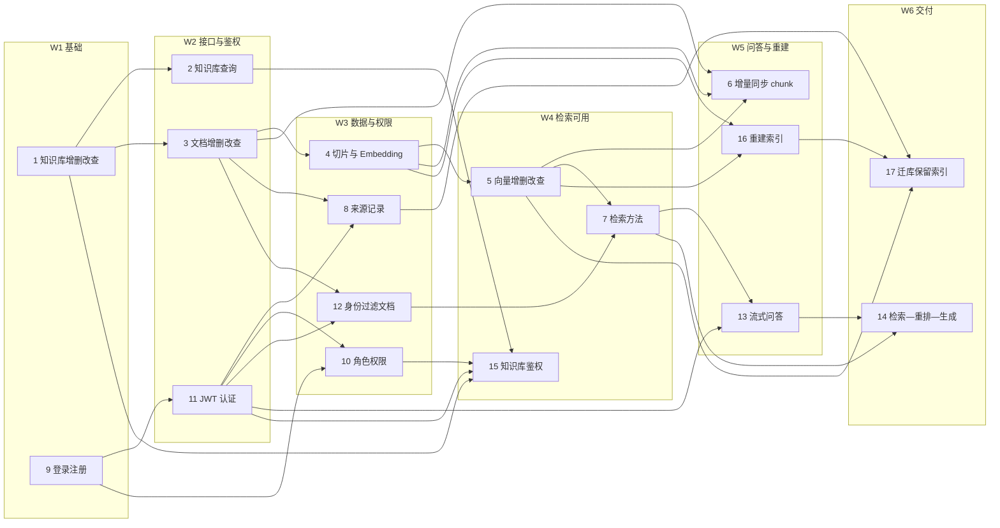

# 知识库项目 · 成员任务进度表

> 本文档把 4 份计划表（分工表、协作与接口对接表、任务依赖映射表、甘特计划）整合为一份可跟踪的进度看板。
> 数据以 `docs/plans/` 下的 xlsx 为准；本文件是汇总视图，两者不一致时改 xlsx 再同步回来。
>
> - 文档版本：v1.3
> - 最近更新：2026-10-29（**v1.3：P0–P4 安全与一致性收口**——JWT 密钥生产护栏、停用账号令牌立即失效、RLS 未部署时启动告警、`role_grants`/`is_public`/权限缓存三处口径注释；全量 **247 passed**。详见 §9 的 v1.3 行与 `docs/IMPLEMENTATION_STATUS.md` 本轮。此前 v1.0：B0 环境对账 + B2 主链路烟测收尾——`migrations/0001–0005` 在真库全部 rc=0、`information_schema` 计数 **17 = 16 表 + `v_active_chunks`**；修 `scripts/seed_for_m3.py` 两个 bug 后输出 `seed ok: 30 chunks, workspaces=2, docs=6, builds=6, per_workspace=15, model=test/hashing, dim=512`；新增 `scripts/smoke_e2e.py`，真起 API + Worker + 假 OpenAI 兼容服务跑通 **14/14 断言、退出码 0**；顺带修 3 个真 bug（同名建库错误码、流内抛 `AppError`、chat 缺 key 未前置 503）。复验全量 **213 passed**、门禁 PASS（lint 0.0s / format 0.0s / pytest 9.1s）。**任务状态修正**：7/8/13/14 代码早已落地、进度表落后于代码 → 转 `已完成/100%`；任务 10 曾一度由 `已完成/100%` 下调为 `进行中/50%`，**经用户裁决走方案 C 后恢复 `已完成/100%`**——保留 `role_grants` 预留权限点表、不提供 grant/revoke 端点，权限以 `workspace_memberships.role` 为准，按计划书 `全员模块实现路径.md:627` 判据记完成（见 §3 口径说明与修复计划 F11）；16/17 当时仍 `未开始`。**随后（同日 16:3x–16:5x）任务 16 完成并验收 → `已完成/100%`**：`/api/v1/admin/reindex`（202）+ `tests/api/test_api_admin.py` 11 条用例、`tests/api` **80 passed**、ruff 全绿；至此 17 个任务只剩任务 17。见 §9 与 `docs/IMPLEMENTATION_STATUS.md`）
> - 终验（同日 17:0x 前后，lead 独立复核）：全量 `pytest -q tests/unit tests/contract tests/api tests/integration` → **224 passed**（unit 76 + contract 20 + api 80 + integration 48）、exit 0；`scripts/ci.py --stage all` → PASS（0.1s / 0.0s / 7.5s，total 7.6s）；三进程（假 LLM + 真 API + 真 Worker）复跑 `scripts/smoke_e2e.py` → **14/14 通过、exit 0**。口径注：上面 213 是 B0/B2 收尾时那次实跑的记录（当时 `tests/api` 69 条），**224 是终验数**（任务 16 的 11 条 admin 用例落地后 `tests/api` 为 80 条）；两条数字都对，只是时点不同。证据见修复计划 §10。
> - v1.2（本次，2026-10-29）：**任务 17 完成 → 17 个任务全部 `已完成/100%`，未开始 0**。新增 `src/pyknora/services/migration/snapshot.py`（713 行：8 张表的导出/重放/校验纯逻辑，`TABLES` 8 个 `TableSpec` + `REPLAY_ORDER` + `SnapshotError`，`FORBIDDEN_COLUMNS={"embedding","tsvector"}` 禁搬向量与派生列）、`scripts/export_metadata.py`（77 行）/`replay_metadata.py`（91 行）/`verify_migration.py`（98 行）、`tests/unit/test_migration_snapshot.py`（202 行、**12 条**用例）；并跑完一次真实迁库演练（同容器 `pyknora-pg-p0` 内新建 `pyknora_migrate` 作目标库 → 8 表导出 → 重放后 5 KB / 7 文档 / 31 切片、**embedding 非空 0 行** → 4 个存活 KB 重算、1 个软删 KB 跳过 → `verify_migration.py` 输出「结论：全部校验项一致」）。用例数实测：`tests/unit` **88**（原 76 + 12）、全量 **236**（88 + 契约 20 + API 80 + 集成 48）。演练记录与 3 个发现见 `docs/plans/任务17_迁库演练记录.md`。
> - 技术栈：Python + FastAPI（据原分工表说明）
> - 覆盖任务：17 项（成员 5 人）
> - 计划周期：W1–W6（一周一个迭代，**建议基线，非承诺工期**）

## 0. 关联文件

| 文件 | 作用 |
|---|---|
| `docs/plans/知识库项目5人分工表.xlsx` | 人员 → 模块 → 任务编号 → 交付物（原始分工） |
| `docs/plans/协作与接口对接表.xlsx` | 6 组跨成员接口约定（5 组原始 + 1 组补充） |
| `docs/plans/任务依赖映射表.xlsx` | 17 个任务的前置、阶段、协作对象、关键产出 |
| `docs/plans/项目甘特计划.xlsx` | W1–W6 排期色块 + M1–M5 里程碑 |
| `docs/plans/分工表.png` | 分工表原始截图（与 §2 逐字一致） |
| `docs/plans/对接表.png` | 协作对接表原始截图（与 §6 逐字一致） |

## 1. 进度总览

| 指标 | 数值 |
|---|---|
| 任务总数 | 17 |
| 已完成 | 17（成员1：1、2；成员2：3、4、5、6；成员3：7、13、14；成员4：9、10、11、12、15；成员5：8、16、17） |
| 进行中 | 0 |
| 未开始 | 0 |
| 阻塞 | 0 |
| 里程碑 | 5（M1–M5） |
| 协作项 | 6（5 组原始 + 1 组补充） |

## 2. 人员分工一览

| 序号 | 成员 | 分组模块 | 任务编号 | 具体任务 | 主要交付内容 |
|---|---|---|---|---|---|
| 1 | 成员1 | 知识库管理 | 1、2 | 知识库增删改查、知识库查询 | 知识库 API、业务逻辑、数据模型 |
| 2 | 成员2 | 文档处理与索引 | 3、4、5、6 | 文档增删改查、文档切片与 Embedding、向量增删改查、文档更新时同步 chunk、维护 chunk 元数据 | 文档 API、切片与向量化流程、增量更新机制 |
| 3 | 成员3 | 检索与 RAG 问答 | 7、13、14 | 检索方法、流式问答接口、检索—重排—生成流程 | 检索服务、RAG 服务、流式响应接口 |
| 4 | 成员4 | 用户认证与权限 | 9、10、11、12、15 | 用户登录注册、部门与角色权限管理、JWT 身份认证、基于用户身份过滤文档、知识库访问权限校验 | 认证接口、权限校验组件、数据访问隔离 |
| 5 | 成员5 | 来源追踪与索引迁移 | 8、16、17 | 记录文档创建者及创建方式、更换 Embedding 模型或 chunk size 时重建索引、迁库时保留索引信息 | 来源追踪、索引重建与迁移、集成测试 |

## 3. 任务进度总表（主看板）

> 状态取值：`未开始` / `进行中` / `已完成` / `阻塞`。
> 协作对象均可在 §6 找到对应项；§6 第 5 项为补充项（原协作表未列），口径见 §8.2。
> 阶段为按依赖推导的建议周次，非既定工期。

| 编号 | 任务 | 负责人 | 阶段 | 前置任务 | 协作对象 | 关键产出 | 状态 | 进度 |
|---|---|---|---|---|---|---|---|---|
| 1 | 知识库增删改查 | 成员1 | W1 | — | — | 知识库 CRUD API | 已完成 | 100% |
| 9 | 用户登录注册 | 成员4 | W1 | — | — | 注册/登录接口 | 已完成 | 100% |
| 2 | 知识库查询 | 成员1 | W2 | 1 | — | 知识库列表/详情接口 | 已完成 | 100% |
| 3 | 文档增删改查 | 成员2 | W2 | 1 | — | 文档 CRUD API | 已完成 | 100% |
| 11 | JWT 身份认证 | 成员4 | W2 | 9 | 成员5 | 鉴权中间件 | 已完成 | 100% |
| 4 | 文档切片与 Embedding | 成员2 | W3 | 3 | 成员3 | 切片流水线 + 向量写入 | 已完成 | 100% |
| 8 | 记录文档创建者及创建方式 | 成员5 | W3 | 3、11 | 成员4 | 来源字段 + 写入逻辑 | 已完成 | 100% |
| 10 | 部门与角色权限管理 | 成员4 | W3 | 9、11 | — | 角色/部门表 + 授权逻辑 | 已完成 | 100% |
| 12 | 基于用户身份过滤文档 | 成员4 | W3 | 3、11 | 成员3 | 数据访问隔离层 | 已完成 | 100% |
| 5 | 向量增删改查 | 成员2 | W4 | 4 | — | 向量存储与查询封装 | 已完成 | 100% |
| 7 | 检索方法 | 成员3 | W4 | 5、12 | 成员4 | 检索服务接口 | 已完成 | 100% |
| 15 | 知识库访问权限校验 | 成员4 | W4 | 1、2、10、11 | 成员1 | 权限校验组件 | 已完成 | 100% |
| 6 | 文档更新时同步 chunk、维护元数据 | 成员2 | W5 | 3、4、5 | 成员5 | 增量更新机制 | 已完成 | 100% |
| 13 | 流式问答接口 | 成员3 | W5 | 7、11 | 成员4 | SSE / 流式响应接口 | 已完成 | 100% |
| 16 | 更换 Embedding 模型或 chunk size 时重建索引 | 成员5 | W5 | 4、5 | 成员2 | 索引重建脚本 + `/api/v1/admin/reindex` + 11 条用例 | 已完成 | 100% |
| 14 | 检索—重排—生成流程 | 成员3 | W6 | 7、13 | — | RAG 编排服务 | 已完成 | 100% |
| 17 | 迁库时保留索引信息 | 成员5 | W6 | 5、8、16 | 成员2 | 导出/重放/校验三脚本 + 12 条单测（`snapshot.py`）+ 一次真实迁库演练 | 已完成 | 100% |

> **v1.0 口径说明（2026-10-29）**
> - 任务 **7 / 13 / 14 / 8** 本轮由 `未开始/0%` 修正为 `已完成/100%`：代码与用例早已落地（`services/retrieval/`、`services/rag/`、`services/lineage/`，`api/v1/{query,chat,lineage}.py`，`tests/api/test_api_{query,chat,lineage}.py`、`tests/unit/test_{retrieval_search,rag_answer,lineage}.py`），是进度表落后于代码（修复计划 F10），非新增交付；A6/A7/A8 由 `scripts/smoke_e2e.py` 实跑覆盖。
> - 任务 **10** 记 `已完成/100%`（**方案 C，2026-10-29 用户裁决**）：保留 `roles`/`role_grants` 两张表与 `RoleGrantRow` 映射，**不提供 grant/revoke 读写接口**，角色授权以 `workspace_memberships.role` 为准、不做部门模型。判据是计划书 `docs/plans/全员模块实现路径.md:627` 对该任务的完成标准「只建表与一个默认角色，不做多角色」，不是"有读写接口"。留痕：本轮曾一度按"零读写代码"下调为 `进行中/50%`，裁决后恢复 `100%` 并在此注明预留口径。依据另见 `docs/adr/0006_Identity_Roles_RLS.md:15`。
> - 任务 **16 转 `已完成/100%`**（2026-10-29，成员5 实现 / lead 复核，修复计划 F8）：新增 `db/repos/index_migrations.py`（154 行，`SqlIndexMigrationRepo`）、`services/migration/reindex.py`（566 行，`reindex_knowledge_base()` = 对已发布 build 的切片正文按 KB 现有 profile 重算向量 → 新 `index_version` 的 staging build → 走既有 `publish()` 激活，不重解析、不重切片、不改 publish 语义、不加表/列/迁移）、`api/v1/admin.py`（113 行，`POST /api/v1/admin/reindex` → 202）、`api/main.py` **仅 +2 行**；`tests/api/test_api_admin.py` 11 条用例。留痕：本轮曾按"并行施工、无验收证据"记 `未开始/0%`，验收（`tests/api` 80 passed、11 passed、ruff 全绿）后转 `已完成`。
> - 任务 **17 转 `已完成/100%`**（2026-10-29，成员5 实现 / lead 记录，修复计划 F9）：前置 17 ← 5、8、16 已全部满足。交付 = `services/migration/snapshot.py`（713 行，8 表的导出/重放/校验纯逻辑）+ `scripts/{export,replay,verify}_metadata.py` + `tests/unit/test_migration_snapshot.py`（12 条用例），并完成一次**真实迁库演练**（目标库 `pyknora_migrate` 建在同一个 `pyknora-pg-p0` 容器里）。三个发现（`v_active_chunks` 不 join `knowledge_bases` → 软删 KB 的切片会露在视图里；软删 KB 取不到 profile 故无法重算向量，属设计边界；演练数据无 `workspaces`/`workspace_memberships` 行，`/admin/reindex` 的 HTTP 路径走不通，改用进程内 `reindex_knowledge_base()`）见 `docs/plans/任务17_迁库演练记录.md`。留痕：本轮之前该行一直记 `未开始/0%`。

## 4. 逐人任务安排

### 4.1 成员1 · 知识库管理

| 编号 | 任务 | 阶段 | 前置 | 交付物 | 状态 |
|---|---|---|---|---|---|
| 1 | 知识库增删改查 | W1 | — | 知识库 CRUD API | 已完成 |
| 2 | 知识库查询 | W2 | 1 | 知识库列表/详情接口 | 已完成 |

- 协作：任务 15 由成员4 实现鉴权，需调用成员1 的查询能力（成员1 + 成员4）。
- 风险：W3 之后无排期任务，易空转。建议 W3 起承接集成测试用例、公共数据模型评审。

### 4.2 成员2 · 文档处理与索引

| 编号 | 任务 | 阶段 | 前置 | 交付物 | 状态 |
|---|---|---|---|---|---|
| 3 | 文档增删改查 | W2 | 1 | 文档 CRUD API | 已完成 |
| 4 | 文档切片与 Embedding | W3 | 3 | 切片流水线 + 向量写入 | 已完成 |
| 5 | 向量增删改查 | W4 | 4 | 向量存储与查询封装 | 已完成 |
| 6 | 文档更新时同步 chunk、维护元数据 | W5 | 3、4、5 | 增量更新机制 | 已完成 |

- 协作：任务 4 需与成员3 对齐 chunk 数据结构、检索参数与返回值（成员2 + 成员3）；任务 6 与成员5 的索引版本策略相关（推断）。
- 风险：单人承载全链路 4 个任务，任一环延迟会直接压缩任务 16、17 的时间窗。

### 4.3 成员3 · 检索与 RAG 问答

| 编号 | 任务 | 阶段 | 前置 | 交付物 | 状态 |
|---|---|---|---|---|---|
| 7 | 检索方法 | W4 | 5、12 | 检索服务接口 | 已完成 |
| 13 | 流式问答接口 | W5 | 7、11 | SSE / 流式响应接口 | 已完成 |
| 14 | 检索—重排—生成流程 | W6 | 7、13 | RAG 编排服务 | 已完成 |

- 协作：任务 12 与任务 7 之间需传递用户身份并做检索权限过滤（成员3 + 成员4）。
- 风险：W1–W3 依赖未就绪，存在被动等待；任务 7 与前置任务 5 同处 W4，需周内串行（先出向量接口再写检索）。

### 4.4 成员4 · 用户认证与权限

| 编号 | 任务 | 阶段 | 前置 | 交付物 | 状态 |
|---|---|---|---|---|---|
| 9 | 用户登录注册 | W1 | — | 注册/登录接口 | 已完成 |
| 11 | JWT 身份认证 | W2 | 9 | 鉴权中间件 | 已完成 |
| 10 | 部门与角色权限管理 | W3 | 9、11 | 角色/部门表 + 授权逻辑 | 已完成 |
| 12 | 基于用户身份过滤文档 | W3 | 3、11 | 数据访问隔离层 | 已完成 |
| 15 | 知识库访问权限校验 | W4 | 1、2、10、11 | 权限校验组件 | 已完成 |

- 协作：任务 11 向成员5 提供登录用户身份（成员4 + 成员5）；任务 12 与成员3 的检索链路对接；任务 15 与成员1 的知识库查询对接（成员1 + 成员4）。
- 风险：权限是横切关注点，最易返工；W3 同时承担任务 10、12，是全程峰值。

### 4.5 成员5 · 来源追踪与索引迁移

| 编号 | 任务 | 阶段 | 前置 | 交付物 | 状态 |
|---|---|---|---|---|---|
| 8 | 记录文档创建者及创建方式 | W3 | 3、11 | 来源字段 + 写入逻辑 | 已完成 |
| 16 | 更换 Embedding 模型或 chunk size 时重建索引 | W5 | 4、5 | 索引重建脚本 + `/api/v1/admin/reindex` + 11 条用例 | 已完成 |
| 17 | 迁库时保留索引信息 | W6 | 5、8、16 | 导出/重放/校验三脚本 + 12 条单测 + 迁库演练记录 | 已完成 |

- 协作：任务 8 从成员4 的鉴权中间件取登录用户身份、写入来源字段（成员4 + 成员5）；任务 16、17 与成员2 约定索引版本、重建策略和迁移规则（成员2 + 成员5）。
- 风险：W1、W2、W4 无排期任务；16、17 依赖切片与向量层稳定，是全项目收尾的关键路径。

## 5. 阶段计划与里程碑

| 周次 | 阶段产出 | 里程碑 | 验收标志 |
|---|---|---|---|
| W1 | 知识库 CRUD、登录注册 | — | 两端骨架可跑通 |
| W2 | 知识库查询、文档 CRUD、JWT | **M1 基础设施可用** | 知识库 / 文档 CRUD 跑通，登录与 JWT 鉴权可用 |
| W3 | 切片入库、权限模型、来源字段 | **M2 数据与权限打通** | 切片与向量入库，权限模型与来源字段落库 |
| W4 | 向量增删改查、检索、知识库鉴权 | **M3 检索可用** | 向量检索生效；越权查询返回空结果 |
| W5 | 增量同步、流式问答、索引重建 | **M4 问答闭环** | 流式问答接口可用，索引重建脚本可执行 |
| W6 | RAG 编排、迁库迁移 | **M5 交付与集成** | RAG 全链路、迁移演练、集成测试通过 |

## 6. 协作与接口对接

| # | 对接成员 | 需要协调的内容 | 目的 | 对应任务 | 状态 |
|---|---|---|---|---|---|
| 1 | 成员1 + 成员4 | 知识库查询与访问权限校验 | 防止用户访问无权限的知识库 | 1、2、15 | 未开始 |
| 2 | 成员2 + 成员3 | chunk 数据结构、检索参数和返回值 | 确保检索模块能够正确使用文档切片 | 4、7 | 未开始 |
| 3 | 成员2 + 成员5 | 索引版本、重建策略和迁移规则 | 保证索引更新与迁移的一致性 | 6、16、17 | 未开始 |
| 4 | 成员3 + 成员4 | 用户身份传递、检索权限过滤 | 确保问答只检索用户有权访问的内容 | 7、12、13 | 未开始 |
| 5 | 成员4 + 成员5 | 用户身份传递到来源记录 | 保证文档创建者可追溯到登录用户 | 8、11 | 未开始 |
| 6 | 全体成员 | 公共数据模型、接口规范、Git 分支和测试规范 | 保证代码能够合并并组成完整项目 | 全项目 | 未开始 |

**建议**：每个成员负责自己的功能分支，通过 PR/MR 合并到 `develop` 分支。成员5 从开发初期就参与接口设计和集成。

> 注：第 5 项为**补充项**——原始对接表未列此组，因任务 8（来源追踪）需从任务 11（JWT 认证）取登录用户身份而新增；xlsx 中同位置已加注说明。原 5 项顺序不变，「全体成员」顺延为第 6 项。

## 7. 依赖关系图

## 8. 风险与待确认事项

### 8.1 排期风险

| 风险 | 说明 | 建议动作 |
|---|---|---|
| 成员4 峰值 | W3 同时承担任务 10、12 | 任务 10 提前到 W2 后半周，或成员1 分担任务 12 的过滤逻辑 |
| 成员1 空档 | W3–W6 无任务 | 转做集成测试、公共数据模型与接口规范 |
| 成员3 被动等待 | W1–W3 前置未就绪 | 提前锁定 chunk 结构与检索参数接口（协作项 2） |
| 成员5 空档 | W1、W2、W4 无任务 | 提前设计来源字段与迁移方案，W4 做迁移演练 |
| 同周串行 | 任务 7 依赖任务 5，两者都在 W4 | W4 周内先交付向量接口，再起检索 |
| 单周压缩 | 甘特按"每任务 1 周"简化，任务 6、14、17 很可能跨周 | 实际执行时按 1.5–2 周估算 |

### 8.2 待确认事项

1. **协作配对口径（已定）**：采纳扩展方案 —— 协作表新增第 5 项「成员4 + 成员5｜用户身份传递到来源记录｜保证文档创建者可追溯到登录用户」，作为任务 8、11 的协作依据；原 5 项顺序不变，「全体成员」顺延为第 6 项。该行在 xlsx 中已加注说明来源，属**补充项而非原始表内容**。
2. **公共规范归属**：协作项 6（公共数据模型、接口规范、Git 分支与测试规范）面向全体，需指定一名牵头人。
3. **计划周期**：当前按 6 周排布，需按课程实际周数确认后重排。
4. **集成测试归属**：原分工把集成测试写进成员5 的交付物，但任务表里没有独立任务编号，建议补一个 18 号任务。

## 9. 更新记录

| 日期 | 版本 | 变更 | 变更人 |
|---|---|---|---|
| 2026-10-28 | v0.1 | 由 4 份 xlsx 整合为单一进度表 | — |
| 2026-10-28 | v0.2 | 对齐原始截图：补技术栈、§6 建议行措辞、§0 登记两张 png | — |
| 2026-10-28 | v0.3 | 协作表新增第 5 项「成员4 + 成员5」；依赖表补全体成员协作注记；撤销 §3 的 † 推断标记 | — |
| 2026-10-28 | v0.4 | 数据契约补外键（计划书 §4.3 v2）：0001 已落 7 条复合 FK + 3 条回归断言；**成员1 任务1 追加一条验收**——建 `0002` 后立即 `ALTER TABLE documents` 补 `(workspace_id, kb_id)` 复合 FK，否则跨区引用无人校验 | lead |
| 2026-10-29 | v0.6 | 成员4 五任务（9/10/11/12/15）转 `已完成/100%`：容器 `pyknora-pg` 重建后 `uv run python scripts/migrate.py` 在真库跑通 `0001`+`0003`（`roles` 1 行、`role_grants` 3 行、`pyknora_app` 非 superuser 且非 bypassrls、`documents/chunks/outbox` `relrowsecurity=t`、`v_active_chunks` `security_invoker=true`）；`pytest -q tests/api` 49 passed、`pytest -q tests/integration` 33 passed、`pytest -q` 122 passed、`ruff check`/`ruff format --check` 全绿。另修 `scripts/migrate.py` 的管道编码（`text=True` 未指定 `encoding` → 中文 Windows 下按 GBK 编码 stdin，psql 报 `invalid byte sequence ... 0xb5`） | 成员4 |
| 2026-10-29 | v0.7 | 成员2 四任务（3/4/5/6）转 `已完成/100%`：`0001`+`0002`+`0003` 迁移在临时真库（`pyknora-pg-verify`，宿主 5434）跑通 → 16 张表 + `v_active_chunks` 视图；`scripts/ci.py --stage all` PASS（ruff-check/ruff-format/pytest 共 7.6s）、`tests/unit` 56 passed、`tests/contract` 20 passed、`tests/api` 49 passed、`tests/integration` 43 passed、全量 `pytest -q` 180 passed。另补两处入口/接缝：新增 `scripts/run_worker.py`（worker 可执行入口，此前只有类没有 `__main__`）、embedding 档位改从知识库 profile 读取（`check_profile_compat`，此前 `recipe_*` 写死全局模型，与任务 16 的"换模型重建索引"冲突）；并修 `scripts/ci.py` 的 `uv run` 缓存初始化失败（改为直连 `.venv/Scripts/*.exe`） | 成员2 |

| 2026-10-29 | v0.8 | 成员2 P0 修复（**不改任务状态**，3/4/5/6 仍 `已完成/100%`）：① `check_profile_compat` 改为维度 + 模型名都比（新增 `EmbeddingProfileMismatch`）——只比维度会放过"两个都是 512 维、模型不同"的不兼容向量空间；② worker 的 `Scope.principal_id` 改从 `job.payload["principal_id"]` 取（`documents.py` 三处入队 payload 补齐，缺失告警回落、非法 4xx）；③ 被集成测试逼出的第三处——上传入口把 `settings.embedding_model_key` 当身份来源，而该字段只有 local 后端权威（openai/hashing 会必然误报），新增 `resolve_embedding_identity(settings)` 并新建 `tests/conftest.py` 钉齐测试进程身份。复验：`tests/unit` 61 / `tests/contract` 20 / `tests/api` 61 / `tests/integration` 43，全量 **185 passed**；门禁 PASS（13.6s） | 成员2 |
| 2026-10-29 | v0.9 | 合并收尾（**不改任务状态**）：收尾远端成员3 的 chat 分支合并（`8caace1` → `d134c8f`，4 个冲突文件 `.gitignore`/`api/main.py`/`models/tables.py`/`contracts/reads.py`）；修合并后 2 条红测试——① `index_migrations` 0004 的 `migration_id` 单列主键与其注释/测试要求矛盾，新开 `migrations/0005_index_migrations_pk.sql` 改复合主键（I4：不回改已合并迁移）② lineage 用例里 BOB 并非 A 区成员，403 是对的，改为在该用例内补成员关系（不放全局夹具，避免放大权限造假通过）。另修夹具性能：两处 conftest 的逐表 `TRUNCATE`（16 次/用例）合成一条 `TRUNCATE ... CASCADE`。复验：全量 **206 passed / 162s**（此前 12 分钟 + 5 个 fixture ERROR）、门禁 PASS（14.6s）。**风险：`0005` 占用成员5 号段，待成员5 追认；远端 chat 路由无任何测试** | 成员2 |
| 2026-10-29 | v1.0 | B0 环境对账 + B2 主链路烟测（**本轮改状态**：任务 7/8/13/14 → `已完成/100%`；任务 10 曾一度下调 `进行中/50%`，**经用户裁决走方案 C 后恢复 `已完成/100%`**（保留 `role_grants` 预留权限点表 + `RoleGrantRow`，不补 grant/revoke 端点，权限以 `workspace_memberships.role` 为准，按 `全员模块实现路径.md:627`「只建表与一个默认角色」判据记完成）；16/17 不动）。① B0：`migrations/0001–0005` 全部 rc=0、`information_schema` 计数 **17 = 16 表 + `v_active_chunks`**；`scripts/seed_for_m3.py` 修两个 bug 后输出 `seed ok: 30 chunks, workspaces=2, docs=6, builds=6, per_workspace=15, model=test/hashing, dim=512`——bug A：ORM 无 relationship，unit of work 只按 mapper 名排序 → chunks 先于 documents 插入，改为依赖序逐层 `flush()`；bug B：`0002` 的 `doc_kb_fk` 复合外键指向 `knowledge_bases(workspace_id,kb_id)`，seed 的 `kb_id` 是 uuid5 父行不存在，新增 `ensure_knowledge_bases()` 先插父行。② B2：新增 `scripts/smoke_e2e.py`，真起 API + Worker + 假 OpenAI 兼容服务，A1–A9 共 14 项断言 **14/14 通过、退出码 0**；修 3 个真 bug——`services/kb/service.py` 同名建库错误码 `IDEMPOTENCY_CONFLICT`→`CONFLICT`、`services/rag/answer.py` 在生成器内抛 `AppError` 致 Starlette `response already started`（降级为 SSE `error` 事件，`schemas/chat.py` 新增 `StreamErrorEvent`）、`api/v1/chat.py` 缺 `chat_api_key` 在构造 `StreamingResponse` 之前直接 503；配 `tests/api/test_api_chat.py` 4 条 + `tests/unit/test_rag_answer.py` 3 条。③ 复验：全量 `pytest -q tests/unit tests/contract tests/api tests/integration` → **213 passed**、exit 0；`scripts/ci.py --stage all` PASS（lint 0.0s / format 0.0s / pytest 9.1s）。**未验证**：`scripts/migrate.py` 原生路径在沙箱内仍跑不了（Python 子进程调 docker CLI → npipe permission denied），迁移是 pwsh 管道喂 psql 逐条验证的；真实 embedder / 真实 LLM 端到端仍未跑。任务 10 的方案 C 口径见 §3 口径说明与修复计划 F11（已裁决、无需施工） | 成员2（lead 复核） |
| 2026-10-29 | v1.1 | **任务 16 完成（`已完成/100%`）**：更换 Embedding 模型或 chunk size 时重建索引。新增 `db/repos/index_migrations.py`（154 行，`SqlIndexMigrationRepo`：create/get/list_for_kb/finish/find_succeeded_by_idempotency_key，SQL 全带 `workspace_id` 谓词）、`services/migration/reindex.py`（566 行，`reindex_knowledge_base()`：按 KB 现有 profile 对**已发布 build 的切片正文**重算向量 → 新 `index_version` 的 staging build → 走既有 `publish()` 激活；**不重解析、不重切片、不改 publish 语义、不加表/列/迁移**）、`api/v1/admin.py`（113 行，`POST /api/v1/admin/reindex` → 202，`ReindexRequest{kb_id,mode,idempotency_key}`）、`api/main.py` **仅 +2 行**；`tests/api/test_api_admin.py` 11 条用例。实测：`ruff check` All checks passed；`ruff format --check` 104 files already formatted；`tests/api` **80 passed in 110.73s**（exit 0）；`test_api_admin.py` 11 passed；`tests/unit` 76 passed。四条硬断言：①新 build active/旧 build retired/`active_index_version` 严格 +1；②重建前后 `content`+`chunk_ordinal` 逐项相同（不重写正文）；③他人 workspace 的 kb → **404**（非 403/202）；④连调两次每文档仍恰一个 active build、同 idempotency_key 重放不刷版本。**未实现**：`mode=export`/`mode=replay` 明确返回 422 `INVALID_REQUEST`（不静默降级）。**未验证**：真实大 KB（数百文档）耗时与连接占用；reindex 下 `EmbeddingDimensionError` 无专门用例；并发两个 admin 请求同 KB。**风险 5 条**：job_type='reindex' 依赖 `ingestion_jobs.job_type` 无 CHECK 约束；并发无锁可能撞 `index_builds` 唯一约束（500）；整库一个事务跑完才回 202，大库会顶网关超时；只要求 `require_kb_access`（读权限即可触发全量重建）；每次重建留 `ingestion_jobs`/`job_attempts` 审计行无清理策略。**测试口径偏差**：`knowledge_bases.kb_id` 在库里是全局主键，"同一 kb_id 登记两区"只存在于 FakeKbRepo，跨区用例实际测的是 B 区自己的 kb_id + workspace_id 谓词。至此 17 个任务只剩任务 17 | 成员5（lead 复核） |

| 2026-10-29 | v1.2 | **任务 17 完成（`已完成/100%`）→ 17/17 全部 `已完成`、未开始 0**：迁库只搬「元信息 + 原文」，向量在目标库重算。新增 ① `src/pyknora/services/migration/snapshot.py`（713 行：8 个 `TableSpec` + `REPLAY_ORDER` + `SnapshotError` + `build_snapshot`/`export_metadata`/`replay_metadata`/`verify_metadata`/`render_sql`/`count_embedding_inserts`/`assert_no_embedding`，`FORBIDDEN_COLUMNS = {"embedding","tsvector"}`）② `scripts/export_metadata.py`（77 行：产物 `<out>.json` + 同目录同名 `.sql`；导出里出现向量列即 exit 3）③ `scripts/replay_metadata.py`（91 行：刻意不提供 `--reindex` 开关，避免把「重放」与「重建索引」揉成一个动作）④ `scripts/verify_migration.py`（98 行：任一不一致非 0 退出并定位到具体表/文档）⑤ `tests/unit/test_migration_snapshot.py`（202 行、**12 条**用例）。**未改** `publish.py`／`reads.py`／`migrations/`。实测：`uv run python -m pytest --collect-only -q tests/unit` → `tests/unit/test_migration_snapshot.py: 12`、**88 tests collected**（原 76 + 12；全量 236 = 88 + 契约 20 + API 80 + 集成 48）。**真实演练**（目标库 `pyknora_migrate` 建在同一个 `pyknora-pg-p0` 容器里，不是 5435）：`0001–0005` 顺序应用建表 → 导出 8 张表 → 重放后 **5 KB / 7 文档 / 31 切片、embedding 非空 0 行** → 重算前 `verify_migration.py` 报 `v_active_chunks` 源 1 / 目标 0 与「缺向量 1 行」（把「migrate 后必须先 reindex」证出来）→ 4 个存活 KB 重算（两个种子 KB 各 3 篇 15 片）、1 个软删 KB 跳过 → 重算后 `uv run python scripts/verify_migration.py --source …/pyknora --target …/pyknora_migrate` → 每个 workspace 的 `knowledge_bases` 集合、KB profile 五字段、`documents` 集合、活动 chunk 边界与正文逐项、`v_active_chunks` 行数、向量无 NULL 全部 `OK`，**结论：全部校验项一致**。**3 个发现**：① `v_active_chunks` 视图不 join `knowledge_bases`——KB 软删后只要文档没删、build 是 active、向量非空，切片仍会露在视图里（源库那条「幽灵行」）；校验器自行加 `JOIN knowledge_bases … AND k.deleted_at IS NULL` 才对齐口径。② `reindex_knowledge_base` 对软删 KB 取不到 profile（`repo.get` 过滤 `deleted_at`）→ 已删 KB 无法重算向量，属**设计边界不是缺陷**；校验器因此分两组断言：存活 KB 必须无 NULL 向量、软删 KB 必须保持 NULL。③ 演练数据里两个种子 workspace 只有 `knowledge_bases` 行（`scripts/seed_for_m3.py` 不写 `workspaces`），且 `workspace_memberships` 不在导出 8 表内 → `POST /api/v1/admin/reindex` 的 HTTP 路径走不通，演练改用进程内 `reindex_knowledge_base()`（scope 取 KB 所属空间）并在记录里注明「绕过 HTTP」；HTTP 202 路径仍由烟测库覆盖。**未做／未验证**：向量字节不搬（跨版本/跨维度靠重算换可迁移性）；`workspace_memberships` 权限数据不搬；`outbox` 不搬；`mode=export/replay` 仍未接进 `/admin/reindex`（仍返回 422）；大库耗时、并发、跨机器网络未验证；本轮未提交 | 成员5（lead 记录） |
| 2026-10-29 | v1.3 | **P0–P4 安全与一致性收口（不改任务状态，17/17 仍 `已完成/100%`）**，经用户 m01547「p0-p4全部解决」授权代修成员4 域：① **P0-1 JWT 密钥无生产护栏**（原先 `jwt_secret()` 回落硬编码默认值、无任何环境校验 = 可伪造任意 `sub`/`workspace_id` 令牌）——`src/pyknora/core/settings.py` 新增 `env` / `jwt_secret` 字段与 `model_validator(mode="after")`：`env` 不在 `{dev,test,local}` 时若密钥为空或仍是 `DEV_JWT_SECRET` 则**启动即失败**；`src/pyknora/services/auth/jwt.py` 的 `jwt_secret()` 改为 `secret or settings.jwt_secret or DEV_JWT_SECRET`（保留"传参优先"，测试 `monkeypatch.setenv` 语义不变）。② **P0-2 停用账号令牌不失效**——`src/pyknora/db/repos/principals.py` 的 `find_membership()` 加 `JOIN PrincipalRow` + `status == "active"` 谓词，`/auth/disable` 后同一 token 立即 403。③ **P1 RLS 部署缺口静默**——`src/pyknora/api/main.py` 新增 `_is_rls_bypassed()`（查 `pg_roles` 的 `rolsuper`/`rolbypassrls`，无权限返回 `None` 不误报）与 `_warn_if_db_role_bypasses_rls()`，非 dev 启动时若连的是特权角色则 `log.warning`（只告警不阻断：只读副本/BI 场景会误报）；`.env.example` 补 `PYKNORA_ENV` / `PYKNORA_JWT_SECRET` 与"生产禁用 owner 连库"注记；`README.md` 快速开始第 1 步同步。④ **P2 `role_grants` 空壳 / P3 `is_public` 死字段 / P4 权限查询不做缓存**——三处**只补注释、不改行为**：`services/auth/membership.py` 与 `api/v1/workspaces.py` 写明"改角色不读 `role_grants`"、`models/tables.py` 的 `is_public` 标注为预留、`load_membership` 写明每请求一次查询是**刻意反缓存**（吊销必须立即生效）；`docs/adr/0006_Identity_Roles_RLS.md` 追加「实现期补充」段记录这三条口径（状态仍是 `提议`）。⑤ 新增测试：`tests/unit/test_security_guards.py` **9 条**（密钥校验 + 角色判定纯函数）、`tests/api/test_auth_revocation.py` **2 条**（停用→403、恢复→200）。**复验**：`ruff check` → `All checks passed!`；`ruff format --check` → 9 files already formatted；`pytest -q` 全量（真库 5434）→ **247 passed / exit 0**；计数 unit **97** / contract 20 / api **82** / integration 48 = 247。**未验证**：`env=prod` 的真实启动（本机无生产配置）、`_is_rls_bypassed` 只在 superuser 与普通角色两态实测（`pyknora_app` 未单独验）、真实 embedder/LLM 端到端 | 成员2（lead 代修成员4 域） |

## 10. 填写说明

- 每个任务只由负责人更新自己的行：改 `状态` 与 `进度`，其余字段不动。
- 进度按 0 / 25 / 50 / 75 / 100 五档填写，避免虚假精度。
- 状态改为 `阻塞` 时，必须在 §8.1 追加一行说明阻塞原因与预计解除时间。
- 协作项状态只在该接口的双向联调完成后才可改为 `已完成`。
- 每次更新同步修改文首的「最近更新」与 §9 更新记录。
