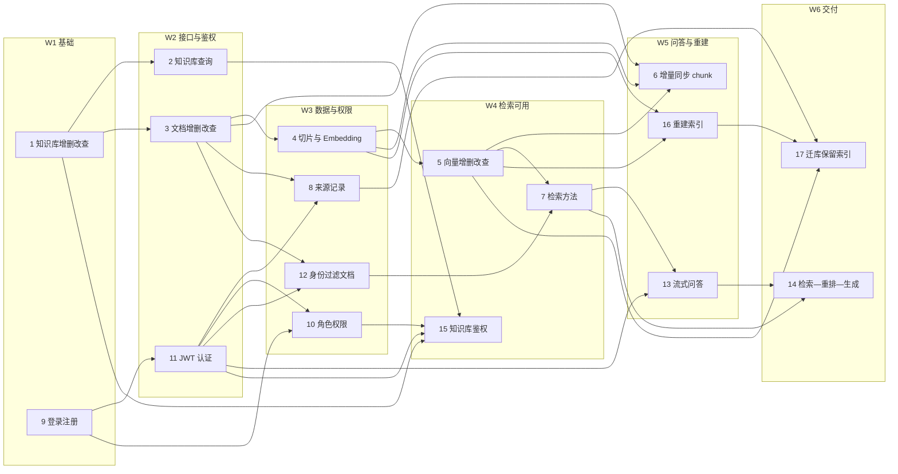

# 知识库项目 · 成员任务进度表

> 本文档把 4 份计划表（分工表、协作与接口对接表、任务依赖映射表、甘特计划）整合为一份可跟踪的进度看板。
> 数据以 `docs/plans/` 下的 xlsx 为准；本文件是汇总视图，两者不一致时改 xlsx 再同步回来。
>
> - 文档版本：v0.8
> - 最近更新：2026-10-29（v0.8：成员2 修两条 P0 —— embedding 校验补齐「模型名」、worker 身份改从作业 payload 取；修 P0 时被集成测试逼出第三处（上传入口把 `settings.embedding_model_key` 当身份来源，openai/hashing 部署必然误报），新增 `resolve_embedding_identity` 并新建 `tests/conftest.py` 钉齐测试进程身份。复验：`tests/unit` 61 / `tests/contract` 20 / `tests/api` 61 / `tests/integration` 43，全量 **185 passed**；门禁 `scripts/ci.py --stage all` PASS（13.6s）。**任务状态不变**——3/4/5/6 仍是 `已完成/100%`，本轮是防线加固，见 §9 与 `docs/IMPLEMENTATION_STATUS.md`）
> - 技术栈：Python + FastAPI（据原分工表说明）
> - 覆盖任务：17 项（成员 5 人）
> - 计划周期：W1–W6（一周一个迭代，**建议基线，非承诺工期**）

## 0. 关联文件

| 文件 | 作用 |
|---|---|
| `docs/plans/知识库项目5人分工表.xlsx` | 人员 → 模块 → 任务编号 → 交付物（原始分工） |
| `docs/plans/协作与接口对接表.xlsx` | 6 组跨成员接口约定（5 组原始 + 1 组补充） |
| `docs/plans/任务依赖映射表.xlsx` | 17 个任务的前置、阶段、协作对象、关键产出 |
| `docs/plans/项目甘特计划.xlsx` | W1–W6 排期色块 + M1–M5 里程碑 |
| `docs/plans/分工表.png` | 分工表原始截图（与 §2 逐字一致） |
| `docs/plans/对接表.png` | 协作对接表原始截图（与 §6 逐字一致） |

## 1. 进度总览

| 指标 | 数值 |
|---|---|
| 任务总数 | 17 |
| 已完成 | 11（成员1：1、2；成员2：3、4、5、6；成员4：9、10、11、12、15） |
| 进行中 | 0 |
| 未开始 | 6 |
| 阻塞 | 0 |
| 里程碑 | 5（M1–M5） |
| 协作项 | 6（5 组原始 + 1 组补充） |

## 2. 人员分工一览

| 序号 | 成员 | 分组模块 | 任务编号 | 具体任务 | 主要交付内容 |
|---|---|---|---|---|---|
| 1 | 成员1 | 知识库管理 | 1、2 | 知识库增删改查、知识库查询 | 知识库 API、业务逻辑、数据模型 |
| 2 | 成员2 | 文档处理与索引 | 3、4、5、6 | 文档增删改查、文档切片与 Embedding、向量增删改查、文档更新时同步 chunk、维护 chunk 元数据 | 文档 API、切片与向量化流程、增量更新机制 |
| 3 | 成员3 | 检索与 RAG 问答 | 7、13、14 | 检索方法、流式问答接口、检索—重排—生成流程 | 检索服务、RAG 服务、流式响应接口 |
| 4 | 成员4 | 用户认证与权限 | 9、10、11、12、15 | 用户登录注册、部门与角色权限管理、JWT 身份认证、基于用户身份过滤文档、知识库访问权限校验 | 认证接口、权限校验组件、数据访问隔离 |
| 5 | 成员5 | 来源追踪与索引迁移 | 8、16、17 | 记录文档创建者及创建方式、更换 Embedding 模型或 chunk size 时重建索引、迁库时保留索引信息 | 来源追踪、索引重建与迁移、集成测试 |

## 3. 任务进度总表（主看板）

> 状态取值：`未开始` / `进行中` / `已完成` / `阻塞`。
> 协作对象均可在 §6 找到对应项；§6 第 5 项为补充项（原协作表未列），口径见 §8.2。
> 阶段为按依赖推导的建议周次，非既定工期。

| 编号 | 任务 | 负责人 | 阶段 | 前置任务 | 协作对象 | 关键产出 | 状态 | 进度 |
|---|---|---|---|---|---|---|---|---|
| 1 | 知识库增删改查 | 成员1 | W1 | — | — | 知识库 CRUD API | 已完成 | 100% |
| 9 | 用户登录注册 | 成员4 | W1 | — | — | 注册/登录接口 | 已完成 | 100% |
| 2 | 知识库查询 | 成员1 | W2 | 1 | — | 知识库列表/详情接口 | 已完成 | 100% |
| 3 | 文档增删改查 | 成员2 | W2 | 1 | — | 文档 CRUD API | 已完成 | 100% |
| 11 | JWT 身份认证 | 成员4 | W2 | 9 | 成员5 | 鉴权中间件 | 已完成 | 100% |
| 4 | 文档切片与 Embedding | 成员2 | W3 | 3 | 成员3 | 切片流水线 + 向量写入 | 已完成 | 100% |
| 8 | 记录文档创建者及创建方式 | 成员5 | W3 | 3、11 | 成员4 | 来源字段 + 写入逻辑 | 未开始 | 0% |
| 10 | 部门与角色权限管理 | 成员4 | W3 | 9、11 | — | 角色/部门表 + 授权逻辑 | 已完成 | 100% |
| 12 | 基于用户身份过滤文档 | 成员4 | W3 | 3、11 | 成员3 | 数据访问隔离层 | 已完成 | 100% |
| 5 | 向量增删改查 | 成员2 | W4 | 4 | — | 向量存储与查询封装 | 已完成 | 100% |
| 7 | 检索方法 | 成员3 | W4 | 5、12 | 成员4 | 检索服务接口 | 未开始 | 0% |
| 15 | 知识库访问权限校验 | 成员4 | W4 | 1、2、10、11 | 成员1 | 权限校验组件 | 已完成 | 100% |
| 6 | 文档更新时同步 chunk、维护元数据 | 成员2 | W5 | 3、4、5 | 成员5 | 增量更新机制 | 已完成 | 100% |
| 13 | 流式问答接口 | 成员3 | W5 | 7、11 | 成员4 | SSE / 流式响应接口 | 未开始 | 0% |
| 16 | 更换 Embedding 模型或 chunk size 时重建索引 | 成员5 | W5 | 4、5 | 成员2 | 索引重建脚本 | 未开始 | 0% |
| 14 | 检索—重排—生成流程 | 成员3 | W6 | 7、13 | — | RAG 编排服务 | 未开始 | 0% |
| 17 | 迁库时保留索引信息 | 成员5 | W6 | 5、8、16 | 成员2 | 迁移方案 + 演练记录 | 未开始 | 0% |

## 4. 逐人任务安排

### 4.1 成员1 · 知识库管理

| 编号 | 任务 | 阶段 | 前置 | 交付物 | 状态 |
|---|---|---|---|---|---|
| 1 | 知识库增删改查 | W1 | — | 知识库 CRUD API | 已完成 |
| 2 | 知识库查询 | W2 | 1 | 知识库列表/详情接口 | 已完成 |

- 协作：任务 15 由成员4 实现鉴权，需调用成员1 的查询能力（成员1 + 成员4）。
- 风险：W3 之后无排期任务，易空转。建议 W3 起承接集成测试用例、公共数据模型评审。

### 4.2 成员2 · 文档处理与索引

| 编号 | 任务 | 阶段 | 前置 | 交付物 | 状态 |
|---|---|---|---|---|---|
| 3 | 文档增删改查 | W2 | 1 | 文档 CRUD API | 已完成 |
| 4 | 文档切片与 Embedding | W3 | 3 | 切片流水线 + 向量写入 | 已完成 |
| 5 | 向量增删改查 | W4 | 4 | 向量存储与查询封装 | 已完成 |
| 6 | 文档更新时同步 chunk、维护元数据 | W5 | 3、4、5 | 增量更新机制 | 已完成 |

- 协作：任务 4 需与成员3 对齐 chunk 数据结构、检索参数与返回值（成员2 + 成员3）；任务 6 与成员5 的索引版本策略相关（推断）。
- 风险：单人承载全链路 4 个任务，任一环延迟会直接压缩任务 16、17 的时间窗。

### 4.3 成员3 · 检索与 RAG 问答

| 编号 | 任务 | 阶段 | 前置 | 交付物 | 状态 |
|---|---|---|---|---|---|
| 7 | 检索方法 | W4 | 5、12 | 检索服务接口 | 未开始 |
| 13 | 流式问答接口 | W5 | 7、11 | SSE / 流式响应接口 | 未开始 |
| 14 | 检索—重排—生成流程 | W6 | 7、13 | RAG 编排服务 | 未开始 |

- 协作：任务 12 与任务 7 之间需传递用户身份并做检索权限过滤（成员3 + 成员4）。
- 风险：W1–W3 依赖未就绪，存在被动等待；任务 7 与前置任务 5 同处 W4，需周内串行（先出向量接口再写检索）。

### 4.4 成员4 · 用户认证与权限

| 编号 | 任务 | 阶段 | 前置 | 交付物 | 状态 |
|---|---|---|---|---|---|
| 9 | 用户登录注册 | W1 | — | 注册/登录接口 | 已完成 |
| 11 | JWT 身份认证 | W2 | 9 | 鉴权中间件 | 已完成 |
| 10 | 部门与角色权限管理 | W3 | 9、11 | 角色/部门表 + 授权逻辑 | 已完成 |
| 12 | 基于用户身份过滤文档 | W3 | 3、11 | 数据访问隔离层 | 已完成 |
| 15 | 知识库访问权限校验 | W4 | 1、2、10、11 | 权限校验组件 | 已完成 |

- 协作：任务 11 向成员5 提供登录用户身份（成员4 + 成员5）；任务 12 与成员3 的检索链路对接；任务 15 与成员1 的知识库查询对接（成员1 + 成员4）。
- 风险：权限是横切关注点，最易返工；W3 同时承担任务 10、12，是全程峰值。

### 4.5 成员5 · 来源追踪与索引迁移

| 编号 | 任务 | 阶段 | 前置 | 交付物 | 状态 |
|---|---|---|---|---|---|
| 8 | 记录文档创建者及创建方式 | W3 | 3、11 | 来源字段 + 写入逻辑 | 未开始 |
| 16 | 更换 Embedding 模型或 chunk size 时重建索引 | W5 | 4、5 | 索引重建脚本 | 未开始 |
| 17 | 迁库时保留索引信息 | W6 | 5、8、16 | 迁移方案 + 演练记录 | 未开始 |

- 协作：任务 8 从成员4 的鉴权中间件取登录用户身份、写入来源字段（成员4 + 成员5）；任务 16、17 与成员2 约定索引版本、重建策略和迁移规则（成员2 + 成员5）。
- 风险：W1、W2、W4 无排期任务；16、17 依赖切片与向量层稳定，是全项目收尾的关键路径。

## 5. 阶段计划与里程碑

| 周次 | 阶段产出 | 里程碑 | 验收标志 |
|---|---|---|---|
| W1 | 知识库 CRUD、登录注册 | — | 两端骨架可跑通 |
| W2 | 知识库查询、文档 CRUD、JWT | **M1 基础设施可用** | 知识库 / 文档 CRUD 跑通，登录与 JWT 鉴权可用 |
| W3 | 切片入库、权限模型、来源字段 | **M2 数据与权限打通** | 切片与向量入库，权限模型与来源字段落库 |
| W4 | 向量增删改查、检索、知识库鉴权 | **M3 检索可用** | 向量检索生效；越权查询返回空结果 |
| W5 | 增量同步、流式问答、索引重建 | **M4 问答闭环** | 流式问答接口可用，索引重建脚本可执行 |
| W6 | RAG 编排、迁库迁移 | **M5 交付与集成** | RAG 全链路、迁移演练、集成测试通过 |

## 6. 协作与接口对接

| # | 对接成员 | 需要协调的内容 | 目的 | 对应任务 | 状态 |
|---|---|---|---|---|---|
| 1 | 成员1 + 成员4 | 知识库查询与访问权限校验 | 防止用户访问无权限的知识库 | 1、2、15 | 未开始 |
| 2 | 成员2 + 成员3 | chunk 数据结构、检索参数和返回值 | 确保检索模块能够正确使用文档切片 | 4、7 | 未开始 |
| 3 | 成员2 + 成员5 | 索引版本、重建策略和迁移规则 | 保证索引更新与迁移的一致性 | 6、16、17 | 未开始 |
| 4 | 成员3 + 成员4 | 用户身份传递、检索权限过滤 | 确保问答只检索用户有权访问的内容 | 7、12、13 | 未开始 |
| 5 | 成员4 + 成员5 | 用户身份传递到来源记录 | 保证文档创建者可追溯到登录用户 | 8、11 | 未开始 |
| 6 | 全体成员 | 公共数据模型、接口规范、Git 分支和测试规范 | 保证代码能够合并并组成完整项目 | 全项目 | 未开始 |

**建议**：每个成员负责自己的功能分支，通过 PR/MR 合并到 `develop` 分支。成员5 从开发初期就参与接口设计和集成。

> 注：第 5 项为**补充项**——原始对接表未列此组，因任务 8（来源追踪）需从任务 11（JWT 认证）取登录用户身份而新增；xlsx 中同位置已加注说明。原 5 项顺序不变，「全体成员」顺延为第 6 项。

## 7. 依赖关系图

## 8. 风险与待确认事项

### 8.1 排期风险

| 风险 | 说明 | 建议动作 |
|---|---|---|
| 成员4 峰值 | W3 同时承担任务 10、12 | 任务 10 提前到 W2 后半周，或成员1 分担任务 12 的过滤逻辑 |
| 成员1 空档 | W3–W6 无任务 | 转做集成测试、公共数据模型与接口规范 |
| 成员3 被动等待 | W1–W3 前置未就绪 | 提前锁定 chunk 结构与检索参数接口（协作项 2） |
| 成员5 空档 | W1、W2、W4 无任务 | 提前设计来源字段与迁移方案，W4 做迁移演练 |
| 同周串行 | 任务 7 依赖任务 5，两者都在 W4 | W4 周内先交付向量接口，再起检索 |
| 单周压缩 | 甘特按"每任务 1 周"简化，任务 6、14、17 很可能跨周 | 实际执行时按 1.5–2 周估算 |

### 8.2 待确认事项

1. **协作配对口径（已定）**：采纳扩展方案 —— 协作表新增第 5 项「成员4 + 成员5｜用户身份传递到来源记录｜保证文档创建者可追溯到登录用户」，作为任务 8、11 的协作依据；原 5 项顺序不变，「全体成员」顺延为第 6 项。该行在 xlsx 中已加注说明来源，属**补充项而非原始表内容**。
2. **公共规范归属**：协作项 6（公共数据模型、接口规范、Git 分支与测试规范）面向全体，需指定一名牵头人。
3. **计划周期**：当前按 6 周排布，需按课程实际周数确认后重排。
4. **集成测试归属**：原分工把集成测试写进成员5 的交付物，但任务表里没有独立任务编号，建议补一个 18 号任务。

## 9. 更新记录

| 日期 | 版本 | 变更 | 变更人 |
|---|---|---|---|
| 2026-10-28 | v0.1 | 由 4 份 xlsx 整合为单一进度表 | — |
| 2026-10-28 | v0.2 | 对齐原始截图：补技术栈、§6 建议行措辞、§0 登记两张 png | — |
| 2026-10-28 | v0.3 | 协作表新增第 5 项「成员4 + 成员5」；依赖表补全体成员协作注记；撤销 §3 的 † 推断标记 | — |
| 2026-10-28 | v0.4 | 数据契约补外键（计划书 §4.3 v2）：0001 已落 7 条复合 FK + 3 条回归断言；**成员1 任务1 追加一条验收**——建 `0002` 后立即 `ALTER TABLE documents` 补 `(workspace_id, kb_id)` 复合 FK，否则跨区引用无人校验 | lead |
| 2026-10-29 | v0.6 | 成员4 五任务（9/10/11/12/15）转 `已完成/100%`：容器 `pyknora-pg` 重建后 `uv run python scripts/migrate.py` 在真库跑通 `0001`+`0003`（`roles` 1 行、`role_grants` 3 行、`pyknora_app` 非 superuser 且非 bypassrls、`documents/chunks/outbox` `relrowsecurity=t`、`v_active_chunks` `security_invoker=true`）；`pytest -q tests/api` 49 passed、`pytest -q tests/integration` 33 passed、`pytest -q` 122 passed、`ruff check`/`ruff format --check` 全绿。另修 `scripts/migrate.py` 的管道编码（`text=True` 未指定 `encoding` → 中文 Windows 下按 GBK 编码 stdin，psql 报 `invalid byte sequence ... 0xb5`） | 成员4 |
| 2026-10-29 | v0.7 | 成员2 四任务（3/4/5/6）转 `已完成/100%`：`0001`+`0002`+`0003` 迁移在临时真库（`pyknora-pg-verify`，宿主 5434）跑通 → 16 张表 + `v_active_chunks` 视图；`scripts/ci.py --stage all` PASS（ruff-check/ruff-format/pytest 共 7.6s）、`tests/unit` 56 passed、`tests/contract` 20 passed、`tests/api` 49 passed、`tests/integration` 43 passed、全量 `pytest -q` 180 passed。另补两处入口/接缝：新增 `scripts/run_worker.py`（worker 可执行入口，此前只有类没有 `__main__`）、embedding 档位改从知识库 profile 读取（`check_profile_compat`，此前 `recipe_*` 写死全局模型，与任务 16 的"换模型重建索引"冲突）；并修 `scripts/ci.py` 的 `uv run` 缓存初始化失败（改为直连 `.venv/Scripts/*.exe`） | 成员2 |

| 2026-10-29 | v0.8 | 成员2 P0 修复（**不改任务状态**，3/4/5/6 仍 `已完成/100%`）：① `check_profile_compat` 改为维度 + 模型名都比（新增 `EmbeddingProfileMismatch`）——只比维度会放过"两个都是 512 维、模型不同"的不兼容向量空间；② worker 的 `Scope.principal_id` 改从 `job.payload["principal_id"]` 取（`documents.py` 三处入队 payload 补齐，缺失告警回落、非法 4xx）；③ 被集成测试逼出的第三处——上传入口把 `settings.embedding_model_key` 当身份来源，而该字段只有 local 后端权威（openai/hashing 会必然误报），新增 `resolve_embedding_identity(settings)` 并新建 `tests/conftest.py` 钉齐测试进程身份。复验：`tests/unit` 61 / `tests/contract` 20 / `tests/api` 61 / `tests/integration` 43，全量 **185 passed**；门禁 PASS（13.6s） | 成员2 |

## 10. 填写说明

- 每个任务只由负责人更新自己的行：改 `状态` 与 `进度`，其余字段不动。
- 进度按 0 / 25 / 50 / 75 / 100 五档填写，避免虚假精度。
- 状态改为 `阻塞` 时，必须在 §8.1 追加一行说明阻塞原因与预计解除时间。
- 协作项状态只在该接口的双向联调完成后才可改为 `已完成`。
- 每次更新同步修改文首的「最近更新」与 §9 更新记录。
