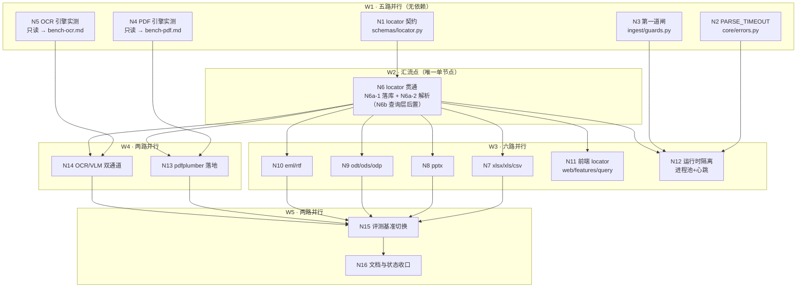

# 文档解析升级施工计划（ADR-0008 落地）

> 状态：**提议**（未开工）
> 上位决策：[`docs/adr/0008_Document_Parsing_Contract.md`](../adr/0008_Document_Parsing_Contract.md)（D1–D10，7 条已决 + D9 两条已决 + D10 六条已决）
> 本文只做**施工分解**，不重开决策。决策冲突以 ADR 为准，本文只记录偏差。
> 撰写：2026-11-02

---

## 1. 现状基线（实测，非推断）

| 事实 | 证据 |
| --- | --- |
| 后缀 **7 个**：`.pdf` `.docx` `.txt` `.md` `.markdown` `.html` `.htm` | `src/pyknora/services/ingest/parser.py:19` `SUPPORTED_SUFFIXES = frozenset({...})` |
| 解析函数 **4 个** | `_parse_pdf`（`parser.py:75`，pypdf）/ `_parse_docx`（`:108`，python-docx，**不读 `document.tables`**）/ `_parse_text`（`:142`）/ `_parse_html`（`:175`） |
| 扫描件只报错不识别 | `PARSE_FAILED "PDF 未提取到任何文本（可能是扫描件）"` |
| 无 `locator` / 无 `is_tabular` | `Block` 只有 `page_no`/`heading_path`；`chunks.locator` 列尚不存在（0014 未建） |
| 无 `PARSE_TIMEOUT` | `src/pyknora/core/errors.py` 现有 17 个 `ErrorCode`（`:13-32`），无该码 |
| **落地率 0%** | 三条 ADR 提交 `f7b3aa1` / `987469a` / `b60a177` 全是文档，`git log --oneline` 无任何 `feat(m2)` 解析提交 |
| `docs/plans` 下**无**解析相关计划 | `Get-ChildItem docs\plans -Filter *.md` 按 `解析|ADR-0008|pars` 过滤 → 0 命中 |

结论：**决策齐了，施工没开始。** 本文补的就是这张施工图。

---

## 2. 目标口径（从 ADR 抄，不加工）

- 格式 **5 → 14 种**，后缀 **7 → 16 个**（P1+P2 共 9 个新后缀；P3 的 `.doc`/`.ppt` 仅在 `PYKNORA_LIBREOFFICE_ENABLED` 开启时接受）。
- 验收档位 **C 档**：文本可读 + 结构可辨 + 位置可回指（页/段/工作表+单元格/幻灯片/表格）。
- 位置模型 = `locator` JSONB（6 种 `kind` 的 discriminated union），与既有 `chunks.locator_ref text` **分工不取代**。

---

## 3. 施工顺序与前置关系

```
S1 契约先行（locator schema + I6 例外 + PARSE_TIMEOUT + 迁移 0014）
   ├─→ S2  P1 格式 7 个（xlsx/xls/csv/pptx/odt/ods/odp）
   │      └─→ S3  P2 格式（eml/rtf）+ P3 拒收 .doc/.ppt
   ├─→ S4  PDF 换 pdfplumber + golden set ≥10（ADR-0004 前置）
   └─→ S6  D10 双通道（pypdfium2 渲染 + rapidocr 识别 / VLM 结构化）
S5 运行时隔离（两道闸 + 心跳三条前置）—— 与 S2–S4 并行可行，但必须早于「大文件进生产」
S7 评测基准切换（D8）—— 必须在 S2+ 之后
S8 前端引用展示 locator —— 依赖 S1 出参
```

**为什么 S1 必须先行**：`locator` 要落 `chunks.locator` JSONB，并穿过 8 处读写（`reads.py` 两个列清单、`tables.py:127` `ChunkRow`、`snapshot.py:170-189` 导出、`schemas/chunk.py:24`、`schemas/document.py:105,134` 出参、`answer.py:196-202` 引用渲染、前端 `web/features/query/format.ts:138`）。先接格式再补 locator，等于把 9 个解析器的产出全部返工一遍。

---

## 3.1 执行 DAG（并行波次）

> 规则：**只有汇流点允许单节点**。同一波次内的节点写入范围两两不相交，可并行；跨波次才串行。
> 所有节点**不自行 `git commit`**，由 Lead 每波收口一次（避免 git index 争用与门禁互相踩）。



### 节点表

| 波 | 节点 | 交付 | 写入范围（互不相交） | 依赖 | 验收 |
| --- | --- | --- | --- | --- | --- |
| W1 | N1 | `Locator` 六 kind 联合类型 | `src/pyknora/schemas/locator.py`、`tests/unit/test_locator_schema.py` | — | 6 kind 往返序列化 + 非法 kind 被拒 |
| W1 | N2 | `PARSE_TIMEOUT`(422/不可重试) | `src/pyknora/core/errors.py`、`src/pyknora/workers/ingest_worker.py`、`tests/unit/test_errors_parse_timeout.py` | — | 码表 17→18；`_NO_RETRY` 含新码 |
| W1 | N3 | 解压前闸（200 MiB / ODF 10 000 / 5 000 行·2 000 页·2 000 片） | `src/pyknora/services/ingest/guards.py`、`tests/unit/test_parse_guards.py` | — | 每阈值一正一反；**解析前**生效 |
| W1 | N4 | pdfplumber vs pypdf 实测 | `docs/plans/parsing-bench-pdf.md` | — | 3 份真实 PDF，含耗时与内存 |
| W1 | N5 | rapidocr 子进程实测 | `docs/plans/parsing-bench-ocr.md` | — | 首帧加载 + 峰值 RSS + 单页耗时 |
| W2 | N6a-1 落库层 | 0014 迁移 + `chunks.locator` 列 + 视图追加列 | `migrations/0014_chunk_locator.sql`、`models/tables.py`、`schemas/chunk.py`、`services/migration/snapshot.py` | N1 | 0014 应用后 `locator IS NULL`=0；`v_active_chunks` 新列在末尾 |
| W2 | N6a-2 解析层 | `Block.locator` / `is_tabular` + 表格块 I6 例外 | `services/ingest/parser.py`、`services/ingest/splitter.py` | N1 | 表格块不进 `full_text`；`page_at`/`heading_at`=None；`locator_ref`=`sheet:Sheet1!B2:C4` |
| W2 | N6b 查询/答案层 | `reads.py` / `schemas/document.py` / `services/rag/answer.py` 三处贯通 | `db/repos/reads.py`、`schemas/document.py`、`services/rag/answer.py` | N6a-1, N6a-2 | 引用回指能落到 sheet/slide/region |
| W3 | N7 | xlsx/xls/csv | `services/ingest/parsers/tabular.py` + 测试 | N6a-2 | csv 引号内换行不串行；编码嗅探三档 |
| W3 | N8 | pptx | `services/ingest/parsers/slides.py` + 测试 | N6a-2 | `kind="slide"` |
| W3 | N9 | odt/ods/odp | `services/ingest/parsers/odf.py` + 测试 | N6a-2, N3 | 重复计数上限生效 |
| W3 | N10 | eml/rtf | `services/ingest/parsers/mail_rtf.py` + 测试 | N6a-2 | rtf 仅 B 档（locator 可 null） |
| W3 | N11 | 前端 locator 渲染 | `web/features/query/format.ts` + 测试 | N6b | `sheet:Sheet1!B2:C4` / `p.12` / `slide 3` |
| W3 | N12 | 进程池 + 硬超时 + 心跳 | `workers/ingest_worker.py`、`scripts/run_worker.py`、`api/v1/jobs.py`、`services/ingest/pool.py` | N2, N3, N6a-1 | 认领单独 commit；超时杀进程重建池 |
| W4 | N13 | 换 pdfplumber + golden set | `services/ingest/parsers/pdf.py`、`tests/fixtures/parsing/` | N4, N6 | 10 份 golden 全过；AGPL 零依赖；**一份文档只 `open()` 一次**（分两次 open = 12.8×）；**≤100 页/批**（内存 3.45–3.8 MB/页线性）；表格走准入规则（≥2行≥2列、首行非空≤20字、任一格>200字丢弃、列数2–12） |
| W4 | N14 | OCR/VLM 双通道 | `services/ingest/vision.py`、`services/ingest/parsers/pdf.py`（仅 region 分支） | N5, N6 | 三信号路由；部分成功；页预算按 D10-8 裁决（20s+`ocr_slow` 降级 / 45s） |
| W5 | N15 | 基准切换 + 旧基准标注 | `eval/README.md`、`eval/results/*/report.md` 顶部 | 全部 | 旧基准保留并标不可比 |
| W5 | N16 | 状态收口 | `docs/IMPLEMENTATION_STATUS.md`、本文件、进度表 | N15 | 四段齐全 |

**W2 原本是唯一单节点（N6）的理由**：`locator` 要一次性穿过 8 处读写，任何一处先落盘都会让其他节点读到半成品契约；串行是契约一致性要求，不是偷懒。

**实际执行时拆成三路**（2026-11-02）：`db/repos/reads.py`、`schemas/document.py`、`services/rag/answer.py` 当时被另一个会话占用未提交，N6 占不到。于是按写入范围切成两个**互不相交**的分片并行：N6a-1（`migrations/0014` + `models/tables.py` + `schemas/chunk.py` + `snapshot.py`）与 N6a-2（`parser.py` + `splitter.py`）。分片共享的唯一契约是 N1 已冻结的 `Locator` 类型，所以并行安全；剩下三处（N6b）等对方提交后再串行收口。**这不是放宽规则**：`locator` 的语义仍由单一份 N1 契约定义，拆分只发生在写入面。

---

## 4. 分步施工

### S1 契约先行（0.5–1 人日，无新依赖）

| 改动 | 文件 |
| --- | --- |
| `Locator` discriminated union（`kind` ∈ page/para/sheet/slide/table/region） | 新增 `src/pyknora/schemas/locator.py` |
| `Block` 增 `locator: Locator \| None`、`is_tabular: bool` | `src/pyknora/services/ingest/parser.py:32-45` |
| 表格块不进 `full_text` 拼接；`page_at`/`heading_at` 对表格块返回 `None`；`locator_ref` 对表格块写紧凑串 | `src/pyknora/services/ingest/splitter.py:52-63`、`:65-75`、`:86-94`、`:107` |
| 新增 `PARSE_TIMEOUT`（422 / 不可重试）+ `_NO_RETRY` 登记 | `src/pyknora/core/errors.py:13-32`、`:35`、`:55`；`src/pyknora/workers/ingest_worker.py:55-66` |
| `chunks.locator jsonb` + 存量回填 `{"kind":"para","index":null,"inferred":true}` | 新增 `migrations/0014_chunk_locator.sql` |
| 视图列**只能追加到末尾**，`0012`/`0013` 两处定义同步改 | `migrations/0012_*`、`0013_*`、`0014_*` 注释已记此坑 |
| 出参与导出同步 | `src/pyknora/db/repos/reads.py:30-36`、`:42-49`；`src/pyknora/models/tables.py:127`；`src/pyknora/services/migration/snapshot.py:170-189`；`src/pyknora/schemas/chunk.py:24`；`src/pyknora/schemas/document.py:105,134`、`:102-103` 注释 |
| 引用渲染优先 `locator`，缺失回退 `page_no`/`heading_path` | `src/pyknora/services/rag/answer.py:196-202` |

**验收命令与断言**：
1. `uv run pytest -q tests/unit` —— 6 种 `kind` 的序列化/反序列化 + 非法 `kind` 被 Pydantic 拒绝。
2. `uv run python scripts/migrate.py` 应用 0014 后：`SELECT count(*) FROM chunks WHERE locator IS NULL` = 0，且全部 `inferred=true`。
3. 表格块回归：`content` 仍能拼回块内原文，但 `page_at(chunk)` 为 `None`（D3 第 2 条），`is_tabular=true` 时 `char_start/char_end` 只用于块内高亮。
4. `ruff check src tests scripts` → All checks passed。

**跨域提示**：`analyzer`/`splitter`/`reads.py` 属成员2；`answer.py` 属成员3（只改渲染分支）；`models/tables.py` 是共用文件（**追加**）。

### S2 P1 格式七件套（2–3 人日，新增 4 依赖）

| 格式 | 引擎（ADR D4） | 必须验证的坑 |
| --- | --- | --- |
| `.xlsx` | `openpyxl`（`read_only=True, data_only=True`） | 只读模式不解析公式；`sheetname` 与 `cells` 区间 |
| `.xls` | `xlrd` 2.x | 只有 `.xls` 能用；与同名 `.xlsx` 内容一致 |
| `.csv` | stdlib `csv` | 编码嗅探 utf-8 → gb18030 → latin-1；分隔符嗅探；**引号内换行不得串行** |
| `.pptx` | `python-pptx` | `locator.kind="slide"`，`shape` 可选 |
| `.odt`/`.ods`/`.odp` | 自写 `zipfile` + `ElementTree` 读 `content.xml` | `number-rows-repeated` 单值上限 **10 000** |

**验收**：每个格式一份真实样例（`tests/fixtures/parsing/`），断言块数、`locator.kind`、表格块的 `sheet`/`cells`/`rows` 取值；三页 ODT + 含 3 表 ODS 各一份（ADR D4 的验收口径）。

### S3 P2 与 P3（0.5 人日）

- `.eml`：stdlib `email`，取正文与附件名，`locator.kind="para"`。
- `.rtf`：`striprtf`，**仅 B 档**（无结构定位，`locator` 允许 `null`）。
- `.doc`/`.ppt`：**默认拒收**，422 且错误信息提示「另存为 .docx/.pptx」；`PYKNORA_LIBREOFFICE_ENABLED` 开启时才走转换，且仍只到 B 档/页级。

### S4 PDF 换 `pdfplumber`（1–2 人日）

1. **先测再换**（D5 硬要求）：3 份真实 PDF（1 页 / 50 页 / 含表格）测耗时；50 页 × 1MB 超 30s → 退回双后端（按页数分流），但**同一文件只走一条路径**。
2. **golden set ≥10 文档**（含表格 / 多栏 / 扫描件）——这是 ADR-0004「抽取器须经 golden set 选择」的前置条件，3 份只够测耗时，**不够选型**。
3. `pypdf` 降级为「快速读页数 + 加密检测」。
4. **`PyMuPDF` 排除**（AGPL-3.0）。

### S5 运行时隔离（1–1.5 人日）

**第一道（纯逻辑，必做）**：ZIP 类格式解压前累加 `ZipFile.infolist()` 的 `file_size`，超 **200 MiB** → `PARSE_FAILED`（`_read_bounded` 的 50 MiB 只卡上传体积，管不到解压后）；ODF 重复计数上限 10 000；单文档上限 **5 000 行 / 2 000 页 / 2 000 张幻灯片**。

**第二道（进程隔离）**：常驻 `ProcessPoolExecutor(max_workers=1)`；子进程 import 链 lazy（禁止把 `sentence_transformers` 拖进解析进程）；parse 硬超时 **60s**（必须 < 租约 90s），超时杀进程 + 重建池 + 标 `PARSE_TIMEOUT` **不可重试**；心跳 **30s**。

**心跳的三条前置（缺一条心跳就不成立）**：
1. `claim()` 完成后**立即 commit**，解析在事务外进行（`src/pyknora/api/v1/jobs.py:138-158` 的认领是 `UPDATE`，全程持行锁）；
2. 心跳用**独立连接**（`jobs.py:198-215` 同样 `UPDATE` 同一行，复用解析 session 会阻塞到主事务提交）；
3. `scripts/run_worker.py:68-77` 的 `_tick()` 与 `src/pyknora/workers/ingest_worker.py:321-331` **一起改**。

### S6 D10 双通道（2–3 人日，新增 2 依赖）

- 渲染 `pypdfium2`（`pdfplumber` 不能光栅化；`pymupdf` AGPL 否决；`pdf2image` 需外部 poppler）。
- 识别 `rapidocr-onnxruntime`（有框与置信度，对上 `region` locator 与升级判据）。
- 路由：`text_scan`→OCR / `structured`→VLM / `uncertain`→VLM 兜底，低置信度才升级。
- 预算按页：单页 **20s** / `ocr_max_pages=20` / `vision_max_pages=50` / 整份 **600s**，与 90s 租约**解耦**（靠 D6 心跳续租）。
- 失败降级 = **部分成功**（`PARSE_INCOMPLETE`，不整份失败）。
- **缓存介质未定**（进程内 LRU vs 新表）；若选表要再加一次迁移——开工前必须定。

### S7 评测基准切换（0.5 人日，依赖 S2+）

旧基准**废弃但不删除**：`eval/results/*-20261030/` 保留，在每个 `report.md` 顶部与 `eval/README.md` 标注「解析器 v1 基线，2026-11-XX 起不可与后续版本直接比较」。升级后以**扩容语料**重跑一期定新基准。
保留理由：将来「新基准低于旧基准」时，必须能查证是解析变差还是语料变难。

### S8 前端引用展示（0.5 人日）

`web/features/query/format.ts:138` 已渲染 `locator_ref`，需并列渲染 `locator`（`sheet:Sheet1!B2:C4` / `p.12` / `slide 3`）；`is_tabular=true` 时提示「仅块内高亮，不能跳转原文」（D3 第 5 条）。

---

## 5. 依赖与迁移

| 项 | 内容 |
| --- | --- |
| 新增依赖（一次性加进 `pyproject.toml`） | `openpyxl`、`xlrd`、`python-pptx`、`pdfplumber`（连带 `pdfminer.six`）、`pypdfium2`、`rapidocr-onnxruntime`、`striprtf` |
| 迁移 | **仅 0014**（`chunks.locator`）；若 S6 缓存选表则再加 0015 |
| `AGENTS.md` | 第 1、2 条已改（I6 限定纯文本流；`lxml` 口径）——已同步，**不要再改** |

> ADR「已决项」写的是「接受 6 个新增依赖」，但 D10 又引入 `pypdfium2` + `rapidocr-onnxruntime`，实际是 7–8 个。开工前需在 ADR 补一行更正，避免两处数字不一致。

---

## 6. 不做

`epub`、压缩包（zip/rar/7z）、`json`/`yaml`/`xml` 解析；`PyMuPDF`；多栏版面分析（B4 已否决的统一引擎方案）；LibreOffice 默认启用；OCR 块级定位（D10-5 只到 `region` + bbox）。

---

## 7. 风险

| 风险 | 影响 | 处置 |
| --- | --- | --- |
| `pdfplumber` 实测超标 | 大 PDF 频繁超时 | ADR 已预设「降 B 档或双后端」，实测后照做，不必再走一轮决策 |
| 表格块 I6 例外被误用到普通块 | 引用拼不回原文，违反 I1 | S1 的验收第 3 条必须先把回归钉死，再接格式 |
| 心跳改事务边界 | 认领/发布可能重复或丢失 | 认领单独 commit + 发布另开事务；`run_worker.py:68-77` 与 `ingest_worker.py:321-331` 同批改，不可只改一处 |
| ODF 重复声明 | 内存爆掉 | 10 000 上限必须在解析前生效，不是解析后过滤 |
| 并发会话抹掉未提交文件 | 本仓已发生过 | 每步完成即提交，不要攒到最后 |

---

## 8. 未验证

- `pdfplumber` 相对 `pypdf` 的真实倍数**未测**（D5 只写了「倍数待实测」）。
- `rapidocr-onnxruntime` 在解析子进程里的内存占用与首帧加载**未测**（本机实测只有单页耗时 3.5–19.7s）。
- `.doc`/`.ppt` 是否有可靠纯 Python 解析器**未穷举 PyPI**（ADR 已标为未验证项）。
- 新增 7–8 个依赖后的镜像体积增量**未测**。
- `0014` 存量回填的 `inferred:true` 是否会让现有前端渲染出错**未验证**（前端 `format.ts:138` 目前只读 `locator_ref`）。

---

## 9. 变更记录

| 日期 | 版本 | 变更 |
| --- | --- | --- |
| 2026-11-02 | v1.0 | 首版：把 ADR-0008 的 D1–D10 分解为 S1–S8，补现状基线（落地率 0%）、依赖清单、验收断言、风险 |
