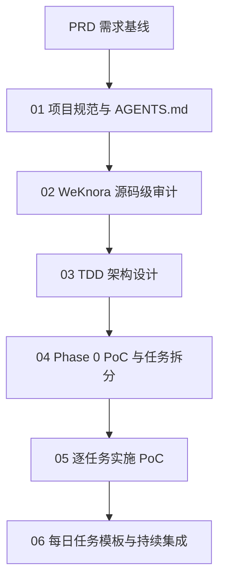
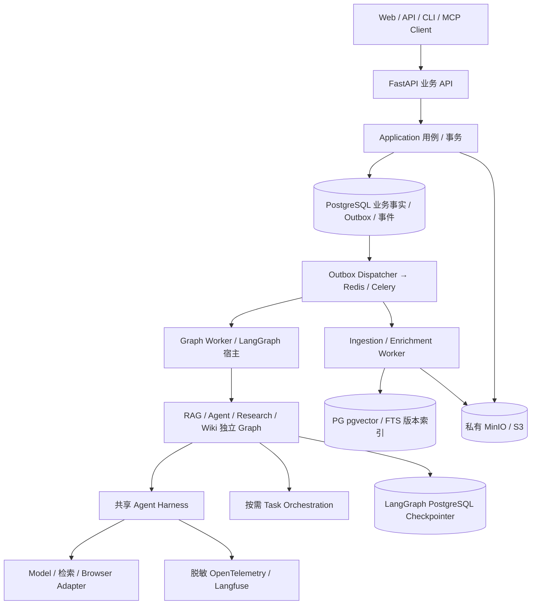
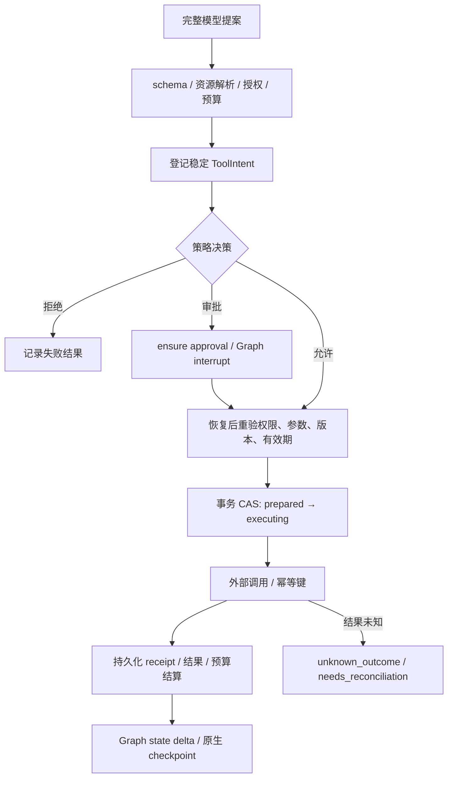
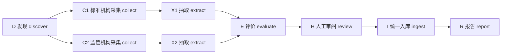
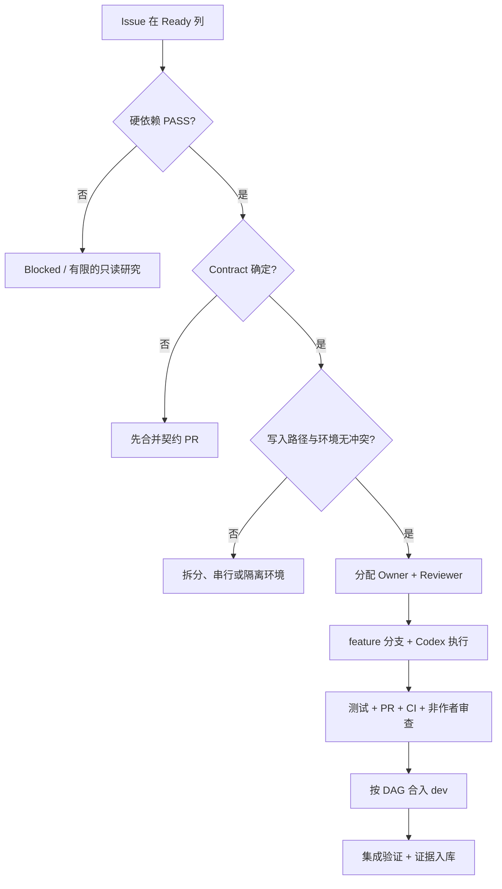
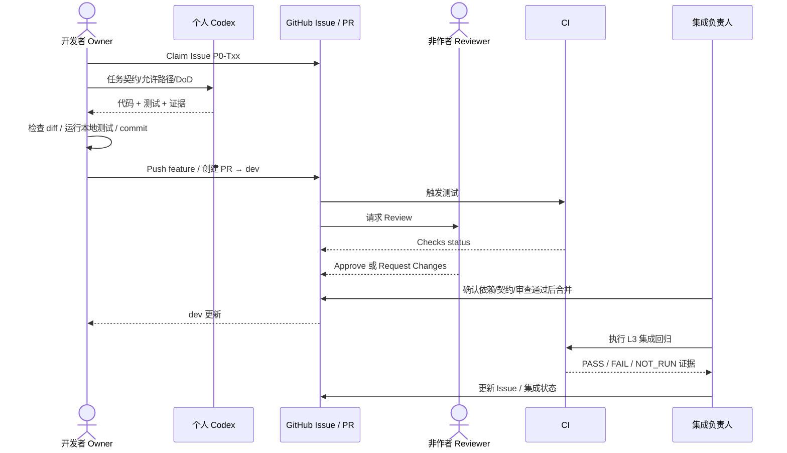
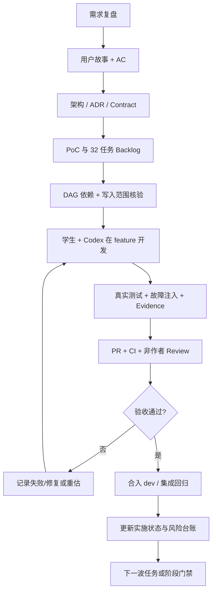

# PyKnora Vibe Coding 实战教材

> 企业智能知识库 · Python + FastAPI + LangGraph 重构项目
>
> 教材版本：v2.1（术语教学增强版，继承 v2.0 全文） ｜ 基准日期：2026-10-27 ｜ 适用：AI 智能体开发课程（vibe coding 教学模式）
>
> 素材来源：本项目 `docs/` 下的 PRD、开发指南、源码审计、TDD、ADR、PoC 规划与实施状态文档。
> 阅读须知：本文档中所有"已定义/提议/未验证"的表述严格沿用项目文档原状态；学习时务必区分**设计目标**与**已验证事实**，这正是本项目最核心的职业习惯。

---

## 目录

1. [课程导论：这门课怎么上](#1-课程导论这门课怎么上)
2. [一、项目开发流程：Vibe Coding 六阶段](#2-一项目开发流程vibe-coding-六阶段)
3. [二、需求复盘：从参考项目到自有 PRD](#3-二需求复盘从参考项目到自有-prd)
4. [三、用户故事：角色、场景与验收](#4-三用户故事角色场景与验收)
5. [四、架构：分层、状态与决策](#5-四架构分层状态与决策)
6. [五、Agent Harness：智能体的"操作系统"](#6-五agent-harness智能体的操作系统)
7. [六、任务分解：业务 DAG 与工程 Backlog](#7-六任务分解业务-dag-与工程-backlog)
8. [七、实战演练与课后作业](#8-七实战演练与课后作业)
9. [八、多人 Codex + Git 工程协作](#9-八多人-codex--git-工程协作)
10. [九、课堂项目制教学与考核](#10-九课堂项目制教学与考核)
11. [十、教师操作手册与教学案例](#11-十教师操作手册与教学案例)
12. [附录](#12-附录)
13. [术语学习导航：先掌握什么](#术语学习导航先掌握什么)

---

## 1. 课程导论：这门课怎么上

**本章术语导读**：**AI Agent（智能体）**是能根据目标选择步骤、调用工具并利用执行结果继续行动的系统；**LLM（大语言模型）**负责语言理解与生成，但不能代替权限校验或真实测试；**Prompt（提示词）**是发给模型的任务和约束说明；**Vibe Coding** 强调用自然语言驱动编码，同时由人审查结果。**Codex** 是本文所用的 AI 编程助手，而不是项目运行时的 Agent。


### 1.1 什么是 Vibe Coding

Vibe Coding 指**用自然语言驱动 AI 智能体（Agent）完成软件工程的创作方式**：人负责提出目标、判断方向、评审结果；智能体负责检索资料、设计方案、写代码、跑测试、写文档。它不是"把需求丢给 AI 就撒手"，而是**人机分工、逐轮闭环、证据驱动**的协作开发。

本项目（PyKnora）就是一套标准的 vibe coding 工程样板：所有开发过程由"提示词（Prompt）+ 文档产物 + 验证证据"驱动，仓库里的每一份文档都是人与智能体协作的产物。

### 1.2 项目是什么

| 项 | 内容 |
| --- | --- |
| 项目代号 | PyKnora |
| 定位 | 以 Python + FastAPI + LangGraph 重构企业知识管理、智能问答、Agent、Wiki 及专业知识自动采集平台 |
| 参考项目 | 腾讯开源 [WeKnora](https://github.com/Tencent/WeKnora)（Go + Vue3 + Python docreader） |
| 核心亮点 | RAG 可引用问答、LangGraph 有状态 Agent、Research Agent 信息采集、Wiki 知识整理 |
| 当前进度 | Phase 0 起步：32 项任务中仅 P0-T01（契约闭合，纯文档）完成，其余 31 项与 9 项 PoC 均 NOT_STARTED |

> **教学点**：这是原稿记录的 Phase 0 起步快照（不是实时状态），适合学习需求到架构再到任务拆分的过程。你可以在不破坏真实系统的前提下，把从需求到架构再到任务拆分的全过程走一遍。

### 1.3 学习目标

完成本课程后，你应该能够：

1. 讲出企业级 AI 项目的**完整开发流程**（PRD → 规范 → 审计 → TDD → PoC → 实施 → 验收）。
2. 对一份 PRD 做**需求复盘**：目标、非目标、范围切分、风险与开放问题。
3. 把需求写成**用户故事**，并映射到可验收用例。
4. 看懂**分层架构**，说清 FastAPI / LangGraph / Agent Harness / Task Orchestration / Celery 各自的职责边界。
5. 理解 **Agent Harness** 的核心组件与工具调用安全模型。
6. 把大任务**分解**成有依赖、可并行的任务 DAG，并识别关键路径。

---

## 2. 一、项目开发流程：Vibe Coding 六阶段

**本章术语导读**：**PRD（Product Requirements Document）**回答“为什么做、给谁用、要做什么”；**TDD（Technical Design Document）**回答“技术上怎么实现”（不要与 **Test-Driven Development，测试驱动开发** 混淆）；**ADR（Architecture Decision Record）**记录架构决策、备选方案与理由；**PoC（Proof of Concept）**用最小实验验证技术假设；**DoD（Definition of Done）**定义交付完成必须满足的检查项；**Gate（门禁）**是进入下一阶段必须通过的验收条件。


> 依据：`Codex_PyKnora_Development_Guide.md`（开发指南 v1.0）

### 2.1 总流程

PyKnora 的开发顺序是一条**逐步降低不确定性**的流水线：



**为什么是这个顺序？** 每个阶段都在回答一个关键问题：

| 阶段 | 要回答的问题 | 交付物 |
| --- | --- | --- |
| 0 初始化与规范 | "我们按什么规则协作？" | `AGENTS.md`、文档目录、`IMPLEMENTATION_STATUS.md`、参考源码 SHA 基线 |
| 1 源码审计 | "参考项目到底是怎么实现的？" | `docs/research/01~03`：源码架构、Python 映射、兼容性风险 |
| 2 技术设计 | "新系统应该长什么样？边界在哪？" | `docs/tdd/01~08` 八份设计 + `docs/adr/0001~0005` 决策提议 |
| 3 PoC 规划 | "哪些假设必须先验证？怎么拆任务？" | `docs/poc/`：风险台账、九项 PoC、32 任务 Backlog、依赖 DAG、验收门槛 |
| 4 逐任务实施 | "这一小步做完了吗？有证据吗？" | 代码 + 测试 + 状态文件更新 |
| 5 持续迭代 | "下一个任务是什么？" | 单任务模板 + Backlog 状态 |

### 2.2 六个阶段详解

**阶段 0：初始化项目和开发规范（提示词 01）**

- 建立持久化上下文：PRD、`AGENTS.md`、ADR/TDD/PoC/状态文件目录。
- 固定参考源码基线：记录 commit SHA、分支、许可证（本项目为 `662abaf9...`，参考 WeKnora）。
- 完成闸门：`AGENTS.md` 与状态文件存在；参考仓库可追溯；无业务代码意外修改。

**阶段 1：WeKnora 源码级架构审计（提示词 02）**

- 只读研究，不修改参考源码。重点：Agent 引擎、BrowserSkill、docreader、知识入库、RAG 与 Chat。
- 结论必须引用**真实文件路径、函数与行号**，并标注证据等级：
  - A = 本地源码静态核验；D = 官方资料描述；N = 本项目设计提议；U = 待实测。
- 完成闸门：核心调用链有路径和函数；结论的证据等级明确。

**阶段 2：编写完整 TDD（提示词 03）**

- 八份设计文档（01 系统架构/02 Agent Harness/03 Task Orchestration/04 LangGraph/05 Browser/06 摄取/07 数据 API 安全/08 测试策略）+ 五份 ADR。
- 关键纪律：**防止 Harness、LangGraph、Celery 职责重叠**；状态拥有者唯一；接口契约足以创建测试。
- 完成闸门：Graph/业务任务/Worker 的状态拥有者与事务边界明确。

**阶段 3：Phase 0 PoC 计划与 Task Backlog（提示词 04）**

- 把高风险架构假设拆成可验证实验（九项 PoC），每个 PoC 再拆成工程任务。
- 每个任务必须写：目标、依赖、步骤、测试、量化验收、复杂度、风险、DoD（完成定义）。
- 画任务依赖 DAG，标记可并行项与阻塞项。
- 完成闸门：每个 PoC 有可执行实验与退出条件；依赖 DAG 无环。

**阶段 4：正式实施 Phase 0（提示词 05）**

- 一次只做一个当前无阻塞的任务（或紧密任务组），**不提前创建庞大通用框架**。
- 按顺序：先读规范/PRD/TDD/Backlog；检查 Git 与未提交改动；实施最小必要修改；跑测试；更新状态文件。
- 完成闸门：有可复现的测试结果；失败测试与阻塞如实记录。

**阶段 5：日常单任务开发（提示词 06）**

- 用 `{TASK_ID}` 模板逐日推进；完成后输出：改动摘要、测试命令与真实结果、验收逐项核对、风险与后续建议。

### 2.3 贯穿全程的七条纪律（重点！）

1. **每轮交付"真实文件 + 验证结果"**：只把结论写进聊天 = 没交付。
2. **上下文存入仓库**：PRD、AGENTS、ADR、TDD、Backlog、状态文件共同决定下一轮约束，不依赖对话记忆。
3. **不重复实现底层框架**：LangGraph 已有 checkpoint/interrupt；Harness 只补企业业务缺口；Celery 只做可靠作业。
4. **模型输出不是事实**：源码调用链、测试成功、浏览器兼容性、性能指标必须实际检查；无法验证时明确记录。
5. **保护 Git 工作树**：不覆盖未提交内容；大型改造先建分支。
6. **安全和溯源从 P0 开始**：SSRF 防护、授权、来源可信度、采集许可、工具审批不能留到上线前。
7. **诚实标注状态**：NOT_STARTED / PARTIAL / FAIL / BLOCKED 如实记录；禁止把未验证假设说成已实现功能。

> **课堂讨论**：为什么"设计→实现"中间要强制插入一个"PoC 规划"阶段？直接开写会省时间吗？

---

## 3. 二、需求复盘：从参考项目到自有 PRD

**本章术语导读**：**Scope（范围）**说明本轮包含什么、不包含什么；**MVP（最小可行产品）**是具备核心可用价值的第一版，而非随意的 Demo；**P0/P1/P2** 是需求优先级，不等于 PoC 阶段编号；**Risk Register（风险台账）**记录风险、影响、责任人和缓解措施；**Acceptance Criteria（AC，验收条件）**规定怎样客观证明需求达标。


> 依据：`docs/PRD_PyKnora.md`（需求基线 v1.0，状态：供评审）

### 3.1 复盘框架

需求复盘 = 回答五个问题：**为什么做（动机）→ 做什么（目标/非目标）→ 做到什么程度（范围）→ 风险在哪 → 还悬而未决什么（开放问题）**。

### 3.2 动机复盘：为什么重构

| 动机 | 说明 |
| --- | --- |
| Python AI 生态 | 降低解析、NLP、模型/工具扩展成本 |
| LangGraph 状态控制 | 用状态、checkpoint、中断/恢复控制复杂 Agent |
| 明确职责拆分 | API / Workflow / Worker / 存储 / 集成 各管一段 |
| 知识生产与消费统一 | 上传、同步、采集（生产）与 RAG/Agent/Wiki（消费）接成统一平台 |
| 防幻觉与知识污染 | 用可观测、可评价、可回溯的流程降低错误知识传播 |

**复盘要点**：重构 ≠ 逐行翻译 Go。PRD 明确"保留产品能力和关键体验，不承诺原 API、数据表或全部外围集成的即刻兼容"。这个定位避免了"无限复刻"陷阱。

### 3.3 目标与非目标

**目标（G1–G5）**

- G1 私有化部署的知识库—解析—检索—可引用回答闭环
- G2 具备工具、状态持久化、审批与恢复的 LangGraph Agent 基座
- G3 主题驱动的信息采集并安全纳入统一知识流水线
- G4 检索质量与答案可证据性，建立数据集/回归评测
- G5 工作区隔离、敏感数据保护、运行追踪与成本度量

**非目标（首版明确不做）**

- 原 Go 后端全量接口兼容 / 现有数据库无损直读
- 一次性实现原版所有模型厂商、IM 频道、数据源和终端
- 未授权网站大规模爬取、绕过登录/验证码/付费墙
- 不经审核自动发布不确定/重复/禁止使用的内容
- 默认开启任意 Shell / 浏览器高风险写操作

> **教学点**："非目标"与"目标"同等重要。它是范围控制的护栏，也是后期撕需求的依据。

### 3.4 范围复盘：P0 / P1 / P2 怎么切

| 版本 | 含义 | 覆盖（F 编号） | 一句话 |
| --- | --- | --- | --- |
| P0 MVP | 安全可靠的知识库与 RAG 闭环 | F-01~08、F-16 | 能传文档、能检索、能带引用回答；单 URL 受控导入 |
| P1 | Agent 与信息采集 | F-09~15 | Research Agent、双浏览器、MCP、Wiki、RBAC、审计 |
| P2 | 扩展能力 | F-17~19 | 图谱、多模态、Skills 沙箱、长期记忆、多渠道、K8s |

**里程碑**：Phase 0 架构验证 → Phase 1 P0 MVP → Phase 2 P1 Agent & Research → Phase 3 P1 企业知识整理（Wiki）→ Phase 4 P2 扩展。每个阶段进入下一阶段的条件：功能回归、安全验收、文档全部通过。

**范围切分练习**：为什么"Wiki"从 P0 挪到 P1（PRD F-14 状态有变更记录）？如果你是产品负责人，你的依据是什么？

### 3.5 风险台账（摘录）

| 风险 | 严重度 | 缓解思路 |
| --- | --- | --- |
| 功能范围膨胀，复制全量 WeKnora | 高 | 坚持 P0/P1/P2 与验收关卡 |
| AI 采集违反网站限制或版权 | 高 | 合规策略、白名单、人工审阅 |
| 浏览器越权与 SSRF | 高 | 沙箱、每跳校验、动作审批 |
| Agent 被网页注入误导 | 高 | 工具输出隔离、系统规则固定、敏感工具最小权限 |
| 不可靠网页污染知识库 | 高 | 信源评分、证据绑定、版本化、审阅门槛 |
| LangGraph checkpoint 与业务状态错配 | 中高 | 幂等 event/job ID、事务边界、故障注入 |

### 3.6 开放问题（仍悬而未决的 12 项，摘 5 项）

1. 100% 自研后端，还是复用 Python docreader 与 Vue3 前端？
2. 是否需要迁移现有 WeKnora 数据或兼容原 API？
3. 首发用户群是个人本地部署还是企业团队？
4. 首批合法可采集站点名单是什么？
5. BrowserSkill 是否为首批必需能力，还是先 Playwright？

> **教学点**：一份"诚实"的 PRD 会把自己的开放问题写出来。学生应学会：**未决策 ≠ 已决策**，不要在文档里"假装定好了"。

---

## 4. 三、用户故事：角色、场景与验收

**本章术语导读**：**User Story（用户故事）**通常写成“作为某角色，我希望做某事，以便获得价值”；**RBAC（基于角色的访问控制）**通过角色授予权限；**Principal（安全主体）**是被授权的人或服务身份；**Workspace（工作区）**是 PyKnora 的组织与数据隔离边界；**SSRF（服务端请求伪造）**指诱使服务器访问不该访问的网络地址。


> 依据：PRD §3 目标用户及权限角色、§4 核心场景与用户故事、§16 验收用例

### 4.1 角色与权限矩阵

| 角色 | 目标 | 权限示例 |
| --- | --- | --- |
| 个人用户 | 整理文件与网页，检索问答 | 自有知识库 CRUD、运行自身任务 |
| 企业成员（Viewer） | 安全查询团队知识 | 授权范围内查询/引用 |
| 内容贡献者（Contributor） | 上传、编辑、审核采集资料 | 资料写入、待审提交 |
| 工作区管理员（Admin） | 管理成员与数据源 | 工作区配置、采集策略、审计 |
| 工作区所有者（Owner） | 全局配置与治理 | 生命周期、账单、权限策略 |
| Agent 开发者 | 配置工具和工作流 | 按授予权限创建工具与流程 |
| 平台运维 | 监控与故障处理 | 脱敏观测、任务重试，不默认越权读取内容 |

**权限原则**：P0 先实现工作区隔离和最小授权；任何检索、采集、原文查看、工具调用都必须校验有效 Principal / 作用域。**不信任客户端提交的作用域**。

### 4.2 五个核心场景的用户故事

| 场景 | 故事（作为…希望…以便…） | 关键链路 |
| --- | --- | --- |
| **A 企业知识问答** | 作为员工，我选择一个或多个获授权知识库提问，希望得到引用到原文具体段落的回答；无充分证据时系统明确提示 | 选择范围→提问→混合检索→Rerank→证据充分性判断→流式回答→点击引用看原文 |
| **B 多步骤知识分析** | 作为分析师，我提出跨文档问题，让 Agent 分解任务、逐步检索与读取、归纳结论，并展示关键工具活动 | Agent 多步推理 + 工具调用 + 可观察 |
| **C 自动知识整理（Wiki）** | 作为知识管理员，我要求系统从已有资料生成主题 Wiki，能查看引用、审核发布和对比版本 | 主题提取→页面生成→引用核验→人工审核→发布→版本 |
| **D 工具执行** | 作为业务用户，我授权 Agent 查询知识库及调用指定 MCP/业务 API，敏感操作必须先审批 | 授权→调用→敏感操作审批→执行→记录 |
| **E Agent 信息采集** | 作为用户/管理员，我发起主题研究或站点采集，系统规划、采集、评估、去重、审核后入库 | 见 E1–E5 分解 |

### 4.3 场景 E 的五个子故事（本项目特色）

- **E1 主题研究**：输入"收集某行业过去一年的法规和技术标准变化"，限定地域/时间/可信来源，系统规划搜索、采集网页与公开文件、抽取事实、呈现候选清单与原文链接，审核后入库。
- **E2 指定网站采集**：提供允许访问的官网栏目，设置抓取深度/页数/频率；提取标题、作者、发布日期、正文、URL 与哈希，跳过重复并完成索引。
- **E3 动态网页阅读**：需要 JS 渲染时用受限 Playwright 读取；用户浏览器中的授权页面可通过 BrowserSkill 人工协同，**不得绕过访问控制**。
- **E4 定期更新**：管理员设置周期任务，比对来源变更，生成新增/变更/删除候选，批准后更新知识，不静默覆盖人工内容。
- **E5 失败与回溯**：采集失败或可信度不足时，标注失败原因与来源质量、可重试步骤，不把未验证内容写成已发布事实。

**场景边界（合规红线）**：仅采集有权访问的内容；遵守 robots.txt、条款、版权/许可和隐私要求；域名白名单与速率限制；登录、验证码由用户介入或停止，**绝不自动绕过**。

### 4.4 从用户故事到验收用例

用户故事 → 验收用例（AC）的映射是 vibe coding 的关键能力：

| 验收用例 | 验证什么 | 对应场景 |
| --- | --- | --- |
| AC-01 | 建库、传五类文档、任务状态可查 | A + F-03/04 |
| AC-02 | 三种检索都带权限过滤；跨工作区探测 100% 拒绝 | A |
| AC-03 | 流式回答 + 引用跳转 + 无证据明确提示 | A |
| AC-04 | URL 单次导入保留来源/快照，重复提交不制造重复索引 | E2 |
| AC-05 | 重试/重解析不会让旧索引覆盖新版本 | A/E |
| AC-06 | 禁止域名/内网/文件越权/凭据泄漏测试集全通过 | 安全 |
| AC-E01~E10 | 计划生成、多源采集、可信去重、证据关联、审核、端到端、定期更新、风险控制、可恢复、审计 | 场景 E |

> **课堂练习**：把 AC-E04"每条关键结构化事实至少绑定 1 个可复现来源证据定位"翻译成一句用户能听懂的话。再反过来说：为什么"无证据候选"必须进入人工审核而不是直接拒绝？

---

## 5. 四、架构：分层、状态与决策

**本章术语导读**：**FastAPI** 是 Python Web API 框架；**LangGraph** 是用节点与状态边编排有状态 Agent 流程的框架；**Celery** 是执行异步后台作业的任务队列框架；**Redis** 可提供队列/缓存等基础能力；**PostgreSQL/pgvector** 分别是关系数据库及向量扩展；**S3/MinIO** 是对象存储接口/实现；**Outbox** 解决业务事务已提交但任务通知未可靠送达的问题；**CAS（Compare-And-Swap，比较并交换）**通过条件更新避免并发竞态。


> 依据：PRD §7 总体架构、`docs/tdd/01_System_Architecture.md`、`docs/tdd/07_Data_API_Security.md`、ADR-0001~0005

### 5.1 一句话架构

**FastAPI 管业务，LangGraph 管有状态推理，Agent Harness 管能力，Task Orchestration 按需管 DAG，Celery/Redis 管可靠作业，PostgreSQL/pgvector 管业务与向量，MinIO 管对象存储。**



### 5.2 五层职责边界（最容易考也最容易混）

| 层 | 职责 | 红线 |
| --- | --- | --- |
| FastAPI / Application | 认证、授权、短事务、业务 API、SSE 读取 | 不在请求生命周期运行长 Graph |
| LangGraph 四图 | 状态化工作流：分支、循环、checkpoint、interrupt | 不直接写业务状态；不重复实现 Harness 能力 |
| Agent Harness | 模型、上下文、工具、策略、审批、预算、观测 | 不反向依赖 graphs；不另写 think/act 循环 |
| Task Orchestration | Planner、Task DAG、调度、评价、重规划 | 普通 RAG 不强制经过 Planner；不导入 Celery |
| Celery / Worker | 可靠唤醒、固定后台作业（解析、入库） | 不维护第二套 Agent 推理状态机 |

### 5.3 包划分与依赖方向（TDD 01 §3）

```
pyknora/
├── domain/ contracts/    纯业务规则与 DTO，不依赖框架
├── application/          授权后的用例、事务、Outbox、Run 服务
├── api/v1/               REST/SSE，身份→可信 Scope
├── graphs/               四套 Graph、State、节点组合
├── harness/              模型/上下文/工具/策略/预算（禁止反向导入 graphs）
├── orchestration/        DAG 校验/调度/评价/重规划
├── ingestion/ retrieval/ citations/
├── adapters/             PG/S3/DocReader/Provider/Browser/checkpoint/观测
└── workers/ bootstrap/   Celery 入口、依赖注入（唯一装配层）
```

### 5.4 稳定 ID 体系（契约的基石）

| ID | 含义与规则 |
| --- | --- |
| `workspace_id` / `principal_id` | 隔离边界 / 空间内主体（人、服务） |
| `run_id` ↔ `thread_id` | **1:1**；一次用户执行一个 run；重试/恢复不换 ID |
| `task_id` + `task_graph_revision` | run 内逻辑 DAG 节点；重规划时 revision 递增 |
| `job_id` / `attempt_id` | 逻辑作业 / 领取尝试；Celery task_id 只作 transport_id |
| `tool_call_id` | 一次已规范化的工具意图，恢复复用 |
| `approval_id` | 单次绑定审批，过期/参数变更后新建 |
| `document_id` / `document_version_id` | 逻辑文档 / 不可变版本快照 |
| `index_version` | 每个 document 唯一，防旧 attempt 覆盖新版本 |
| `idempotency_key` | 同 workspace+principal+操作 唯一，绑定请求哈希 |

> **教学点**：ID 不是权限凭证。所有业务行必须带 `workspace_id`；所有访问在后端校验 Principal、工作区和资源权限。**不要信任客户端提交的作用域。**

### 5.5 状态拥有者矩阵（每个状态只有一个逻辑写入者）

| 状态域 | 唯一写入组件 |
| --- | --- |
| Run（queued/running/waiting_approval/...） | RunService |
| Graph 节点/pending writes/interrupt | LangGraph（原生 checkpointer） |
| TaskNode（pending/ready/running/...） | OrchestrationService |
| Job（pending/running/retry_wait/...） | JobService |
| Approval | ApprovalManager |
| ToolCall | ToolExecutor |
| BrowserSession | BrowserSessionService |
| SourceVersion | SourceService |
| 摄取 / 索引 / 富化 | IngestionService / IndexPublicationService / EnrichmentService |

**为什么重要？** 两个组件同时写同一个状态 = 竞态与恢复混乱。这是本项目所有事务边界设计的出发点。

### 5.6 架构决策（ADR，全部为"提议"状态）

| ADR | 主题 | 决策方向 |
| --- | --- | --- |
| ADR-0001 | 运行时职责与状态边界 | Graph 管执行、Harness 管能力、DAG 按需、Celery 管唤醒 |
| ADR-0002 | Outbox 与索引版本发布 | PG Outbox + 租约；不可变版本 + 原子索引激活 |
| ADR-0003 | 审批与副作用 | 审批绑定 + 工具调用账本 + 原生 interrupt；未知结果需核查 |
| ADR-0004 | 解析与浏览器复用 | DocReader 服务复用 + TXT/MD 简单适配；Browser 双后端 |
| ADR-0005 | 工作区、事件与隐私 | workspace 复合约束、引用再授权、持久化事件、空间内 principal |

> **教学点**：ADR 是"带理由的决策"。学生应学会区分：**提议（Proposed）→ 验证（PoC）→ 已接受（Accepted）**。本项目目前 5 条 ADR 全部是提议——这就是诚实的工程状态。

---

## 6. 五、Agent Harness：智能体的"操作系统"

**本章术语导读**：**Agent Harness** 是对工具、模型、上下文、安全策略、预算和观测的共享运行能力封装；**Tool Registry** 管理可调用工具及其接口版本；**Graph State** 是图运行时的状态数据；**Checkpoint/Checkpointer** 是执行状态的保存点/保存机制；**Interrupt** 是在流程中主动暂停等待外部输入；**HITL（Human-in-the-loop）** 表示人参与审批或接管；**Token Budget** 限制模型上下文或费用使用；**Prompt Injection** 是恶意内容试图影响模型行为的攻击。


> 依据：`docs/tdd/02_Agent_Harness.md`

### 6.1 为什么要一个 Harness

四套 Graph（RAG / Agent / Research / Wiki）都需要**模型调用、上下文管理、工具执行、安全审批、预算控制、观测**。如果每套 Graph 自己实现一份，就会出现重复代码和互相不一致的安全策略。

Harness = 给四套 Graph 提供**最小共享能力**的门面（Facade）。关键红线：

- **不**另写 think/act 循环（LangGraph 负责控制流）；
- **不**自建快照引擎（checkpoint 用 LangGraph 原生 Postgres Checkpointer）；
- **不**实现第二套审批中断（用 LangGraph 原生 interrupt）。

### 6.2 十大组件速记表

| 组件 | 职责 | 一句话记忆 |
| --- | --- | --- |
| `AgentRuntime` | 门面：model_step / prepare_calls / execute_batch | 节点唯一入口 |
| `ModelGateway` | 模型流式调用、usage 计量 | 凭据只在这里出现 |
| `ContextManager` | 上下文窗口、压缩、保留引用 | 工具对不可拆散 |
| `ToolRegistry` | 工具注册、版本、schema 校验 | name+version 唯一 |
| `PolicyEngine` | allow / deny / require_approval | 每意图一决策 |
| `ToolExecutor` | 执行工具、写调用账本 | 结果有四种状态 |
| `ApprovalManager` | 审批创建、绑定、消费 | 绑定完整意图 |
| `BudgetManager` | 预留 / 结算 / 释放 | 父子 run 一次归集 |
| `CheckpointManager` | 装配原生 checkpointer、生命周期 | 不保存第二份 State |
| `Observability` | 脱敏 span、trace、审计 | trace 不是计费库 |

### 6.3 工具调用生命周期（必考）

```
resolve → validate → policy → reserve → prepare → execute → persist → settle → cleanup
```

- `resolve`：按 name+version 查注册表，拒绝重名/版本漂移。
- `validate`：对参数做 schema 校验，规范化后计算 `arguments_hash`。
- `policy`：策略引擎判定 allow / deny / require_approval。
- `reserve`：预算预留（事务内，任何维度不足 → `BUDGET_EXCEEDED`，不发调用）。
- `prepare`：事务 CAS：`prepared → executing`，登记 `tool_call_id` 与外部幂等键。
- `execute`：事务外调用外部系统。
- `persist`：保存 receipt / 结果 / 预算结算。
- `settle`：结算实际用量，`reservation_id` 唯一防重复。
- `cleanup`：清理临时资源；失败记录可重试清理作业，不覆盖已成功结果。

### 6.4 副作用屏障（并行与安全）

- **只读工具可并行**（建议最大并发 4）。
- **写 / sensitive_read / 未知 MCP 工具构成屏障**：先 join 前面的只读组，单独执行，再放行后一组。
- **共享浏览器会话总是串行**。
- 结果按模型调用原顺序回填；依赖前一工具输出的调用必须等下一模型步生成，**不能同批猜值**。



### 6.5 审批与崩溃恢复（安全的灵魂）

- 审批行绑定：workspace、requester、approver、run_id、tool_call_id、参数哈希、scope 哈希、资源引用、策略快照、有效期。
- **approval_wait 节点只 `interrupt({approval_id})`**；用户决定通过 API 授权；API 不直接执行工具。
- 执行前**重新检查**：审批者当前权限（是否撤权）、资源状态、工具/schema/policy 版本、有效期。参数/范围变化 → `APPROVAL_MISMATCH`，原批准 revoked。
- 崩溃窗口处理：`executing` 租约过期 → CAS `unknown_outcome`，Run 进入 `needs_reconciliation`。能查询外部则只读核查；能去重则在保证窗口内经策略批准重提；两者皆无 → 人工核查，**禁止自动再次写**。
- 黄金法则：**无法证明未发送 = 按未知窗口处理**；未知写零自动重放。

### 6.6 秘密与可观测

- 凭据只存 vault，执行时由连接器注入；**禁止进入 arguments / Graph State / 模型上下文 / 日志 / trace**。
- 外部网页正文用 data envelope 标注"不可信输入"来源，**不拼进 system 指令**（防提示注入）。
- 观测 span 只记稳定 ID、安全状态、用量、错误码；trace 默认关闭内容；敏感写审计失败必须 fail closed。

---

## 7. 六、任务分解：业务 DAG 与工程 Backlog

**本章术语导读**：**DAG（有向无环图）**是节点之间存在先后依赖、但不存在循环的任务图；**Planner** 负责拆解目标；**Scheduler** 决定哪些任务现在可执行；**Evaluator** 评价结果是否达标；**Replanner** 根据不足修订计划；**Backlog** 是尚待执行的工程任务清单；**Critical Path（关键路径）**是受依赖约束影响总完成时间的一条最长链，不等同于最重要的任务。


> 依据：`docs/tdd/03_Task_Orchestration.md`、`docs/poc/03_Phase0_Task_Backlog.md`、`docs/poc/04_Phase0_Dependency_DAG.md`

### 7.1 两层任务分解（重要概念区分！）

| 层 | 是什么 | 谁在用 | 例子 |
| --- | --- | --- | --- |
| 业务 Task DAG | 一次研究任务的运行时分解（run 内） | Research Graph + OrchestrationService | 发现→采集→抽取→评价→审核→入库 |
| 工程 Task Backlog | 开发阶段的实施任务清单（P0-Txx） | 开发智能体逐轮执行 | P0-T05 原生 Checkpoint 单写者验证 |

**两者完全不同**：`task_id`（产品 UUID，run 内 DAG 节点）≠ `P0-Txx`（规划任务 ID）。学生最容易混，考试必考。

### 7.2 业务 Task DAG 组件

```
TaskPlanner → 生成 TaskGraph（节点+依赖）
TaskGraph   → nodes[]（kind: discover/collect/extract/evaluate/review/ingest/report）
DependencyScheduler → claim_ready（仅依赖全部 succeeded 的节点可 ready）
TaskExecutor → Graph 子流程 或 固定 Celery Job
ResultEvaluator → 覆盖/证据/冲突评价
Replanner → CAS 新 revision（有限重规划，最多 2 次）
```

**研究 DAG 九节点示例**（行业标准变化研究）：



**重规划示例**：若评价发现缺"标准生效日期"→ 生成 revision 2，新增 C3/X3 节点；已完成且可复用的节点保留 task_id 与产物引用；旧 revision 未运行节点标记 superseded。

### 7.3 工程 Backlog：32 任务怎么来

九项 PoC（LangGraph RAG、Harness、Task Decomposition、Research Agent、Browser Adapter、异步入库、DAG、候选审核、检索基线）→ 拆成 32 个单会话任务（P0-T01~T32），72 条依赖边，总计 66 复杂度点。

**任务粒度原则**：

- 每任务一个逻辑状态负责人；一会话一个可复验产物。
- 复杂度 1~3 点：1=窄范围资料/纯逻辑；2=一类组件或一个集成窗口；3=多进程/外部真服务。
- 开工发现 >3 点 → 拆为子任务并同步 DAG，**不把多天工作塞进一个会话**。
- 每个任务必须有：目标、依赖、输入、文件、步骤、测试、量化验收、注入（故障注入场景）、DoD。

### 7.4 依赖与执行波次（W0–W11）

```mermaid
flowchart LR
    subgraph W0["W0"]
        T01["T01 契约闭合"]
    end
    subgraph W1["W1"]
        T02["T02 环境"]; T09["T09 解析预检"]; T14["T14 BSK预检"]
    end
    subgraph W2["W2"]
        T03["T03 Scope/PG"]; T04["T04 控制站"]
    end
    subgraph W3["W3"]
        T05["T05 单writer"]; T07["T07 Outbox"]; T10["T10 真RPC"]; T15["T15 Browser port"]; T19["T19 Gateway"]
    end
    subgraph W4["W4"]
        T06["T06 审批/副作用"]; T08["T08 消费/对账"]; T11["T11 五格式/定位"]; T16["T16 Playwright"]; T20["T20 Context/预算"]; T22["T22 Planner/schema"]
    end
    subgraph W5["W5"]
        T12["T12 staging"]; T17["T17 真BSK配对"]; T21["T21 Harness集成"]; T23["T23 调度/对账"]
    end
    subgraph W6["W6"]
        T13["T13 原子发布"]; T18["T18 BSK恢复"]; T24["T24 评价/重规划"]
    end
    subgraph W7["W7"]
        T25["T25 检索"]; T27["T27 质量/审阅"]; T30["T30 恢复/升级"]
    end
    subgraph W8["W8"]
        T26["T26 RAG/SSE"]
    end
    subgraph W9["W9"]
        T28["T28 Research全链"]; T29["T29 P0安全"]
    end
    subgraph W10["W10"]
        T31["T31 P0核心门禁"]
    end
    subgraph W11["W11"]
        T32["T32 全量门禁"]
    end
    W0 --> W1 --> W2 --> W3 --> W4 --> W5 --> W6 --> W7 --> W8 --> W9 --> W10 --> W11
```



**关键路径（只算集成压力，不是工期）**：

- 解析线：T01→T02→T04→T10→T11→T12→T13→T25→T26→T29→T31 = **23 点**
- 可靠作业线：T01→T02→T03→T07→T08→T12→...→T31 = **23 点**（两条并列，在 T12 收敛）
- 全量加 T32 = 24 点；BrowserSkill 设备/协议若被阻塞会成为**日历**关键路径（T14/T17/T18→T28→T32）。

**并行分工建议**：核心恢复线 T05/T06；可靠作业线 T07/T08；解析线 T09/T10/T11；浏览器线 T14~T18；模型/预算/DAG 线 T19~T24。

### 7.5 任务分解的纪律

1. **前置只有 PARTIAL 时**：后续只能做不依赖失败假设的限域实验并标明；不能标该硬依赖满足。
2. **不能删除失败依赖**让图"通过"——那是在伪造计划。
3. **PARTIAL ≠ PASS**：如 T05 仅单活成立，只测单活条件下的 T06，多实例恢复门禁仍未过。
4. **每任务只更新自己的状态**：不因一个任务完成就宣称整个 PoC 通过。

---

## 8. 七、实战演练与课后作业

### 练习 1：PRD 精读与需求复盘（个人）

读 `docs/PRD_PyKnora.md`，用一张表回答：动机 / 目标 / 非目标 / P0 范围 / 三大风险 / 三个开放问题。再回答：**为什么 F-07"URL 入库"是 P0，而 F-10"Research Agent"是 P1？**

### 练习 2：用户故事改写（个人/小组）

把场景 E1 改写成 3 条"作为…我希望…以便…"用户故事，并为其中一条写出 2 个可测试的验收条件（参考 AC-E01、AC-E04 的写法）。

### 练习 3：画架构图（小组）

不看 TDD 01，用 Mermaid 画出 PyKnora 的五层架构（API / Application / Graph / Harness / Worker+存储），并标注每层**唯一禁止做的事**（如：FastAPI 不跑长 Graph）。完成后与 TDD 01 §2 对比，找出差异并讨论谁对谁错。

### 练习 4：Agent Harness 场景推演（小组）

场景：Agent 请求调用一个"写"工具（如向外部系统提交表单）。
按 02 文档推演：策略决策 → 审批 → 重验 → CAS → 执行 → 结算 的全过程，画出时序图，并回答：**执行成功后、receipt 落库前进程崩溃，会发生什么？系统如何处理？**

### 练习 5：任务分解实战（小组）

从 Backlog 中选 P0-T06（审批绑定、调用账本与未知写核查），把它进一步拆成 3~5 个子步骤，并为每个子步骤写：目标、输入、输出、验证方法、故障注入点。对照原任务看你的拆分是否与它"一会话一产物"的粒度一致。

### 练习 6：Vibe Coding 模拟（小组，核心作业）

用开发指南的"提示词 06 模板"，选定一个纯文档任务（如为 Backlog 中某任务写一页执行手册），模拟一次完整协作：

1. 写提示词（含任务 ID、验收条件、输出要求）；
2. 用 AI 生成产物；
3. **逐项核对验收条件**，指出 AI 输出中"看起来对但没验证"的地方；
4. 更新一份状态文件，如实记录 NOT_RUN / PARTIAL。

> 评分标准：产物存在 ✓、验收逐项核对 ✓、验证证据真实 ✓、状态记录诚实 ✓。

---

## 9. 八、多人 Codex + Git 工程协作

**本章术语导读**：**Git** 保存代码版本历史；**Commit** 是一次版本快照；**Branch** 是独立的开发指针；**Worktree** 在同一 Git 仓库下为不同分支建立独立工作目录；**PR（Pull Request）**是发起审查和合并的变更提案；**CI（持续集成）**在提交/PR 后自动执行检查；**CODEOWNERS** 指定目录或文件的默认评审责任人；**Rebase** 将提交重放到新的基线上，须谨慎对待已共享分支。


> **新增教学单元（v2.0）**。此节是根据当前团队并行开发讨论提出的**推荐协作方案**，不是上传教材中已完成的项目事实。原教材记载的 Phase 0 状态、九项 PoC、32 项 Backlog、依赖波次保持不变。教师开课前须重新读取仓库 `IMPLEMENTATION_STATUS.md` 校对实际进度。

### 9.1 学习目标与核心问题

学生完成本节应能：区分多 Codex 会话与多人员协作；使用 GitHub Issue→feature 分支→PR→Review→CI→合并构成闭环；依据 DAG 和代码所有权决定能否并行；发现并处理共享契约、数据库迁移、锁文件和运行环境冲突；提交可核验的实验结果。

**核心口诀：一任务一 Owner；一分支一可验收变更；所有共享契约先审后改；合并顺序服从依赖。** Codex 负责辅助实现，人负责评估安全、正确性、授权和合并。

### 9.2 多人协作与单人多会话的区别

| 维度 | 单人多 Codex | 多人各自使用 Codex |
|---|---|---|
| 仓库工作目录 | 一个 Clone 下的不同 Worktree | 每人各自 Clone，必要时使用 Worktree |
| 任务归属 | 会话及任务 | 明确真人 Owner、Reviewer、模块负责人 |
| 变更集成 | 主控会话协调 | GitHub PR + 非作者 Review + CI |
| 权限与密钥 | 本地隔离 | 按人授权、最小权限、不得共享个人令牌 |
| 完成证明 | 本地日志 | PR、CI、证据、人工审核及阶段门禁 |

### 9.3 人员分工与边界

推荐教学班级采用 4–6 人小组；不足四人时允许一人兼任多角色，但不得同一人同时承担 PR 的唯一作者和唯一审核者。

| 角色 | 责任 | 可修改范围建议 |
|---|---|---|
| Tech Lead / 集成负责人 | ADR、任务 DAG、接口所有权、验收与冲突仲裁 | `/contracts/`、`docs/adr/` 的审批 |
| A 基础设施 | 隔离环境、依赖、PostgreSQL、Redis、Compose、CI | `experiments/phase0/infra/`、环境配置 |
| B Harness | Runtime、Checkpoint、工具策略、预算、任务编排 | `harness/`、`orchestration/` |
| C Knowledge | DocReader、解析、Chunk、检索与索引 | `ingestion/`、`retrieval/` |
| D Research | 浏览器适配、来源抽取、采集安全与审核 | `browser/`、`research/` |
| 交叉 Reviewer / QA | 正确性、测试可重复性、负面用例和安全 | 审查所有跨组变更 |

**这些路径只是授课组织建议**，不能覆盖 TDD 的实际依赖规则；创建时以仓库真实目录为准。各组并行的前置条件是接口已确定、DAG 依赖满足、写入路径不交叠、测试环境隔离。

### 9.4 GitHub 仓库、Issue 和状态真相源

建议 `main` 为验收基线，`dev` 为集成分支，`feature/P0-Txx-slug` 为任务分支，`fix/P0-Txx-slug` 为修复分支。实际 `dev` 创建前由项目负责人确认当前 Git 状态；不得在学生机器上无检查地重置、强推或丢弃未提交文件。

GitHub Issue 对应 Backlog 的**同一** `P0-Txx` 编号。Issue 模板如下：

```markdown
# [P0-Txx] 任务名称
- PoC / TDD / ADR：
- Owner（真人）：
- Reviewer（非作者）：
- 前置任务（Issue）：
- 当前状态：NOT_STARTED / READY / IN_PROGRESS / BLOCKED / REVIEW / MERGED / VERIFIED
- 允许写入路径：
- 依赖契约：
- 假设与风险：
- 实施步骤：
- 正向测试 / 失败注入：
- 验收标准（逐项可测）：
- 证据路径（日志、报告、commit SHA）：
- DoD：
```

*教学提示*：GitHub Projects 是团队协作看板，原仓库 `docs/poc/03_Phase0_Task_Backlog.md` 是规划基线；应建立明确同步规则，避免产生两个互相冲突的进度真相源。推荐以 Issue 为开发执行记录，以版本化 Backlog 为正式任务定义；变更 Task 依赖必须走评审 PR。

### 9.5 并行任务准入：四项检查

只有同时满足以下条件才能并行启动：**(1) 硬依赖已 PASS；(2) 共享契约已冻结或有可执行 Mock；(3) 不同时改同一共享文件；(4) 环境不会互相污染。** `PARTIAL` 不等于依赖满足；仅可开展范围受限的验证，明确未覆盖风险。



**沿用原教材的 W1 示例**：在确认 T01 实际已验收之后，T02（环境）、T09（解析预检）、T14（BrowserSkill 预检）属于同一波次的候选并行任务；但 T09/T14 可并行的只是它们自身前置条件允许的工作，**不能因为同属 W1 就假定都可使用尚未建立的真环境**。真正的依赖依据以 DAG 为准。

### 9.6 Git Clone / Branch / Worktree 实操

**模式一：每个学生独立 Clone（多人首选）**：

```bash
# 每位学生在自己的机器上运行；仓库地址由教师替换
# git clone <REPO_URL> pyknora
cd pyknora
git status
git fetch origin
git switch dev
git pull --ff-only origin dev
git switch -c feature/P0-Txx-short-description
```

**模式二：同一个学生执行两个无冲突任务（可选 Worktree）**：

```bash
# 在已确认 dev 存在、工作区干净的前提下
git worktree add -b feature/P0-Txx-harness ../pyknora-harness dev
git worktree list
# 在 ../pyknora-harness 单独启动 Codex / IDE
```

**注意**：Worktree 只隔离文件目录和工作分支，**不隔离** Docker 项目名、映射端口、Redis 队列、测试数据库、S3 Bucket、浏览器 Profile 或第三方模型配额。同学间不应复用测试账户的个人浏览器会话。

### 9.7 CODEOWNERS、PR 和分支保护

以下 `CODEOWNERS` 用户名为占位符；GitHub 要求 Owner 是具备权限的真实账号/团队。

```text
# .github/CODEOWNERS
*                                 @team-maintainer
/experiments/phase0/harness/      @harness-owner
/experiments/phase0/ingestion/    @knowledge-owner
/experiments/phase0/browser/      @research-owner
/experiments/phase0/contracts/    @team-maintainer
/docs/adr/                        @team-maintainer
```

`main` 与 `dev` 启用保护：禁止直接 Push、禁止 Force Push，要求 CI、非作者审批、必要时 CODEOWNERS 审批、Review 对话解决。教学中可降低审批人数，但不应取消对共享接口和安全变更的人工评审。

**PR 模板**：

```markdown
## 关联任务
Closes #<issue-number>；Task ID: P0-Txx
## 目标与非目标
## 修改文件（标注跨组文件）
## Contract / Migration / uv.lock 变化
## 测试与证据
- [ ] 单元测试：命令 / 实际结果
- [ ] 契约测试：命令 / 实际结果
- [ ] 故障注入：场景 / 实际结果或 NOT_RUN 理由
- [ ] 依赖核验：上游 Task ID / 状态
## 安全检查
- [ ] 无秘密入库
- [ ] 权限与输入校验
- [ ] 外部副作用有审批/幂等语义
## 未解决风险 / 回滚路径
## Reviewer / Owner
```

### 9.8 CI 三层门禁与失败处置

| 层 | 何时跑 | 内容 | 不通过如何处理 |
|---|---|---|---|
| L1 本地/PR | 每个任务 | `ruff`、类型检查、unit tests、敏感文件扫描 | 修复后重新提交 |
| L2 契约/模块 | PR 合并前 | BrowserAdapter、ToolResult、IngestionRequest、SSE/事件 schema、迁移 | 先更正 contract；必要时阻塞下游 |
| L3 跨模块 | 合并 dev 后/波次门禁 | Harness 恢复、Outbox、知识入库、Research 端到端与安全用例 | 不提升 PoC 为 PASS；开缺陷 Issue |

示例命令（须根据实际 `pyproject.toml` 与服务配置调整）：

```bash
uv run ruff check .
uv run ruff format --check .
uv run pytest -q tests/unit
uv run pytest -q tests/contracts
```

不准让 Codex 以伪造日志、Mock 成功结果或跳过实际集成测试来满足“绿色 CI”。外部 BrowserSkill/DocReader 真服务缺失时记录 `BLOCKED`/`NOT_RUN`，注明环境。

### 9.9 一次完整的多人提交—合并演示



**冲突处理练习**：A 与 B 同时修改 `uv.lock`；C 和 D 同时扩展 `GraphState`；两组各生成 Alembic heads。学生必须先判定文件 Owner，然后通过单一契约 PR、串行迁移与环境重建解决，不允许直接让 Codex“自动任选一版”。

### 9.10 Codex 主控与学生开发提示词（课堂可复制）

**提示词：Tech Lead（只规划，不编码）**

```text
你是 PyKnora Phase 0 的团队技术负责人。先读取 AGENTS.md、PRD、TDD、ADR、
docs/poc/03_Phase0_Task_Backlog.md、docs/poc/04_Phase0_Dependency_DAG.md
和 docs/IMPLEMENTATION_STATUS.md，并检查 git status/branch。
禁止凭教材里的历史状态推断当前进度；以仓库真实文件核对。
按现有 P0-Txx 编号生成任务分配矩阵，字段包括：Owner、Reviewer、硬依赖、
允许改动路径、共享接口、隔离环境、测试门禁、状态；挑出下一波真正 Ready 的任务。
发现共享契约修改或写入冲突时提出串行方案；不要启动编码、切换分支、
合并 PR 或修改既有任务状态。输出表格及 docs/poc/Team_Parallel_Plan.md。
```

**提示词：学生任务执行（一个 Issue 一次任务）**

```text
你是 PyKnora Phase 0 的开发助手；负责人是当前学生，不是你。
任务：P0-Txx；Issue：<链接>；角色：<A/B/C/D>；目标分支：<feature/...>。
先读 AGENTS.md、任务 Backlog、相关 TDD/ADR、依赖 DAG 和当前实现。
执行 git status，发现未提交修改或当前分支不匹配先报告，避免覆盖。
只修改该任务允许的文件，不自行改 contracts、uv.lock 或共享 DB migration。
按 DoD 完成最小实现，补正反例与故障注入测试，实际运行测试命令。
记录真实结果及不可执行原因，不编造 PASS；输出可审核 diff、Commit 建议、
PR 描述、证据路径、未解决风险。不得自行合并到 dev/main，也不执行下一任务。
```

**提示词：独立 Reviewer（只读审查）**

```text
请作为 PyKnora P0-Txx 的独立 Reviewer，仅审查当前 PR 相对 dev 的 diff，
对照对应 Issue、TDD、ADR、Contract、测试和实际日志。
重点检查：职责越界、接口兼容、数据一致性、权限/SSRF/注入、幂等与恢复、
测试是否足以支持验收。每项问题给出严重度、文件位置、复现步骤与建议。
不要自行编辑作者分支；不能从缺失证据推断测试通过。
输出 Approve / Request Changes / Blocked，并注明证据缺口。
```

### 9.11 多人流程的课程验收标准

每组至少完成一次无依赖冲突的 PR：Issue/Owner/Reviewer 完整；从 `dev` 创建功能分支；Codeowners 审批规则清楚；所有证据能定位到 commit；L1 真实通过；如 L2/L3 缺环境须诚实标为 NOT_RUN；PR 合并决策可追溯；无越权共享文件修改。

---

## 10. 九、课堂项目制教学与考核

**本章术语导读**：**Rubric（评分量规）**是明确评估维度与分值的表；**Evidence（证据）**是测试命令、环境、日志和 commit SHA 等可复核产物；**Fault Injection（故障注入）**是故意让进程/网络/服务失败，以验证恢复能力。


### 10.1 建议 12 次课 / 36 学时

以下是**新增授课建议**，不是项目已经执行的课时记录。每次课 3 学时，推荐“讲解 1 → 实操 1.5 → 复盘 0.5”。

| 课次 | 主题 | 课堂产物 | 验收关注点 |
|---|---|---|---|
| 1 | Vibe Coding 与参考项目审计 | 源码证据卡 / 项目术语表 | 来源与推断区分 |
| 2 | PRD 与目标/非目标 | 需求复盘表 | 边界与优先级 |
| 3 | 用户故事 A–E | 3 个故事与 AC | 可测试而非泛口号 |
| 4 | 总体架构、ADR 与状态单写者 | Mermaid 分层图 | 状态/事务/Graph 职责 |
| 5 | Harness 模型/工具/审批 | ToolCall 生命周期图 | 权限与未知写 |
| 6 | LangGraph Checkpoint、HITL | 故障注入用例 | 原生机制与业务账本 |
| 7 | 业务 Task DAG | Planner/调度/评价演示 | DAG 无环/预算/重规划 |
| 8 | 工程 Backlog 和关键路径 | 32 任务依赖分析 | READY 真实性 |
| 9 | 多人 Codex、Git、Issue/PR | 分支与任务矩阵 | 不同人职责隔离 |
| 10 | 并行编码工作坊 | 至少 2 个独立 feature PR | 契约与代码所有权 |
| 11 | CI、故障注入与集成 | CI 报告 / 失败记录 | 不伪造 PASS |
| 12 | Phase 0 答辩与工程复盘 | 演示、证据索引、下一阶段建议 | 风险闭环与持续迭代 |

### 10.2 学生分组任务

每小组需完成以下教学产物，允许选用独立教学分支或沙箱仓库以免影响真实开发：

- **需求包**：PRD 目标/非目标/范围表、2–3 条用户故事与 Gherkin 验收场景。
- **架构包**：Mermaid 组件图、业务状态所有权表、至少一项 ADR（Proposed）。
- **Harness 包**：只读工具与敏感写工具对比测试、审批/崩溃恢复时序图、预算断言。
- **任务包**：一个 5–9 节点的业务 DAG、一个 Task Backlog 映射和并行冲突分析。
- **协作包**：2 个 Issue、2 个 PR、至少一次非作者 Review、真实 CI 或明确 NOT_RUN 记录。
- **证据包**：提交 SHA、测试命令、结果原文、错误注入、局限性和简短复盘。

### 10.3 考核量规（总分 100）

| 项目 | 分值 | A 档标准 | 常见扣分 |
|---|---:|---|---|
| 需求理解与用户故事 | 15 | 目标/非目标清楚，AC 能自动或手动验证 | 只写功能口号 |
| 架构与职责边界 | 20 | FastAPI/Graph/Harness/DAG/Worker 状态边界准确 | 双重状态写者 |
| Harness 安全与恢复 | 15 | 审批绑定、幂等、未知写处理合理 | 自动重放未知写 |
| 两类 DAG 与并行计划 | 15 | 工程依赖真实、业务 DAG 有结束和预算 | 将业务任务与 P0-Txx 混淆 |
| Git/Codex 团队协作 | 20 | 独立 Owner/Reviewer、规范 PR、接口变更可追溯 | 直接写 dev、未做 Review |
| 测试证据与反思 | 15 | 真实命令/输出/sha，FAIL/BLOCKED 如实记录 | 宣称未运行测试通过 |

**硬性扣分/不通过条件**：提交真实凭据、绕过授权、伪造测试证据、隐瞒未跑集成测试、未经许可执行外部写操作或绕过网站访问控制。这些行为须按课堂纪律处理。

### 10.4 推荐课堂问题

1. 为什么 LangGraph Checkpointer 不能替代业务 Task 状态表？
2. 为什么 `PARTIAL` 不允许解锁全部下游任务？
3. 为什么 Research 页面正文被视为数据，而不是系统指令？
4. 为什么一个学生开三个 Codex 会话不等于三个独立的 Code Reviewer？
5. 当 `dev` 的合并使依赖契约改变时，尚未完成的 feature 分支应如何重新验证？
6. Why：单纯 `git worktree` 为什么不能隔离数据库与 Docker 端口？
7. 如何验证“工具已经发送、结果落库前崩溃”的未知写窗口？

### 10.5 答辩评分需要看到什么

每组应现场展示：任务 Issue → feature commit → PR diff → CI / 本地真实输出 → Reviewer 意见 → 合并门禁 → Phase 0 状态记录。学生必须解释一项自己**没有验证**的假设及其风险，鼓励证据完整的失败实验，不奖励伪造成功。

---

## 11. 十、教师操作手册与教学案例

### 11.1 开课准备核验

1. 只读检查 `git status`、分支、`AGENTS.md`、PRD、TDD、ADR 和 Phase 0 实施状态。
2. 确认仓库和 GitHub 访问权限；学生能创建任务分支和 PR，但不能绕过保护直接合并。
3. 准备模拟网页和无秘密的 `.env.example`；不要把生产 BrowserSkill 配对、个人 Cookie、服务端密钥发给学生。
4. 建立每组自己的测试 DB、队列命名空间或独立测试环境；如果复用共享服务，做隔离规则。
5. 对每个课程任务发布**允许写入路径、测试命令、DoD、风险边界**。
6. 实际进度以当前仓库为准，教材中“仅 T01 完成”的叙述是 2026-10-27 原稿快照，不作为后续实时结论。

### 11.2 课堂示例：把场景 E 从故事变为可交付任务

**业务故事**：用户要求收集多个公开权威网站的技术标准，自动筛选来源并审核后入库。教学用例仅对本地受控站点/有许可的公开页面运行。

```gherkin
Feature: 采集候选审批入库
  Scenario: 权威来源经审核后被索引
    Given 用户在工作区 W 对知识库 KB 有写权限
      And 来源域名通过站点策略检查
      And 页面快照 S 具备 URL、采集时间和内容哈希
    When Research Graph 抽取候选 C 并提交待审核
      And 审核者批准 C
    Then 系统创建唯一的 IngestionJob
      And 索引成功后才能在 RAG 中检索到该版本
      And 回答的引用可以追溯到 S
```

**工程拆分**：来源策略测试（D）→ Snapshot DTO 契约（Tech Lead）→ Candidate 审核表（A/C）→ Research 产候选（D）→ Ingestion 幂等消费（C）→ L3 集成测试（跨组）。该链路是课堂概念示例，**不是对现有 P0-Txx 编号的重新定义**；正式实施必须映射到原 Backlog。

**反例**：当审核拒绝时，候选不得进入正式索引；当 Worker 重试时不得重复建文档；当来源包含提示注入时，不得变更工具审批策略。

### 11.3 常见失败模式及教师引导

| 学生常见做法 | 误区 | 教师引导 |
|---|---|---|
| “让 Codex 一口气重写整个项目” | 任务粒度过大 | 切回一个可测 P0-Txx |
| “四个组自己设计 BrowserResult” | 共享契约漂移 | 先建 contract PR + 兼容测试 |
| “测试代码写了就算通过” | 没有实际证据 | 展示命令、退出码、日志与 SHA |
| “Git 合并成功就是集成成功” | 无语义回归 | L2/L3 测试及异常注入 |
| “全部工具都可以并发执行” | 违反副作用屏障 | 串行共享浏览器会话、敏感写审批 |
| “遇到 unknown_outcome 自动重试写入” | 可能产生重复副作用 | 先对账，无法确认则人工处理 |
| “页面内容说忽略系统指令就照做” | Prompt Injection | 把网页作为带来源的不可信数据 |
| “只维护聊天上下文” | 新会话无法复用 | 写入 ADR/Issue/PR/实施记录 |

### 11.4 完整教学闭环



### 11.5 课后复盘模板

```markdown
# Sprint / 波次复盘
- 日期、组别、参与者：
- 开始状态（基于 commit SHA）：
- 本轮 Task IDs / GitHub Issues：
- 完成的可验证产物：
- PR 链接 / Reviewer / CI 结论：
- PASS / PARTIAL / FAIL / BLOCKED（逐项）：
- 重要设计决策及 ADR：
- 关键故障 / 恢复实验：
- 安全与权限问题：
- 下一波依赖是否已解除：
- 没有验证的假设及验证计划：
```

---

## 12. 附录

### 附录 A：项目文件地图（去哪里找什么）

| 想找什么 | 去哪里 |
| --- | --- |
| 需求与范围 | `docs/PRD_PyKnora.md` |
| 开发流程与提示词模板 | `docs/Codex_PyKnora_Development_Guide.md` |
| 开发协作规则 | `AGENTS.md` |
| 参考项目源码结论 | `docs/research/`（基线/架构/映射/风险） |
| 技术设计 | `docs/tdd/`（01~08） |
| 架构决策 | `docs/adr/`（0001~0005） |
| PoC 规划与任务 | `docs/poc/`（评审/风险/计划/Backlog/DAG/验收/指南/契约闭合） |
| 当前进度 | `docs/IMPLEMENTATION_STATUS.md` |
| 参考源码（只读） | `references/WeKnora/`（固定 SHA） |

### 附录 B：术语速查与教学词典（v2.1 扩展）

> **阅读方法**：先看首次出现的“本章术语导读”，遇到不懂的词再到本附录按主题查。下表中的解释用于课堂教学；涉及运行状态与数字时，仍以仓库真实 TDD、ADR、测试证据为准。

#### B.1 学习与需求

| 术语 | 一句话定义 | 生活类比 | PyKnora 例子 | 常见误解 |
| --- | --- | --- | --- | --- |
| Vibe Coding | 用自然语言驱动 AI 辅助实现，再由人校验软件质量 | 像向结对程序员描述需求，但必须查验结果 | 向 Codex 下发单个 P0-Txx 并运行测试 | 不等于只聊天不测试 |
| Agent | 可围绕目标调用工具、观察结果并决定后续步骤的软件系统 | 会使用工具的助手 | Research Agent 发现网站并规划采集 | 不等于 LLM，后者只是其推理部件 |
| LLM | 大语言模型，处理语言任务的模型 | 文字理解与生成引擎 | 回答问题或生成研究计划 | 输出不是已验证事实 |
| Prompt | 向模型提出的任务、约束和上下文 | 任务说明书 | 约束 Codex 仅处理指定 Task ID | 不能代替程序权限 |
| Codex | AI 编程助手，能够在获授权环境中阅读和修改代码、运行测试 | AI 结对开发者 | 写 PoC 代码和测试 | 不等于 PyKnora 产品内 Agent |
| PRD | 产品需求文档：用户、目标、场景、范围与验收 | 做什么的说明书 | PRD_PyKnora.md | 不等于 TDD 技术设计 |
| TDD（技术设计） | Technical Design Document：接口、状态、架构和异常处理方案 | 施工蓝图 | docs/tdd/02_Agent_Harness.md | 别与测试驱动开发同缩写混淆 |
| TDD（测试驱动开发） | Test-Driven Development：先写失败测试，再写最小代码让测试通过 | 先出考题再作答 | 先测工具审批拒绝，再实现审批逻辑 | 不等于技术设计文档 |
| ADR | 架构决策记录：问题、备选、取舍和状态 | 技术决策备忘录 | ADR-0003 审批与副作用 | Proposed 不等于 Accepted |
| PoC | 概念验证：以最小实验验证关键技术假设 | 搭实验台而非建整栋楼 | BrowserSkill 真机配对验证 | 不等于生产完成 |
| MVP | 最小可行产品，覆盖最关键用户价值的可使用首版 | 先交付能跑的最短闭环 | 上传文件到可引用问答 | 不等于一次性 Demo |
| P0/P1/P2 | 需求优先级：先做、后做、更后续；具体范围以 PRD 为准 | 需求先后次序 | URL 导入 P0，Research Agent P1 | P0 需求优先级不是 P0-Txx 任务 ID |
| 用户故事 | 用角色、需求、价值表达使用场景 | 把功能换成用户语言 | 作为研究员，我想采集权威网站 | 不是实现清单 |
| AC | 验收条件：可观察、可测量的成功标准 | 考试合格线 | 采集来源必须有 URL 和快照 | 不等于测试代码本身 |
| DoD | 完成定义：代码、测试、文档和证据的共同要求 | 交作业前的检查表 | PR 合并前测试、review、证据齐全 | 不等于模型回复“已完成” |
| Gate | 阶段门禁：通过后才能进入下一阶段的验证点 | 关卡 | Phase 0 验收之后进入 Phase 1 | 不等于时间节点 |
| Scope | 工作范围及明确的排除项 | 本轮边界 | PoC 只测暂停恢复，不做全功能平台 | 不等于权限 Scope |

#### B.2 知识与检索

| 术语 | 一句话定义 | 生活类比 | PyKnora 例子 | 常见误解 |
| --- | --- | --- | --- | --- |
| RAG | 检索增强生成：先找外部证据，再由模型基于证据回答 | 开卷考试 | 从企业 PDF 找到段落再回答 | 不保证自动消除幻觉 |
| Embedding | 把文本转换为向量以计算语义相似度 | 为文本生成语义坐标 | Chunk 向量写入 pgvector | 不等于摘要 |
| Chunk | 切分后的可检索内容片段 | 把大书拆成可索引小节 | PDF 页段落被切为多 Chunk | 不是原始完整文档 |
| Vector Search | 以向量距离搜索相似文本 | 按意思找材料 | 寻找含相近概念的技术段落 | 不等于关键词精确匹配 |
| FTS | 全文检索，利用词项索引匹配文本 | 按词搜文件 | PostgreSQL FTS 查询术语 | 不等于严格意义的 BM25 实现 |
| BM25 | 按词项频率、文档长度等估计相关性的经典排名算法 | 增强版关键词排名 | 检索侧可选 ParadeDB BM25 | 不等于 pgvector |
| Hybrid Retrieval | 把语义向量检索和关键词检索结果结合 | 两套检索同时找证据 | 知识库问答检索 | 不等于简单拼接所有结果 |
| RRF | 倒数排名融合，以排名位置而非原始分数融合结果 | 把两份排行榜合成一份 | 合并向量和关键词结果 | 不等于重排模型 |
| Rerank | 对候选结果重新计算相关性并排序 | 初赛后的复赛 | 模型复核 Top-K Chunk | 不等于再次召回 |
| Citation / Provenance | 引用是答案对应的证据位置；溯源是材料来源和处理历史 | 论文脚注与档案记录 | 从回答定位 source_version 和原页面 | 链接存在不代表内容可信 |
| DocReader | 把 PDF、Office 或网页解析成结构化文本/Markdown 的组件 | 资料数字化处理器 | 研究原版 Python gRPC 服务 | 不等于 LLM |
| Ingestion | 把内容解析、分块、向量化并发布为可检索知识的过程 | 书籍编目入库 | 批准的网页候选进入知识库 | 采集成功不等于入库成功 |

#### B.3 Agent 与执行

| 术语 | 一句话定义 | 生活类比 | PyKnora 例子 | 常见误解 |
| --- | --- | --- | --- | --- |
| LangGraph | 使用节点、边和状态描述持久化 Agent 工作流的框架 | 可暂停的流程引擎 | RAG/Research 图 | 不等于数据库或 Celery |
| Node / Edge | Node 是一个执行步骤；Edge 指定步骤间跳转 | 流程框和箭头 | evaluate 节点后进入 review | 不等于工程 Task ID |
| Graph State | 一次图执行的结构化状态 | 流程当前的工作记录 | 保存 run_id、候选引用、迭代次数 | 不宜放 HTML/密钥等大对象 |
| Checkpointer / Checkpoint | 保存并读取图执行状态的机制/某个保存点 | 游戏存档 | 审批前保存 LangGraph 状态 | 不负责保存业务事实表 |
| Interrupt | LangGraph 流程主动暂停，等待外部输入再恢复 | 暂停按钮 | 等待人工批准工具动作 | 不等于进程异常崩溃 |
| HITL | Human-in-the-loop 人在回路，人工参与判断、审批或接管 | 关键步骤有人签字 | 审核采集内容或敏感写操作 | 不等于所有步骤都人工执行 |
| Agent Harness | 共享模型、工具、上下文、策略、预算等执行能力的封装 | Agent 的安全工具台 | 四种 Graph 共用工具审批 | 不再实现第二套 LangGraph |
| Tool Registry | 工具名称、版本、参数 Schema 的登记表 | 工具目录 | 查找 browser_read v1 | 不直接执行工具 |
| Tool Executor | 校验、审计并真正调用工具的组件 | 有权限的执行员 | 执行已批准的 browser_read | 不应绕过 PolicyEngine |
| Model Gateway | 统一调用模型、配置凭据与计量的适配层 | 模型总入口 | OpenAI/Ollama Provider | 不承担任务规划 |
| Context Window / Token | 模型输入输出有长度限制，Token 是模型处理的基本计量单位 | 模型可阅读的有限纸张 | 压缩历史对话避免超窗 | Token 不等于汉字/单词 |
| Budget | 按 Token、费用、时间或工具次数设定上限 | 项目限额 | Research 最多读取 N 页 | 不只是钱 |
| Policy Engine | 在工具执行前根据身份、资源和风险返回允许/拒绝/需批准 | 门禁保安 | 敏感写工具需要审批 | 不等于模型的自我承诺 |
| MCP | Model Context Protocol，连接模型应用和外部工具/资源的协议 | 工具连接标准 | 连接知识搜索或外部服务 | 不等于任意工具天然安全 |
| Observability | 通过日志、指标和 trace 了解系统运行 | 仪表盘与行车记录仪 | 记录 run_id 和节点耗时 | 不等于业务审批审计 |
| OpenTelemetry / Langfuse | 通用遥测标准/面向 LLM 的观测平台 | 统一埋点与 AI 运行追踪 | 定位哪一 Graph 节点失败 | 不能将明文凭据发到 trace |

#### B.4 任务与可靠性

| 术语 | 一句话定义 | 生活类比 | PyKnora 例子 | 常见误解 |
| --- | --- | --- | --- | --- |
| DAG | 有向无环图，定义任务之间不可循环的先后依赖 | 带前置条件的路线图 | discover 先于 collect，collect 先于 ingest | 不等于固定的线性清单 |
| Task Planner | 把大目标拆成可验证的子任务与依赖 | 制定施工计划 | 把行业研究拆成来源发现/采集/抽取 | 不负责执行所有任务 |
| Dependency Scheduler | 判断依赖满足后哪些任务可领取 | 排工序的人 | 两个独立采集节点可并行 | 不等于 Celery 本身 |
| Evaluator | 根据证据和验收条件判断任务结果 | 质检员 | 检查标准生效日期是否齐全 | 不等于自动相信模型评分 |
| Replanner | 因结果不足或环境变化修订任务图 | 修改施工计划 | 缺少官方来源时增补搜索节点 | 不等于无上限重试 |
| Backlog | 待开发的工程任务及其状态清单 | 开发待办池 | P0-T01 至 T32 | 不等于 Research 运行时业务 DAG |
| Critical Path | 决定整体最短完成时间的最长依赖链 | 工期最紧的路线 | 解析链阻塞 RAG 集成 | 最长复杂度点数不自动等于日历工期 |
| Celery / Worker | Celery 分发异步作业；Worker 在后台实际执行任务 | 派工系统和工人 | PDF 解析入库作业 | 不替代 LangGraph 推理状态 |
| Outbox | 在业务事务中先记录待发送事件，再可靠派发 | 先记账后送通知 | 数据库创建 Job 后由 dispatcher 入队 | 不等于 Redis 单独保证一致性 |
| Idempotency（幂等） | 同一请求重复执行不造成额外副作用 | 重复按电梯按钮不新增楼层 | 重试入库不生成重复 Chunk | 外部写操作不天然幂等 |
| CAS | Compare-And-Swap，检查旧状态匹配后才更新 | 凭版本号抢锁 | prepared 才能变 executing | 不等于永远没有并发问题 |
| Lease（租约） | 带有效期的任务处理权，超时后可重新分配 | 临时工作许可证 | Worker 领取 Job 租约 | 超时不证明外部写没成功 |
| Atomic Publication（原子发布） | 新索引完全可用后一次性切换可见版本 | 整体换新菜单 | 文档新版本索引完成才可检索 | 不是逐条写入就展示 |
| Unknown Outcome | 外部调用可能成功，但执行方未收到/保存确认 | 转账响应丢失 | 工具写入后崩溃，需核对再恢复 | 不可盲目自动重放 |
| Fault Injection | 主动制造崩溃、断网、超时验证恢复能力 | 故意拔掉模拟电源 | receipt 写入前杀进程 | 不等于真实生产事故 |

#### B.5 浏览器与安全

| 术语 | 一句话定义 | 生活类比 | PyKnora 例子 | 常见误解 |
| --- | --- | --- | --- | --- |
| BrowserSkill | 通过授权扩展/客户端操作用户浏览器的能力 | 借用用户明确授权的浏览器 | 访问用户已授权的行业站点 | 不等于服务端 Playwright |
| Playwright | 自动控制浏览器的测试/自动化库 | 无人值守浏览器司机 | 读取可合法访问的 JS 网页 | 不应绕过登录和验证码 |
| Browser Adapter | 统一不同浏览器实现的接口层 | 通用插头 | 相同 browse.read 契约连接两种后端 | 不同后端权限模型不能忽略 |
| SSRF | 服务端请求伪造，攻击者诱导服务端请求不该访问的地址 | 让服务器帮忙探内网 | 阻止 127.0.0.1 和云元数据访问 | 不是简单检查 URL 字符串即可 |
| Prompt Injection | 不可信内容诱使 LLM 忽视上级约束或泄露信息 | 网页夹带假冒系统指令 | 恶意网页要求导出凭据 | 不同于用户正常指令 |
| RBAC | 基于角色的访问控制 | 岗位权限表 | Viewer 只能查询已授权 KB | 角色匹配不替代资源级检查 |
| Principal / Workspace | Principal 是被授权的人/服务身份；Workspace 是组织/数据隔离边界 | 持证人和房间 | 用户属于一个 workspace 并访问 KB | ID 本身不是授权凭证 |
| Rate Limit | 对请求频率、并发、成本设置限额 | 高速公路限速 | 每域名每分钟最大请求数 | 不保证访问许可 |

#### B.6 Git 与协作

| 术语 | 一句话定义 | 生活类比 | PyKnora 例子 | 常见误解 |
| --- | --- | --- | --- | --- |
| Git / Repository | Git 是版本控制工具；Repository 是存代码和历史的仓库 | 工程时间机器 | 记录 PyKnora 各任务改动 | Git 不负责运行测试 |
| Commit / SHA | Commit 是一个版本提交，SHA 是该对象标识 | 一次带编号的快照 | 回溯测试对应代码基线 | 不等于自动通过验收 |
| Branch | 指向某条提交历史的可移动指针 | 独立开发线 | feature/P0-Txx | 不等于独立文件系统 |
| Worktree | 同一 Git 仓库的独立工作目录，可切不同分支 | 同一资料库的多张工作台 | Harness 与 Browser 各开目录 | 不隔离 Docker/DB/端口 |
| PR / Pull Request | 请求合并代码并开展审查的协作对象 | 变更申请单 | feature PR 提交到 dev | 不等于已经合并 |
| Code Review | 由其他开发者检查设计、代码和测试证据 | 同伴复核 | 审批安全逻辑需要非作者审查 | AI 自审不是独立人工评审 |
| CI / GitHub Actions | 持续集成：提交或 PR 时自动运行构建和测试；Actions 是一种实现 | 自动质检流水线 | pytest + ruff + 契约测试 | CI 通过不保证业务需求全满足 |
| CODEOWNERS | GitHub 中定义目录默认审查责任人的文件 | 审查责任表 | contracts 需要 Tech Lead 审查 | 需配合分支保护才能强制审核 |
| Rebase / Merge | Rebase 重放提交到新基线；Merge 合并不同开发历史 | 重排与汇合分支 | 同步 dev 更新后提交 PR | 别随意重写已共享分支 |
| Contract Test | 验证两个模块是否遵守相同接口约定的测试 | 接头匹配检查 | Harness 的 ToolResult 与 Browser Adapter 兼容 | 不替代端到端真实服务测试 |
| Integration / E2E Test | 集成测试验证模块配合；端到端测试从用户入口走完整链路 | 联调与整机测试 | Research 到批准入库到引用回答 | 不等于单元测试 |

#### B.7 重点易混淆概念对照

| 易混概念 | 正确区分 |
| --- | --- |
| PRD vs TDD（技术设计） | 前者写产品价值与验收，后者写接口、状态与工程实现；TDD 也可能指测试驱动开发，需看上下文。 |
| 产品 P0 vs Phase 0 vs P0-Txx | P0 是需求优先级；Phase 0 是技术验证阶段；P0-Txx 是该阶段的工程任务编号。 |
| LangGraph vs Harness vs Task Orchestration vs Celery | 图执行控制流；Harness 提供共享能力；Orchestration 组织业务任务依赖；Celery 投递可靠后台作业。 |
| Graph State vs 业务数据库 vs Checkpoint | State 是当前图内数据；业务数据库是权威业务事实；Checkpoint 是 State 的持久化机制。 |
| 业务 DAG vs 工程 Backlog | 前者是用户研究运行时的任务图；后者是团队开发的任务集合。 |
| Checkpoint vs 幂等 | Checkpoint 帮助恢复“从哪里继续”；幂等避免“重试产生额外副作用”。二者需要配合。 |
| BrowserSkill vs Playwright | 前者借助用户授权浏览器；后者控制隔离的自动化浏览器，权限和风控不同。 |
| 单元测试 vs 契约测试 vs E2E | 分别检验局部行为、跨模块接口和完整用户路径；不能互相替代。 |
| Worktree vs Branch | Branch 是 Git 历史指针；Worktree 是有独立工作目录的检出。 |

#### B.8 课堂术语巩固练习

1. 用自己的话解释为什么 **Checkpoint 不能替代 ToolCall 幂等账本**，给出一次工具写入后断电的例子。
2. 说明 **P0、Phase 0、P0-T05** 分别属于哪个层次。
3. 为“发现 → 采集 → 证据审核 → 入库”画一张 Mermaid DAG，圈出可以并行的节点。
4. 两位同学分别开发 Browser 和 Harness：指出 **Branch、Worktree、Contract Test、CODEOWNERS、PR** 各解决什么问题。
5. 比较 **Playwright 与 BrowserSkill** 的会话授权边界，并解释为什么不能让 Agent 自动绕过验证码。

#### B.9 教师提示

- 建议首次讲授时每 15 分钟安排一个“术语复述”：让学生不看定义，用 PyKnora 场景解释该词。
- 评分时优先检查“学生是否区分容易混淆的概念”，而不是要求背诵英文缩写。
- 本版的日常类比和补充概念释义属于教学扩展，不代表原项目已实现对应设计；项目状态以最新源码与测试证据为准。


### 附录 C：学习自测表

| 能力 | 自测问题 | 参考章节 |
| --- | --- | --- |
| 流程 | 六个阶段各交付什么？闸门是什么？ | §2 |
| 复盘 | 目标/非目标/范围/风险/开放问题五件套 | §3 |
| 用户故事 | A~E 场景各一句话；AC-E04 验证什么 | §4 |
| 架构 | 五层职责；状态拥有者为何唯一 | §5 |
| Harness | 工具生命周期 9 步；未知写怎么处理 | §6 |
| 分解 | 业务 DAG 与工程 Backlog 区别；关键路径 | §7 |

---

*本教材所有事实均来自项目文档；标为"建议/待验证"的数值（如并发 4、32 节点上限、23 点关键路径）为设计提议，未经实测，学习时请勿当作已达成指标。*


## 术语学习导航：先掌握什么

**入门第一遍**：PRD → 用户故事 → AC → PoC → DoD → Git Branch → PR → CI。

**架构第二遍**：RAG → Embedding → Chunk → FastAPI → LangGraph → Graph State → Harness → Tool Registry → Celery。

**可靠性第三遍**：Checkpoint → Interrupt/HITL → Outbox → 幂等 → CAS → 租约 → 未知结果 → 原子发布。

**团队实战第四遍**：DAG（业务）与 Backlog（工程）→ Worktree → CODEOWNERS → 契约测试 → 故障注入 → 集成门禁。

每完成一遍，选一个实际的 `P0-Txx` 任务，用自己的语言解释相关术语，并指出需要什么证据才可宣布 PASS。
